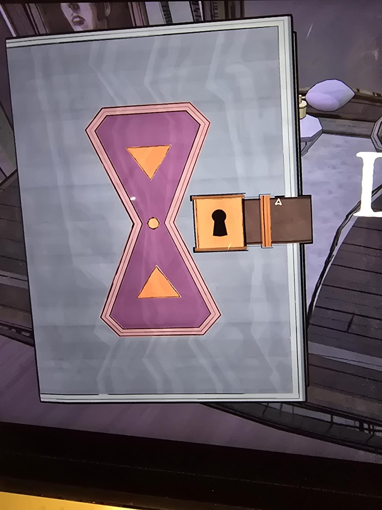

# Запертая книга (дневник Клары) с песочными часами
Her Ladyship's Chamber. Закрытая книга — **дневник Клары**, с **фиолетовыми песочными часами** на обложке (два оранжевых треугольника, розовая кайма) и **замочком с замочной скважиной**. На момент снимка закрыта. **Ключ из [гроба Клары в Tomb](../../../tomb/solutions.md) откроет её** (открыть ещё не успел).

## Photos / Фото

