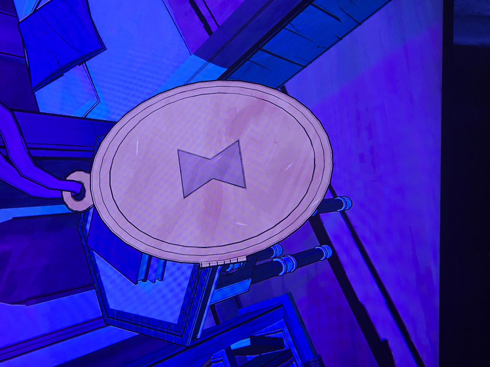
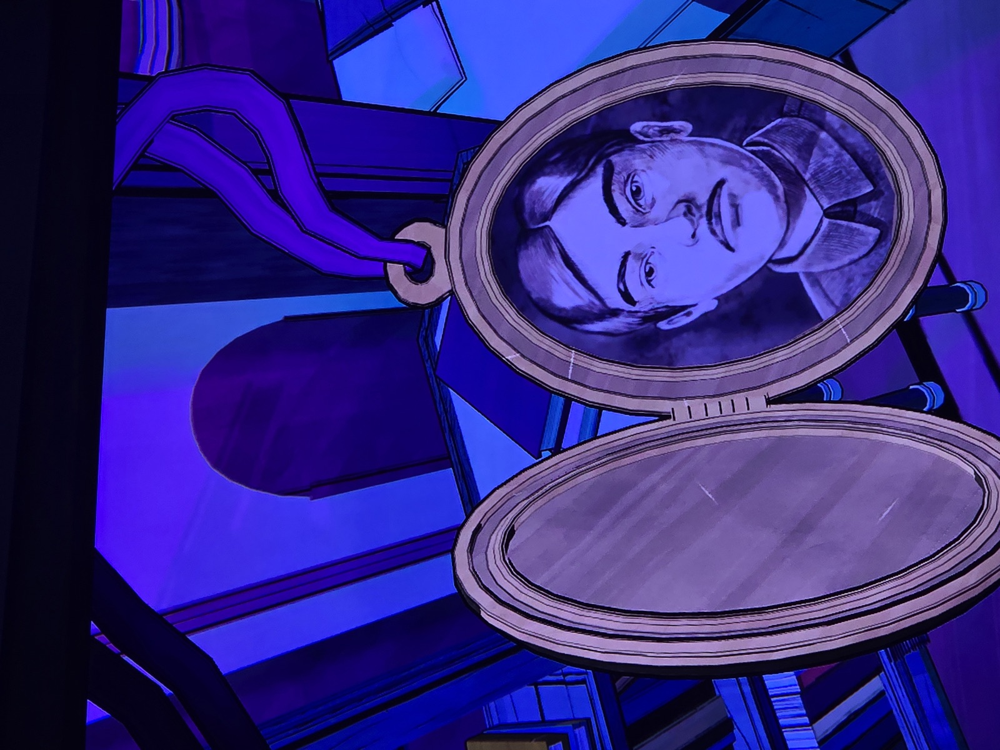
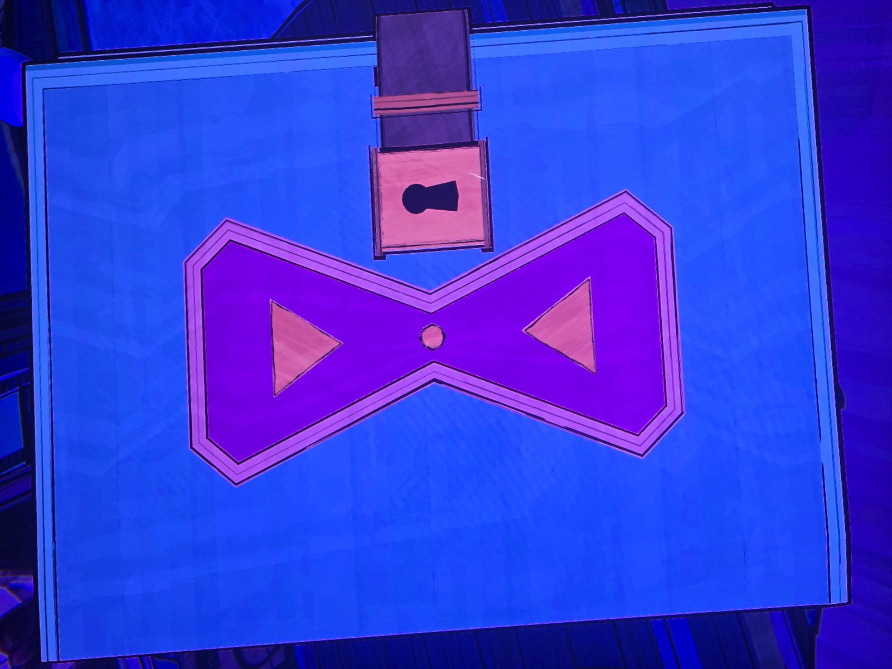

Три фото, снятые подряд в одной (фиолетовой) комнате:
1. Медальон с символом **песочных часов** на крышке.
2. Открытый медальон — портрет молодого человека с усиками в кителе. Очень похож на **Саймона Х. Синклера** с семейного древа (муж Клары).
3. Запертая обложка книги/дневника с фиолетовыми песочными часами и замочной скважиной.
Там же — записка со спиралью «does it never end?» (см. documents/sketch-notes/barbed-spiral).

*Заметка: комната не подписана на фото — **предположительно** Her Ladyship's Chamber (фиолетовый цвет, дневник под ключ — Diary Key из Tomb). Песочные часы — один из 8 символов царств (камин Room 46; на цветном листе — фиолетовый). Проверить комнату.*

## Photos / Фото

