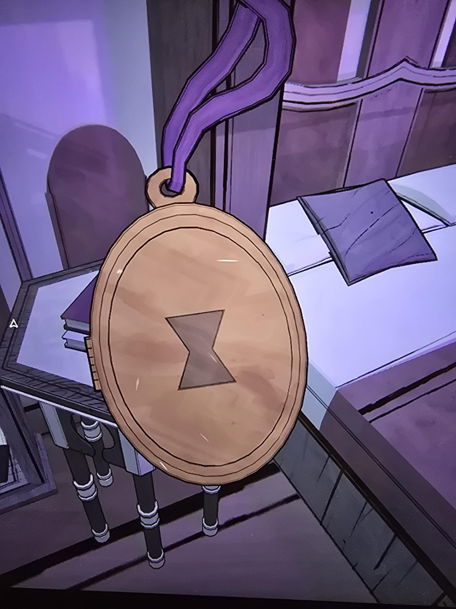
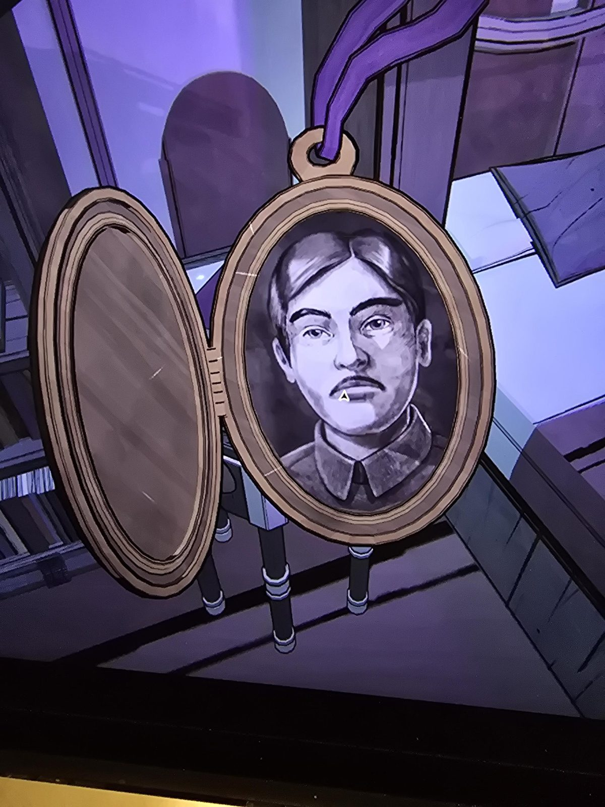

# Медальон с песочными часами
Her Ladyship's Chamber. Овальный медальон на фиолетовой ленте. На крышке знак **песочных часов**; внутри **портрет мужчины с усами** в форменной одежде (вторая половинка пуста). Подписи нет, кто это, не установлено.

## Заметка
- Знак песочных часов тот же, что на [запертой книге](../locked-book-hourglass/ru.md) и на [Mora Jai в Tomb](../../../../puzzles/mora-jai/tomb/ru.md); по выводу из Classroom это знак королевства Eraja (не проверено).

## Photos / Фото

