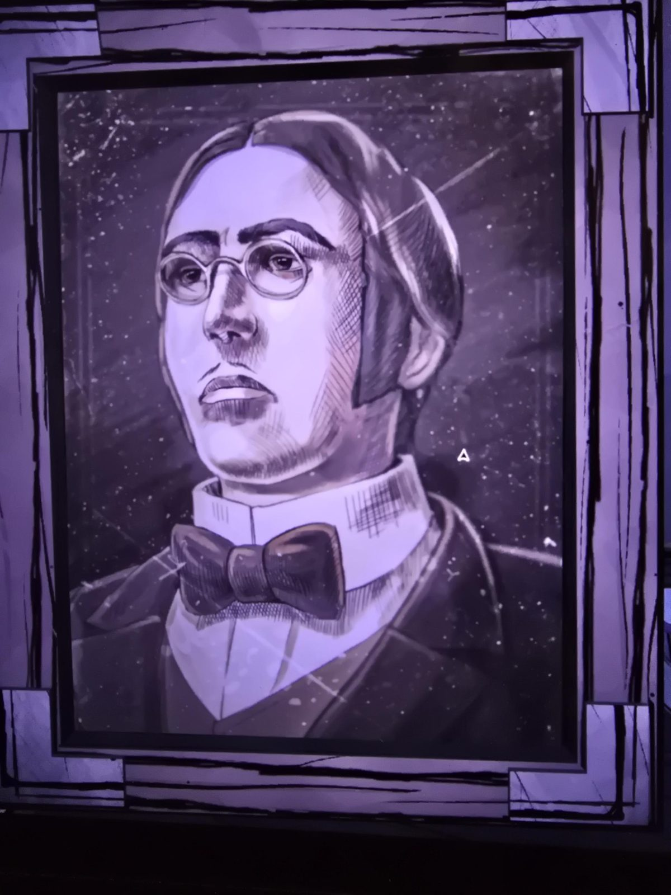

# Портрет: мужчина в круглых очках и галстуке-бабочке
Her Ladyship's Chamber. Портрет в раме: мужчина с зачёсанными назад волосами, круглые очки, бабочка, высокий воротничок. Подписи нет. Со слов пользователя, скорее всего **лорд Уильям Эпсен**, отец Клары (по [семейному древу](../../../root-cellar/docs/mount-holly-family-tree/ru.md); парный портрет — [женщина](../portrait-woman-short-hair/ru.md)).

## Photos / Фото

