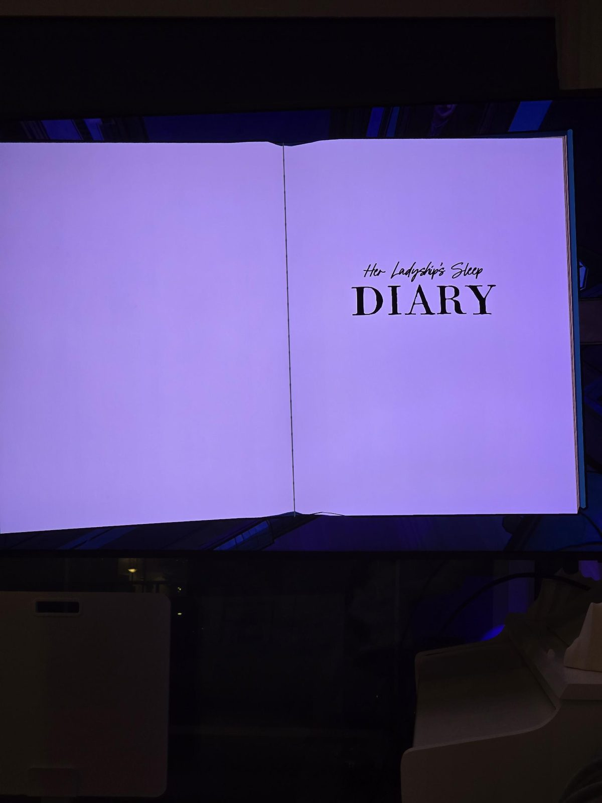
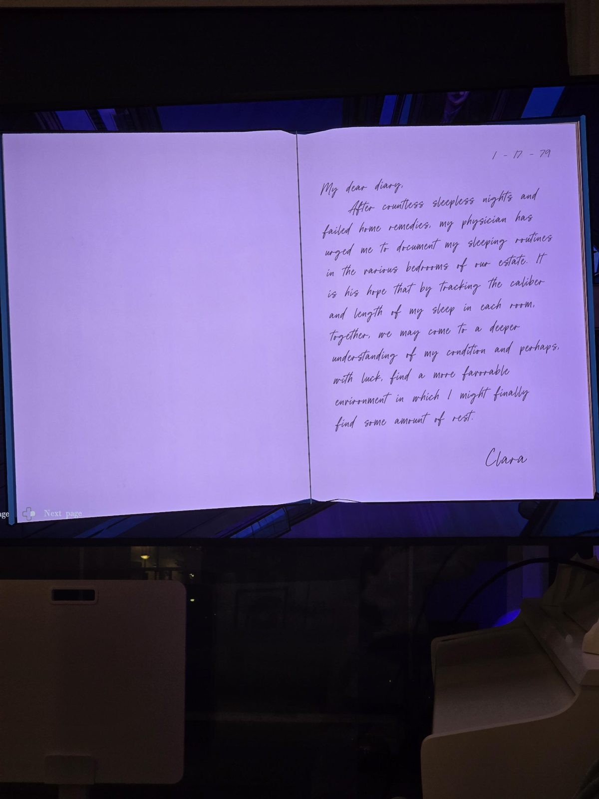
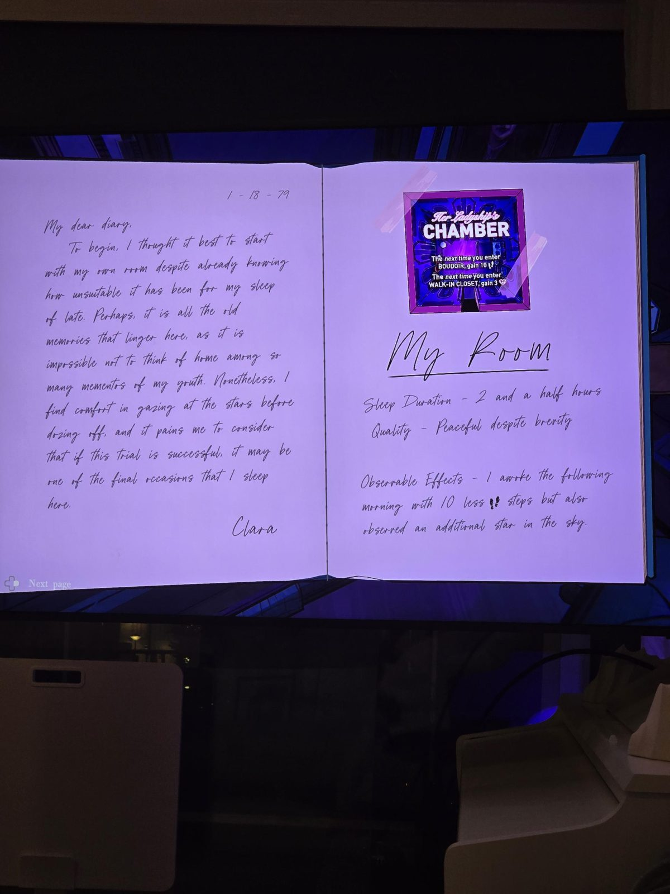
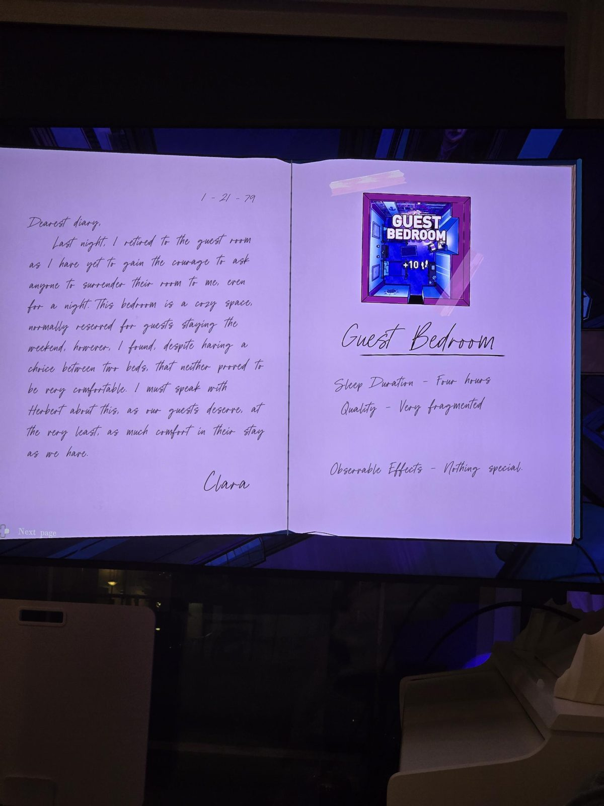
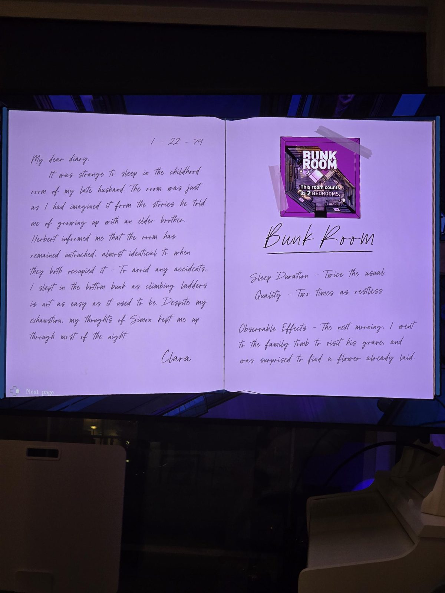
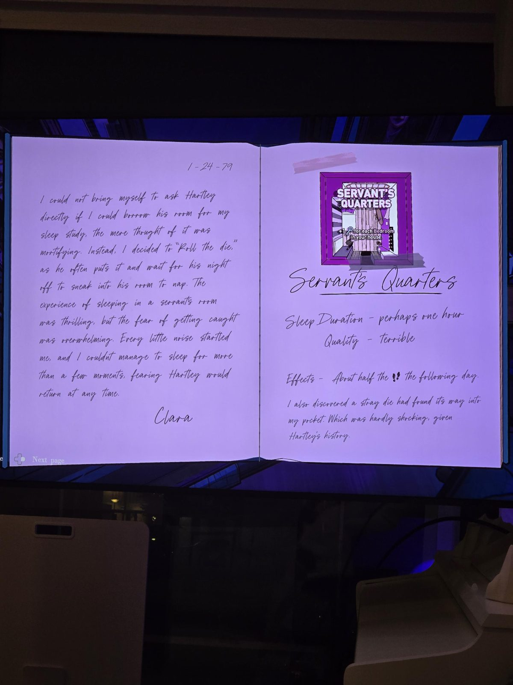
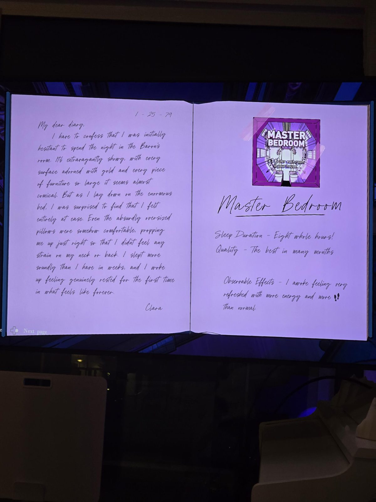
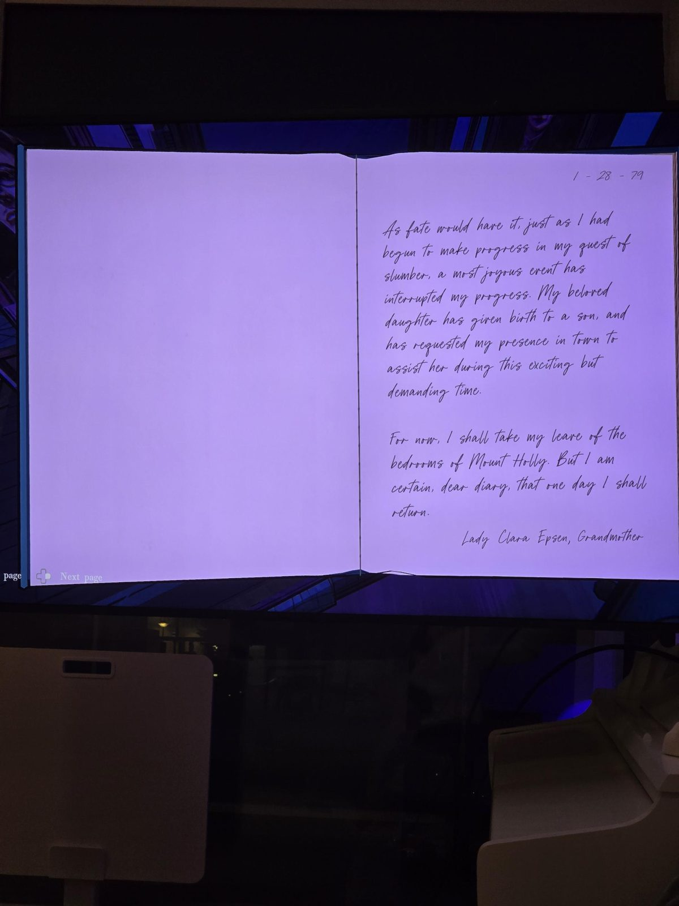
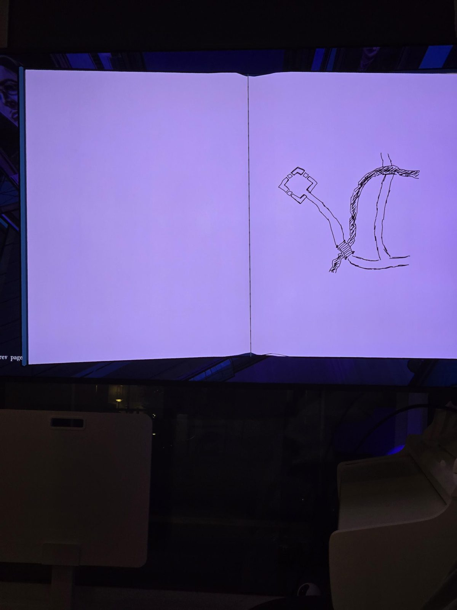

# Сонный дневник её светлости (леди Клара Эпсен, январь 1979)
- 17.01 — врач велел записывать, как она спит в разных спальнях.
- 18.01 **Её комната** — 2,5 ч, спокойно. Эффект: на 10 шагов меньше, но на небе ещё одна звезда.
- 21.01 **Guest Bedroom** — 4 ч, прерывисто. Ничего особенного.
- 22.01 **Bunk Room** — детская её покойного мужа (Саймона, младшего брата Герберта). Сон вдвое дольше и вдвое беспокойнее. Наутро на его могиле в склепе уже лежал цветок.
- 24.01 **Servant's Quarters** (комната Хартли) — ~1 ч, ужасно. Вдвое меньше шагов, в кармане кубик.
- 25.01 **Master Bedroom** — 8 ч, лучший сон. Больше сил и шагов.
- 28.01 — **дочь родила сына**, Клара уезжает помогать. «Леди Клара Эпсен, бабушка».
- Последняя страница: рисунок без подписи — квадратная постройка, тропа, мост над оврагом, дорога.

Вывод для сюжета: Клара — вдова Саймона-старшего, мать Мэри; сын Мэри (род. янв. 1979) — главный герой.

## Photos / Фото

