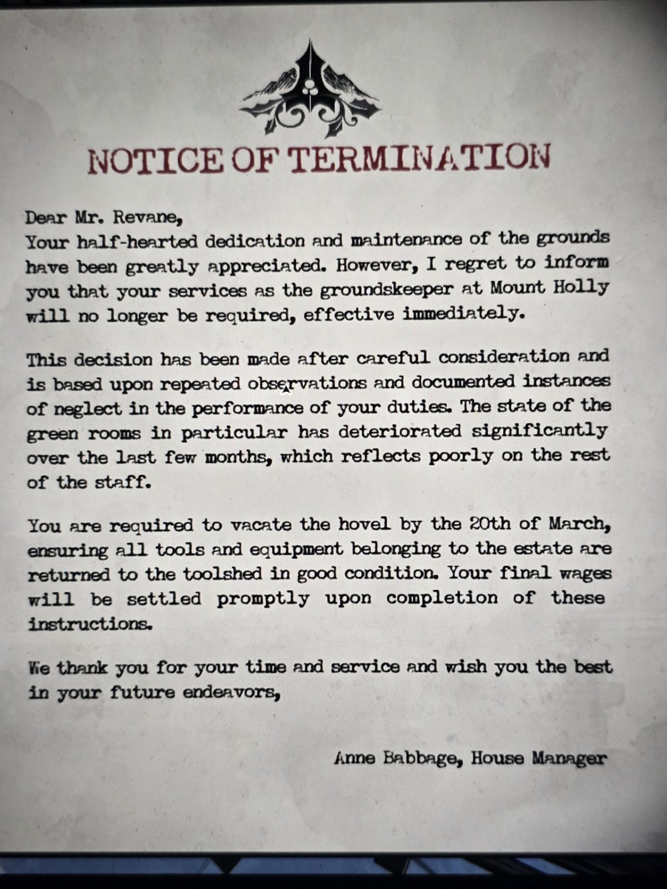

# Уведомление об увольнении Денни Ревейна
Лист в Hovel (лачуга смотрителя, внешняя зона). Герб с остролистом.

**УВЕДОМЛЕНИЕ ОБ УВОЛЬНЕНИИ**

Уважаемый мистер Ревейн,
мы высоко ценили ваше вялое старание и уход за территорией. Однако с сожалением сообщаю, что ваши услуги в качестве **смотрителя территории** Маунт-Холли больше не требуются, с немедленным вступлением в силу.

Решение принято после тщательного рассмотрения и основано на неоднократных наблюдениях и задокументированных случаях небрежного исполнения обязанностей. Особенно сильно за последние месяцы ухудшилось состояние **зелёных комнат**, что плохо отражается на остальном персонале.

Вы должны освободить **лачугу (hovel) до 20 марта**, вернув все инструменты и оборудование поместья в **сарай для инструментов** в хорошем состоянии. Окончательный расчёт будет произведён сразу после выполнения этих указаний.

Благодарим за время и службу и желаем удачи в будущих начинаниях,

Энн Бэббидж, управляющая домом

## Заметка
- **Денни Ревейн** — прежний смотритель территории, тот самый предшественник, который «не оставил никаких записей» ([журнал садовника](../../../apple-orchard/docs/gardeners-logbook/ru.md)). Его сменил Роберт Ногула (с апреля 1992) → увольнение, видимо, **март 1992**.
- Его подозревали в краже почты барона ([Mail Room](../../../mail-room/docs/denny-revane-return-note/ru.md)).
- Упомянут **сарай для инструментов** (toolshed).

## Photos / Фото

