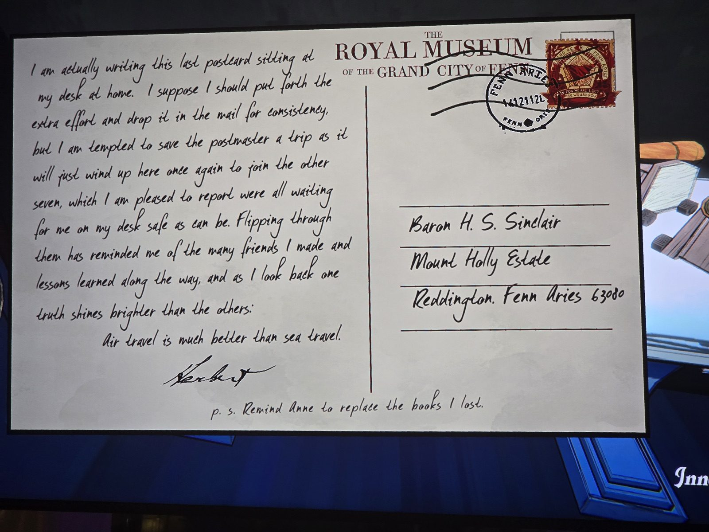

THE ROYAL MUSEUM OF THE GRAND CITY OF FENN — postmark FENN ARIES, stamp with a pentagon sigil. To: Baron H. S. Sinclair, Mount Holly Estate, Reddington, Fenn Aries 63080.
I am actually writing this last postcard sitting at my desk at home. I suppose I should put forth the extra effort and drop it in the mail for consistency, but I am tempted to save the postmaster a trip as it will just wind up here once again to join the other seven, which I am pleased to report were all waiting for me on my desk safe as can be. Flipping through them has reminded me of the many friends I made and lessons learned along the way, and as I look back one truth shines brighter than the others:
Air travel is much better than sea travel.
— Herbert
p.s. Remind Anne to replace the books I lost.

## Photos / Фото

