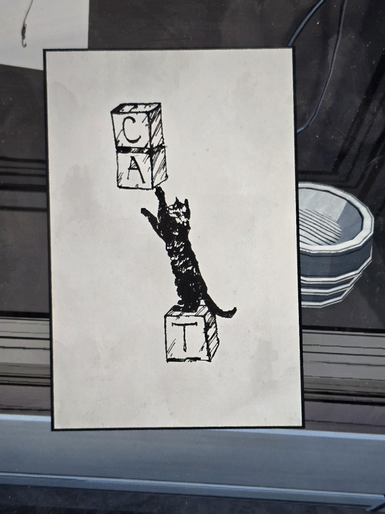

# Картинка «CAT» (кубики и кошка)
Kennel. Картина в рамке, чёрно-белый рисунок тушью: чёрная кошка встала на задние лапы на кубике с буквой **T** и тянется лапой к двум поставленным друг на друга кубикам с буквами **C** (сверху) и **A**. Читается как слово **CAT** («кошка»). На заднем плане справа лежанка/миска, в левом верхнем углу игрушечная мышь на крючке.

## Заметка
- Слово cat встречается в [записях Study](../../../study/docs/word-pair-scribbles/ru.md): пара coat / cat там зачёркнута.

## Photos / Фото

