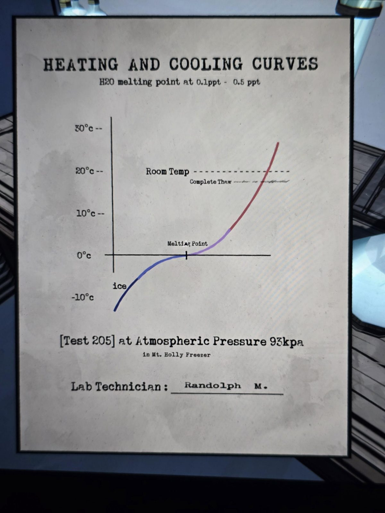

# График «Кривые нагрева и охлаждения»
Лист в Laboratory.

**КРИВЫЕ НАГРЕВА И ОХЛАЖДЕНИЯ**
Точка плавления H₂O при солёности 0,1–0,5 ‰

*(График: от −10 °C до 30 °C. Кривая идёт от «льда» через «точку плавления» при 0 °C; пунктир «комнатная температура» ≈ 20 °C и чуть ниже «полное оттаивание».)*

[Тест 205] при атмосферном давлении 93 кПа
в морозильнике (Freezer) Маунт-Холли

Лаборант: **Рэндольф М.**

## Заметка
- Связано с комнатой **Freezer**: видимо, лёд там оттаивает при определённой температуре (полное оттаивание около 18–19 °C, ниже комнатной).
- Персонаж: лаборант **Рэндольф М.**

## Photos / Фото

