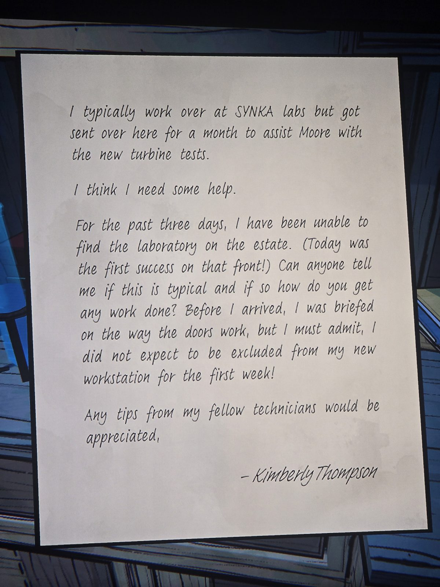

Обычно я работаю в лабораториях SYNKA, но меня на месяц прислали помогать Муру с испытаниями турбины.
Мне нужна помощь. Три дня не могла найти лабораторию (сегодня впервые нашла!). Это нормально? Как вы вообще работаете? Мне объясняли, как устроены двери, но я не ожидала целую неделю не попасть на рабочее место!
Буду рада советам коллег.
— Кимберли Томпсон

## Photos / Фото

