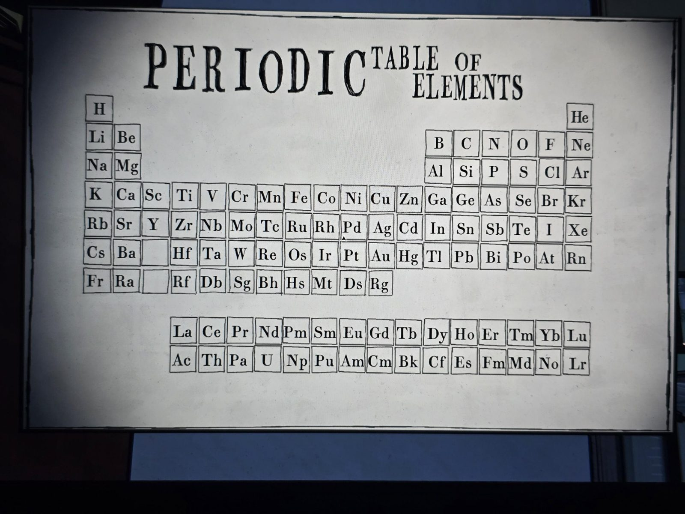
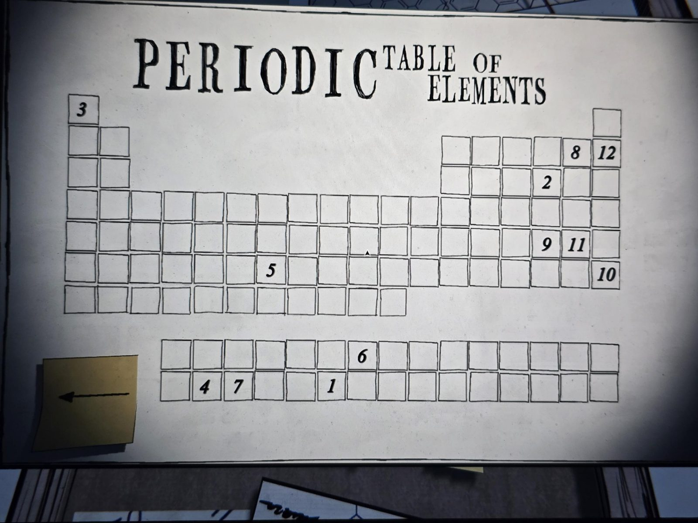

# Таблица Менделеева и пустая таблица с номерами
Два листа в Laboratory:
1. Обычная таблица Менделеева с символами элементов.
2. Та же сетка без символов, но в 12 клетках стоят цифры **1–12**. Рядом жёлтый стикер со стрелкой влево.

Решение: см. [solutions.md](../../solutions.md).

## Photos / Фото

