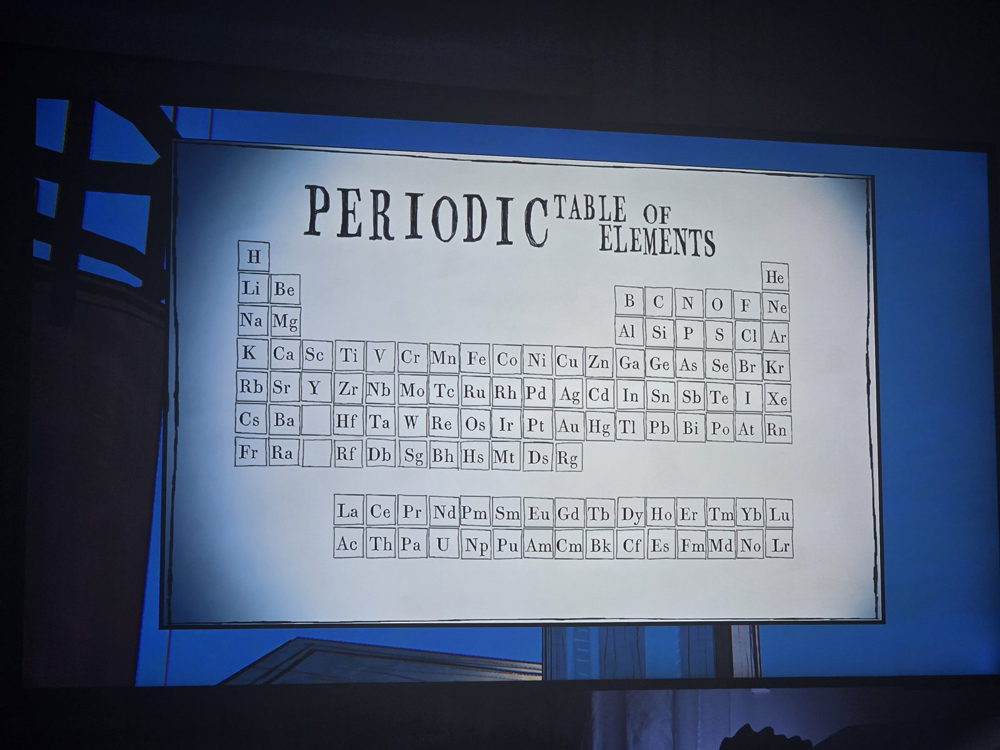
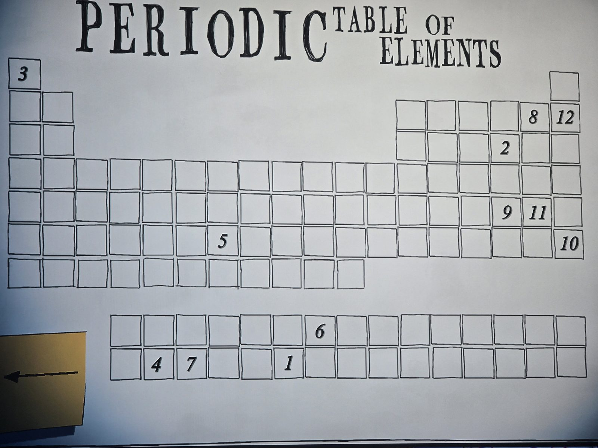

Two periodic tables: a standard one and one with numbered cells 1–12.
Numbers → elements: 1 Pu, 2 S, 3 H, 4 Th, 5 Re, 6 Eu, 7 Pa, 8 F, 9 Te, 10 Rn, 11 I, 12 Ne
→ "PUSH THREE UP AFTER NINE"

## Photos / Фото

