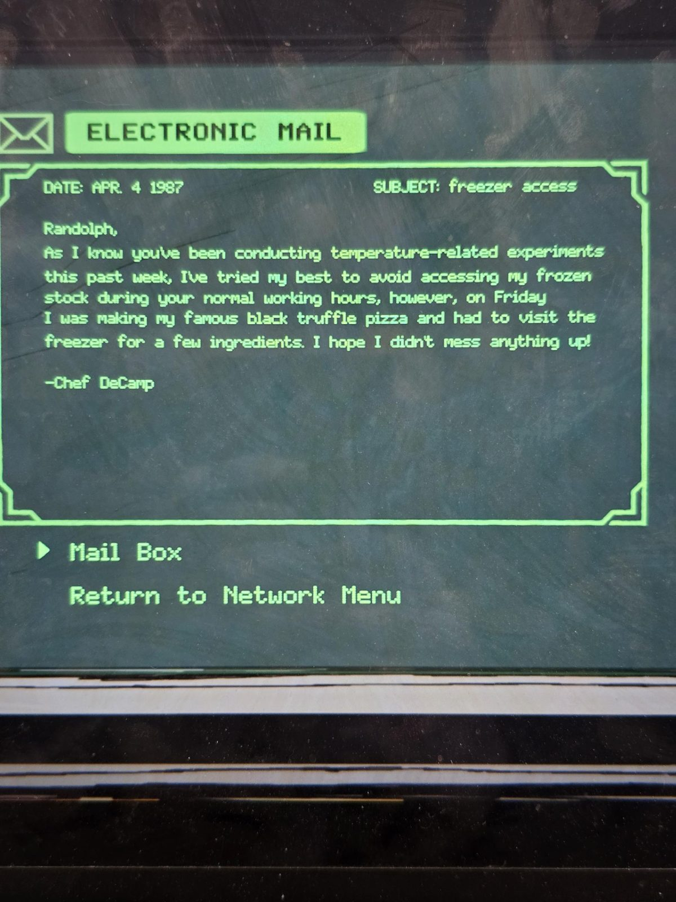
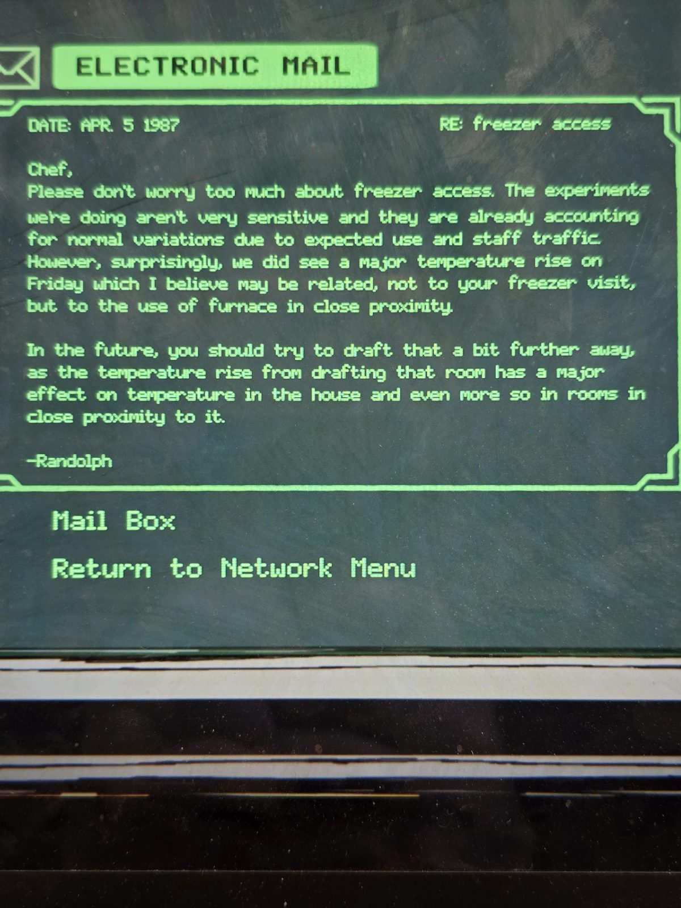
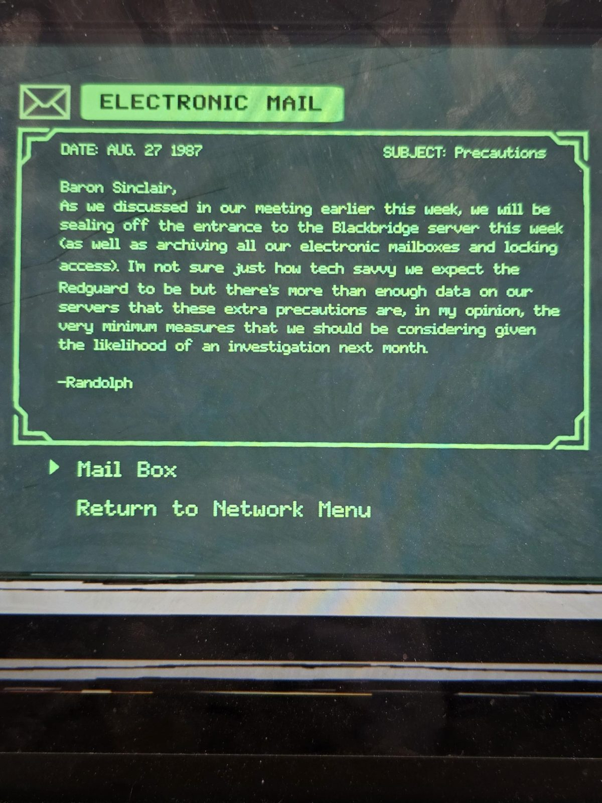
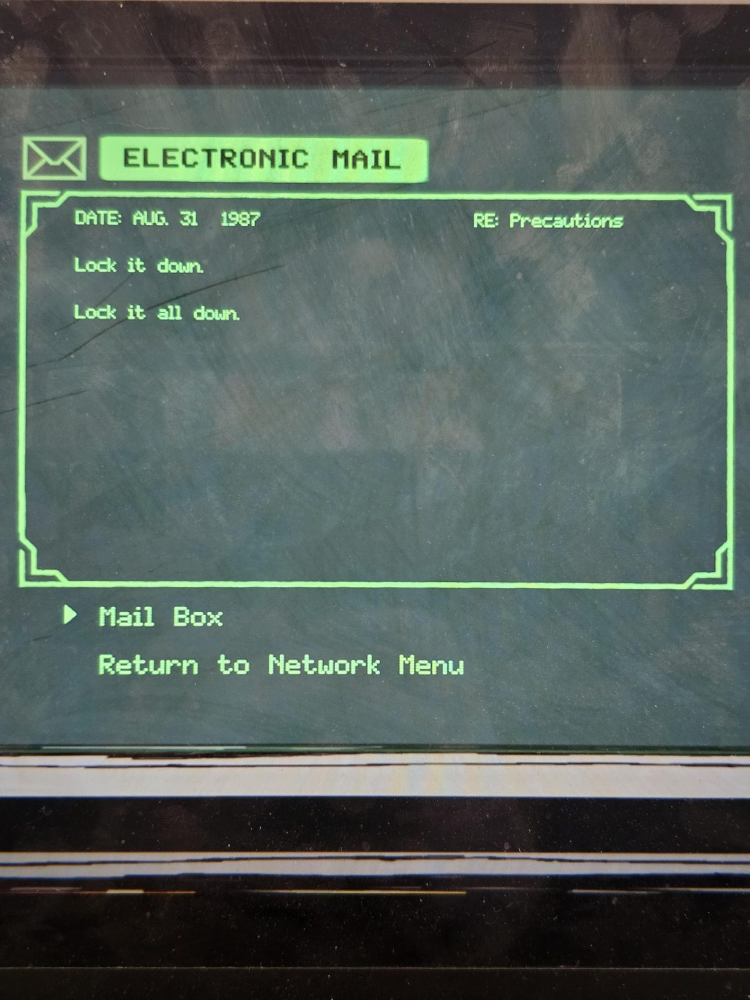

# Электронные письма 1987 (терминал в Laboratory)
Почта с терминала в Laboratory. Фото 01–04 по порядку.

## 4 апр. 1987: «freezer access» (шеф-повар → Рэндольф)
Рэндольф, знаю, что вы всю неделю проводите эксперименты с температурой, и я старался не лазить в морозильник в ваши рабочие часы, но в пятницу готовил свою знаменитую пиццу с чёрным трюфелем и должен был зайти в морозильник за ингредиентами. Надеюсь, ничего не испортил!
— Шеф **ДеКамп** (Chef DeCamp)

## 5 апр. 1987: «RE: freezer access» (Рэндольф → шеф)
Шеф, не переживайте насчёт морозильника. Наши эксперименты не очень чувствительны и учитывают обычные колебания из-за использования и ходящего персонала. Но, как ни странно, в пятницу мы видели сильный рост температуры, который, как я думаю, связан не с вашим визитом в морозильник, а с **использованием Furnace** рядом.

В будущем старайтесь выбирать эту комнату (Furnace) **подальше**: рост температуры от её выбора сильно влияет на температуру в доме, и особенно в комнатах рядом с ней.
— Рэндольф

## 27 авг. 1987: «Precautions» (Рэндольф → барону Синклеру)
Барон Синклер, как мы обсуждали на встрече раньше на этой неделе, на этой неделе мы **закрываем вход на сервер Blackbridge**, а также архивируем все электронные почтовые ящики и блокируем доступ. Не уверен, насколько технически подкованной мы ждём **Красную гвардию**, но на наших серверах более чем достаточно данных, и эти меры, на мой взгляд, **абсолютный минимум**, учитывая вероятность **расследования в следующем месяце**.
— Рэндольф

## 31 авг. 1987: «RE: Precautions» (отправитель не указан; ответ барону)
«Lock it down. Lock it all down.» («Закройте это. Закройте всё.»)

## Заметка
- Рэндольф М. — лаборант/техник ([Laboratory](../heating-cooling-curves/en.md)); письма идут сразу после [заговора в логах Blackbridge](../../../blackbridge-grotto/docs/admin-logs/ru.md) (08-25/26-87: «пора стереть логи»); **вход на сервер закрыли в конце августа 1987**.
- Furnace: **выбор Furnace повышает температуру в доме**, сильнее в соседних комнатах; Рэндольф советует ставить её подальше от Laboratory/морозильника (практическое правило драфта; со слов письма).
- Шеф **DeCamp**: повар, «чёрная трюфельная пицца» (ср. [Kitchen](../../../kitchen/solutions.md)).

## Photos / Фото

