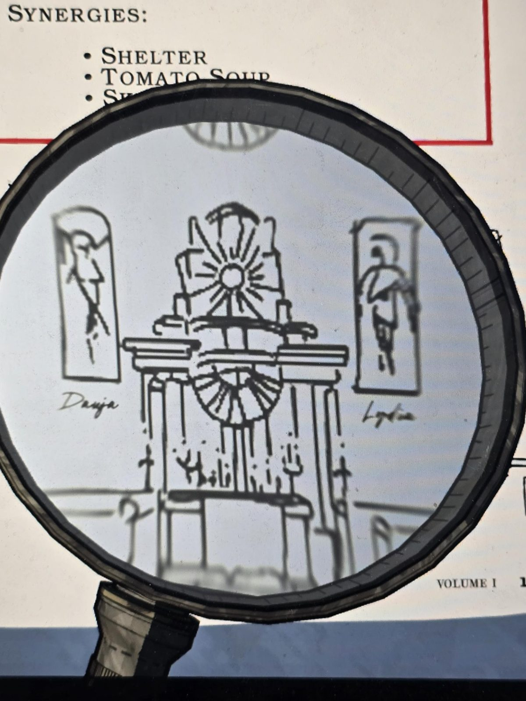

# Drafting Strategy, Vol. I (January Issue)
*Drafting Strategy — Architectural Digest Vol. 1* (found in the Drafting Studio)

## Contents
FEATURES / Page
- THE DRAFTING SPECTRUM — by the Editor ... 2
- MOST VIOLET DREAMS — Guide to Bedrooms ... 4
- INDOOR VERDURE — Guide to Green Rooms ... 6
- ORANGE PASSAGE — Guide to Hallways ... 8
- GOLDEN TRIM — Guide to Shops ... 10
- NEGATIVE SPACE — Guide to Red Rooms ... 12
- PRISMATIC ROOMS — Guide to Multicolored Floorplans ... 14
- WORD FROM THE EDITOR — by the Editor ... 17

## p. 2-3 THE DRAFTING SPECTRUM — Blueprints Are More Than Just Blue.
It should come as no surprise that the first color that comes to mind when speaking about blueprints is blue. And while it is true most architectural plans and designs are found on blue paper, it is not the only color on which floorplans are drafted. In fact, originally they were not blue at all.

Hundreds of years ago, the chemicals used to create floorplans caused coated paper to turn black when exposed to light. This raven hue, perhaps more fitting to the reign of Oris, was decidedly more difficult to affix an architect's revision edits to and so blue was proposed as an ideal replacement as it had no political ties to any other realms. By the fourth era, all floorplans were being printed on blue paper.

Over the years, the fear of political connotation deferred to innovation and the use of colored prints eventually became popular with engineers and architects who used hues as a way to differentiate various types of buildings and rooms.

Violetprints, for example, are only used when creating plans for a bedroom, while an orange floorplan will immediately inform a contractor that the print contains designs for a hallway.

In this issue of Drafting Strategy, we will explore the different features of each type of floorplan and look at the underlying connections that tie each room to its color.

## p. 4-5 MOST VIOLET DREAMS — Architectural Digest's Guide to Bedrooms
The bedroom is often referred to as the "heart of the home" and with good reason. It is the place where people can rest during a long day, where they can kick up their feet for a bit and recharge their batteries. Architects always use violet bordered floorplans for bedrooms and the comforting purple hues encountered while drafting will usually let a weary traveler know they have found a room in which they can rest up.

*(Picture: NURSERY — "Whenever you draft a Bedroom, gain 5 steps")*

Architects may wish to utilize Bedroom strategies if they are the type who love to explore and backtrack frequently. Having an excess of steps usually affords bedroom enthusiasts the mobility to be more carefree with their plans for the day.

TYPE: Bedrooms · COLOR: Violet · ASSOCIATED RESOURCE: Steps · AVERAGE NUMBER OF DOORS: 1-2 · EXTRA ITEMS?: Likely · SYNERGIES: Sleeping Mask, Nursery, Servant's Quarters

## p. 6-7 INDOOR VERDURE — Architectural Digest's Guide to Green Rooms
Green Rooms are a wonderful way to bring the outdoors inside and provide a breath of fresh air for the home. The abundance of plant life, rich soil and natural resources in these spaces makes them extremely appealing for architects who enjoy gardening and open spaces. These floorplans are extremely synergistic, and strategies centered around green will often involve drafting as many of this color as possible. The more green rooms you are able to draft in your house, the more powerful their effects will become. Additionally, these spaces are more likely than other types of rooms to contain piles of dirt for digging.

*(Picture: TERRACE — "Green Rooms do not cost gems to draft.")*

TYPE: Green Rooms · COLOR: Green · ASSOCIATED RESOURCE: Gems · AVERAGE NUMBER OF DOORS: 2-3 · EXTRA ITEMS?: Often · SYNERGIES: Most Green Rooms, Shovel, Watering Can

## p. 8-9 ORANGE PASSAGE — Architectural Digest's Guide to Hallways
If the bedroom is the "heart of the home," then hallways are the "arteries," serving as diverging paths that branch out to connect different parts of the house and lead visitors to their intended destination. While these orange corridors are often overlooked as one travels through them, they are a vital component of any house. The numerous doors found in each hall provide the means to add more rooms to your house, and the more hallways you have, the less likely you are to draft yourself into a dead end. Hallway strategies are ideal for the architect who prefers more rooms and flexible options for expansion over pure resources.

*(Picture: FOYER — "Hallway Doors are always unlocked.")*

TYPE: Hallways · COLOR: Orange · ASSOCIATED RESOURCE: Keys · AVERAGE NUMBER OF DOORS: 3-4 · EXTRA ITEMS?: Rarely · SYNERGIES: Foyer, Lockpick Kit, Hall Pass

## p. 10-11 GOLDEN TRIM — Architectural Digest's Guide to Shops
Shops are an essential part of any large estate, providing a convenient place for the staff and residents to purchase items without having to leave the property. Including at least one of these floorplans in your house will provide you with an outlet for any coins that are found during the day. Strategies that involve generating lots of gold will usually want to draft multiple shop rooms to expand the range of shopping opportunities. These floorplans are bordered with shades of gold, enhancing the sense of luxury and refinement in the shopping experience. Whether it's a quick snack or a high-end fashion item, having a well-placed shop within the estate can greatly enhance the quality of life for the entire household.

*(Picture: COMMISSARY — "Items for Sale")*

TYPE: Shops · COLOR: Gold · ASSOCIATED RESOURCE: Coins · AVERAGE NUMBER OF DOORS: 2 · EXTRA ITEMS?: Never for Free! · SYNERGIES: Coin Purse, Coupon Book, Vault

## p. 12-13 NEGATIVE SPACE — Architectural Digest's Guide to Red Rooms
Red rooms are a daring addition to any home, providing a small element of danger that can excite and thrill both residents and visitors. While these rooms come with a certain level of risk, they also offer the potential for substantial returns, as they provide as many doors as they do opportunities. Architects who are willing to take the plunge and draft a red room are often rewarded with a unique and striking space that leaves a lasting impression on those who enter. Just like in life, taking risks can be intimidating, but those who dare to venture outside their comfort zone can reap the greatest rewards.

*(Picture: DARKROOM — "You cannot see the Floor Plans while drafting in this room.")*

TYPE: Red Rooms · COLOR: Red · ASSOCIATED RESOURCE: Vexation · AVERAGE NUMBER OF DOORS: 3-4 · EXTRA ITEMS?: Seldom · SYNERGIES: Shelter, Tomato Soup, Skilled Players

## p. 14-15 PRISMATIC ROOMS — Architectural Digest's Guide to Multicolored Floorplans
You may, on rare occasions, notice some floorplans that have more than one color in their design. These rooms are unique in that they simultaneously share all the characteristics of each type of room associated with those colors. For example, a floorplan with a violet and gold border would be best described as a bedroom shop, while an orange and green one might contain a corridor of greenery and plants.

*(Picture: AQUARIUM — "AQUARIUM is every color of room.")*

The AQUARIUM is a very useful, multicolored floorplan, as it supports all of the color-based strategies listed in this volume. For example, it can give you bonus steps for having a NURSERY as well as being unlocked for having a FOYER.

*(Picture: MAID'S CHAMBER — RED ROOM + BEDROOM — "Less likely to find items laying around in your house.")*

## p. 17 WORD FROM THE EDITOR
As we reach the end of this volume of "Drafting Strategy," we hope you have found valuable insights and colorful inspiration for your next architectural project. From the purples of our dreams to the reds of our fears, we believe that no ambition for an architect is too brave and no design is too colorful. To achieve our goals, we must delve deep into the spectrum, drawing upon all colors and ideas of daring merit.

At the end of the day, color is just another tool. Some wield it to express their own creativity. Some hoist it up as a display of their own power. Some use it to calculate great sums. But all of us want to find a color we can call our own.

(Through the magnifying glass, photo 10: a sketch of a throne on a dais with a sunburst and two angel statues captioned "Dauja" (left) and "Lydia" (right).)

## Photos
    
    
