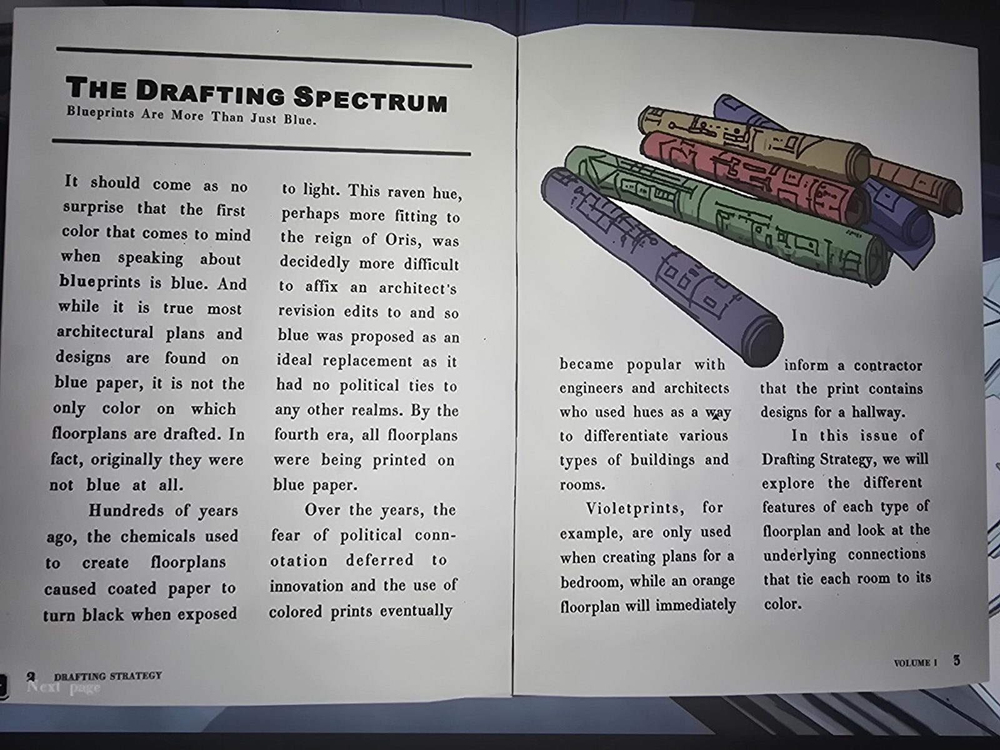
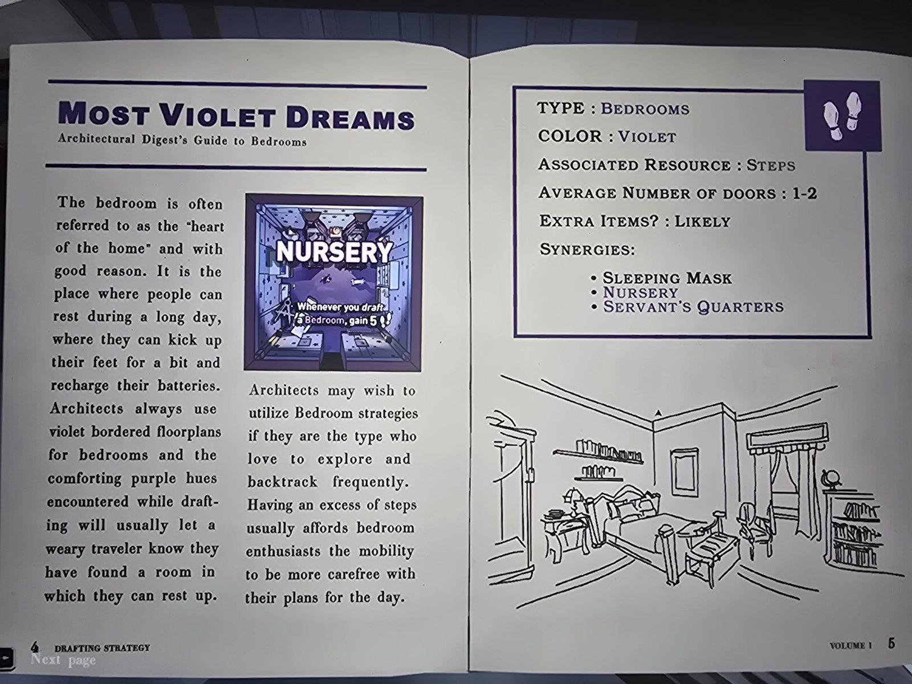
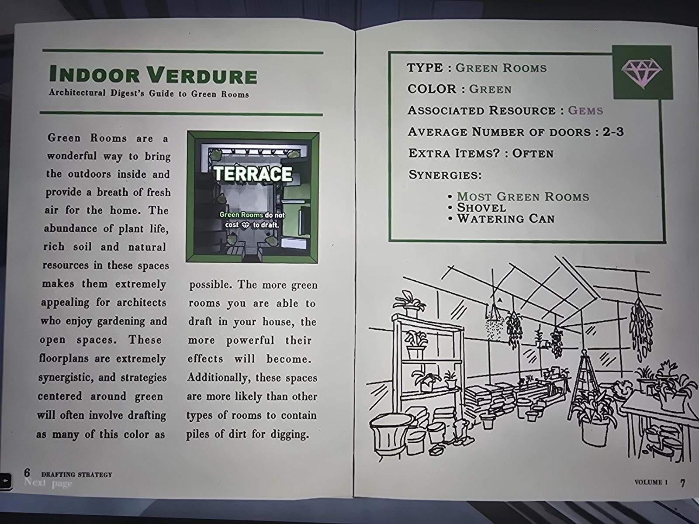
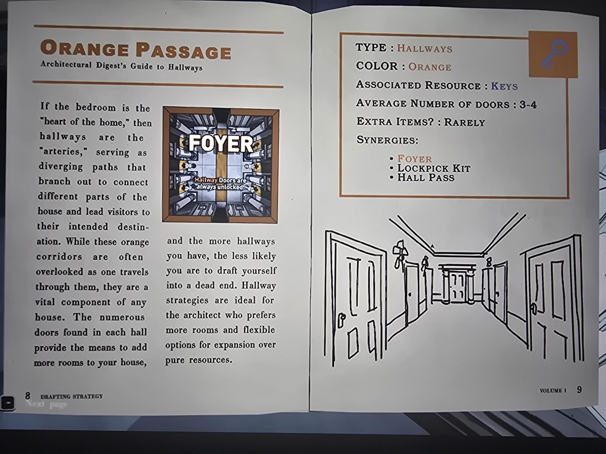
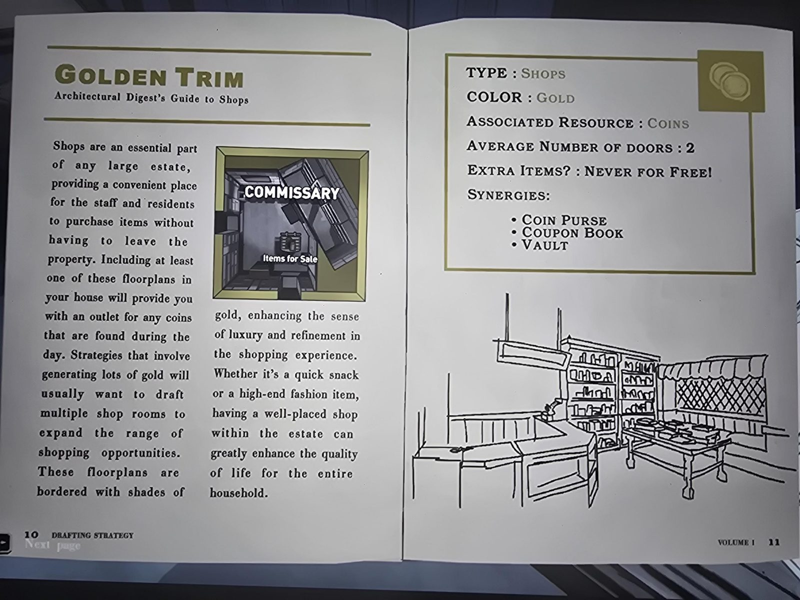
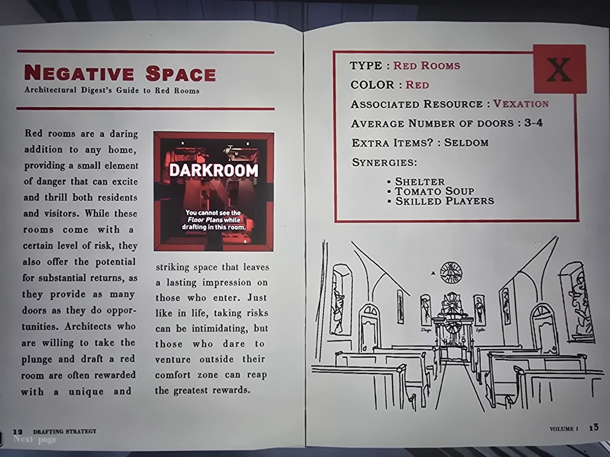
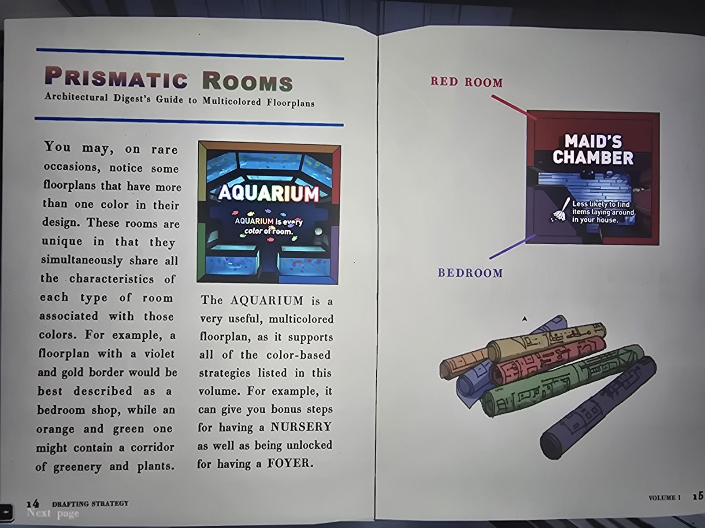

# Журнал «Drafting Strategy», т. I (январь)
*Drafting Strategy — Architectural Digest, Vol. 1, январский выпуск.* Книга лежала в [Drafting Studio](../../../drafting-studio/solutions.md), в Library добавлена по просьбе пользователя. Полный текст: [en.md](en.md). Формуляра в кадре нет.

## Содержание
Спектр черчения (2) · Фиолетовые сны, спальни (4) · Комнатная зелень (6) · Оранжевый проход, коридоры (8) · Золотая отделка, магазины (10) · Негативное пространство, красные комнаты (12) · Призматические комнаты (14) · Слово редактора (17).

## Суть
Чертежи не только синие: цвет рамки плана при драфте выдаёт тип комнаты. Раньше чертежи чернели на свету (чёрный связан с эпохой Ориса), синий выбрали как политически нейтральный.

| Цвет | Тип | Ресурс | Двери | Предметы | Синергии | Пример и эффект |
|---|---|---|---|---|---|---|
| Фиолетовый | спальни | шаги | 1-2 | вероятно | Sleeping Mask, Nursery, Servant's Quarters | Nursery: при драфте спальни +5 шагов |
| Зелёный | зелёные комнаты | самоцветы | 2-3 | часто | большинство зелёных, Shovel, Watering Can | Terrace: зелёные комнаты бесплатны по самоцветам; чаще кучи земли |
| Оранжевый | коридоры | ключи | 3-4 | редко | Foyer, Lockpick Kit, Hall Pass | Foyer: двери коридоров всегда открыты |
| Золотой | магазины | монеты | 2 | никогда бесплатно | Coin Purse, Coupon Book, Vault | Commissary: предметы на продажу |
| Красный | красные комнаты | Vexation | 3-4 | редко | Shelter, Tomato Soup, Skilled Players | Darkroom: при драфте в ней не видны планы этажей |
| Многоцветные | сочетание | все | | | | Aquarium: «каждый цвет комнаты» (бонус шагов за Nursery, открыта за Foyer); Maid's Chamber (красная + фиолетовая): меньше предметов валяется по дому |

Слово редактора: «цвет это инструмент»: творчество, демонстрация силы, подсчёт больших сумм (намёки на фиолетовый/красный/золотой).

## Заметка
- Игровые советы по тексту выглядят как механика игры; я их не проверял.
- Ср. [т. III](../drafting-strategy-vol-3/ru.md) (там упоминаются Terrace, Foyer, Nursery).

## Photos / Фото
    
   
