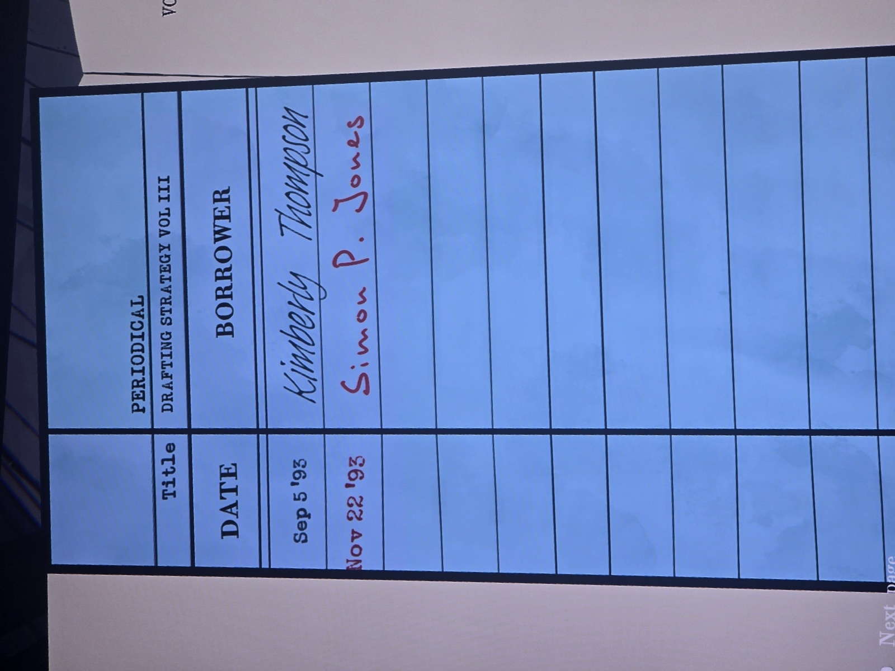
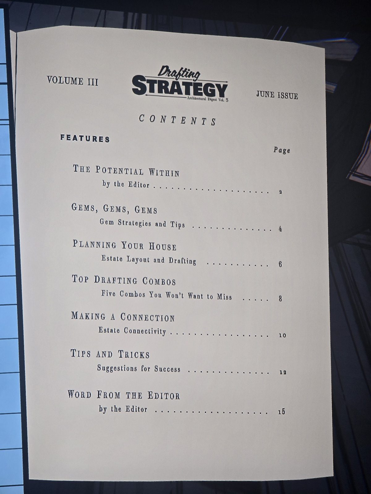
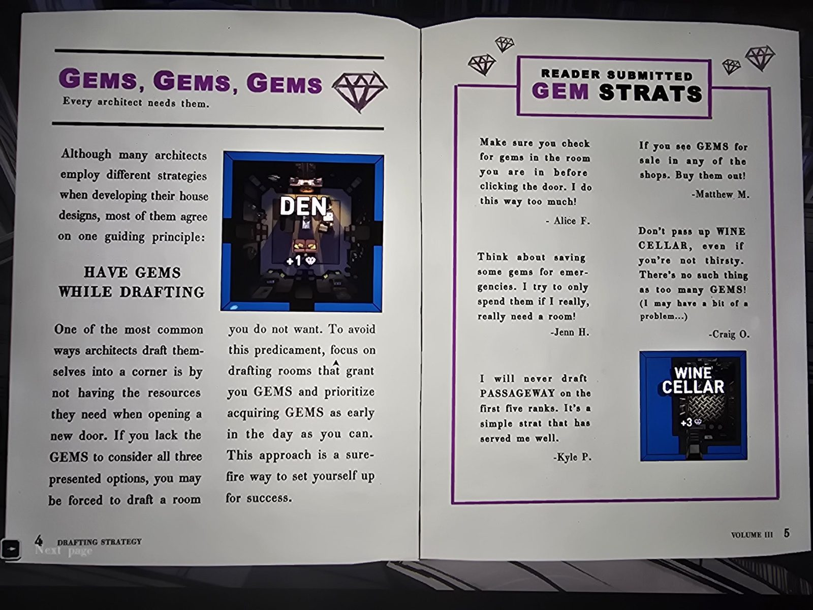
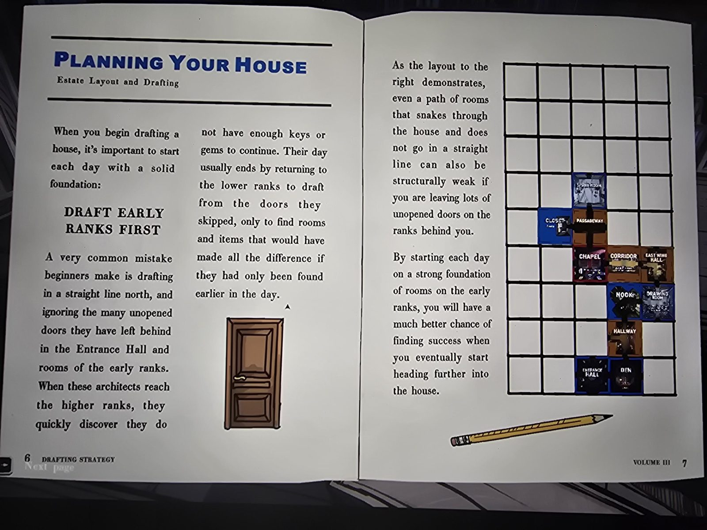
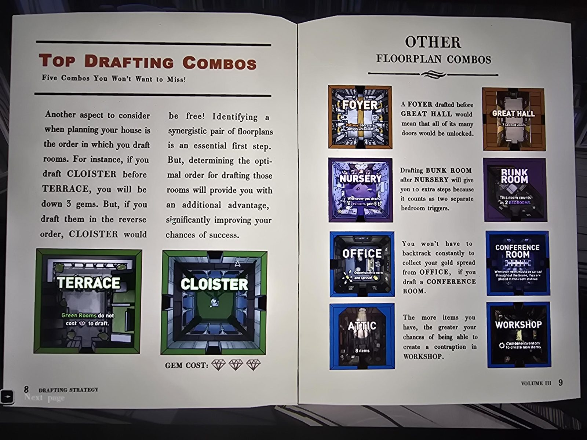
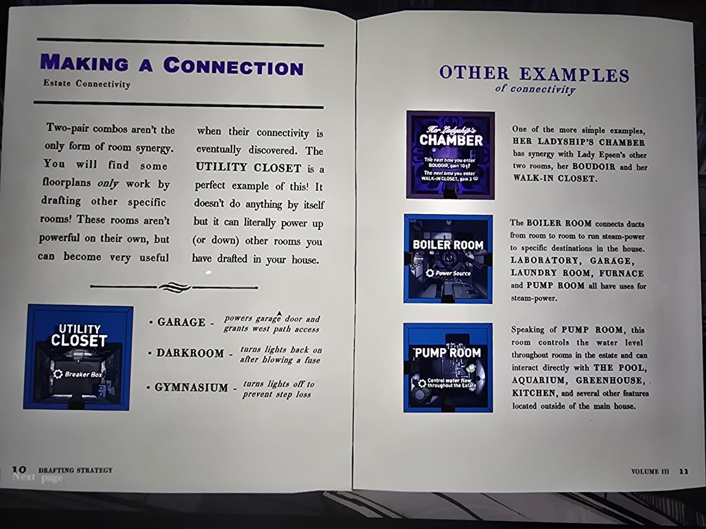
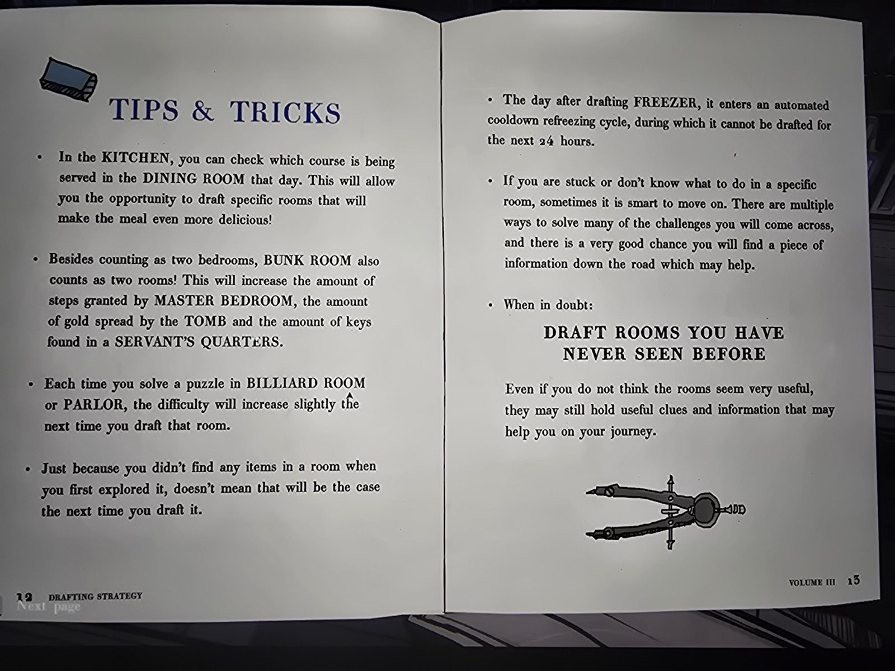

# Журнал «Drafting Strategy», т. III (Library)
Периодическое издание в библиотеке: *Drafting Strategy — Architectural Digest, Vol. III, июньский выпуск*. Сборник советов по составлению плана дома (драфт комнат). Полный текст — в [en.md](en.md).

## Формуляр (карточка выдачи, PERIODICAL)
| Дата | Кто брал |
|---|---|
| 5 сент 1993 | Kimberly Thompson |
| 23 нояб 1993 | Simon P. Jones (красными чернилами) |

## Содержание (страницы)
Потенциал внутри (2) · Самоцветы (4) · Планирование дома (6) · Лучшие комбо драфта (8) · Налаживание связей (10) · Советы и хитрости (12) · Слово редактора (15).

## Что полезного (игровые советы из журнала)
Это советы из журнала; по тексту они выглядят как механика игры.
- **Самоцветы:** иметь самоцветы при драфте; сначала брать комнаты с самоцветами (Den +1, Wine Cellar +3); не брать Passageway на первых пяти рангах (совет читателя); скупать самоцветы в магазинах.
- **Ранги:** сначала открывать двери ранних рангов, а не идти прямой линией на север: иначе в дальних рангах не хватит ключей и самоцветов.
- **Порядок комнат:**
  - **Terrace** до **Cloister**: Terrace делает зелёные комнаты бесплатными по самоцветам, Cloister (3 самоцвета) становится бесплатной; в обратном порядке теряете 3 самоцвета.
  - **Foyer** до **Great Hall**: все 7 запертых дверей Great Hall окажутся открыты.
  - **Bunk Room** после **Nursery**: +10 шагов (Bunk Room считается за две спальни).
  - **Office** + **Conference Room**: «золото», разбросанное по дому, окажется в Conference Room.
  - **Attic** (8 предметов) → больше шансов на изобретение в **Workshop**.
- **Utility Closet** (Breaker Box): питает Garage (ворота и западная тропа), Darkroom (свет после перегоревшей пробки), Gymnasium (свет выкл. = не терять шаги).
- **Her Ladyship's Chamber**: при следующем входе в Boudoir (+10 шагов) и Walk-in Closet (+3 самоцвета); знаки плохо читаются.
- **Boiler Room** (пар): Laboratory, Garage, Laundry Room, Furnace, Pump Room. [Питание](../../../../puzzles/boiler-power.md)
- **Pump Room**: уровень воды в Pool, Aquarium, Greenhouse, Kitchen и ещё вне дома.
- **Советы:** на Kitchen видно блюдо в Dining Room; Bunk Room считается за 2 комнаты (шаги Master Bedroom, золото Tomb, ключи Servant's Quarters); Billiard Room и Parlor усложняются после каждого решённого пазла; в комнате без предметов в первый раз они могут быть в следующий; Freezer после драфта 24 часа остывает; застряли — идите дальше; «когда сомневаетесь — драфтите комнаты, которых никогда не видели».

## Заметка
- Подпись **Simon P. Jones 23 нояб 1993** красными чернилами, как и в других книгах Library (вероятно, подпись игрока).
- Это Vol. **III** (экземпляр в Library); в [Bookshop](../../../bookshop/solutions.md) продаются Vol. IV и V, их содержание: [IV](../drafting-strategy-vol-4/ru.md), [V](../drafting-strategy-vol-5/ru.md).

## Photos / Фото

