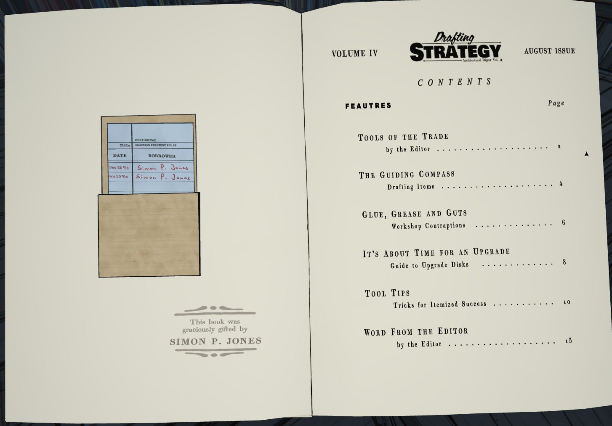
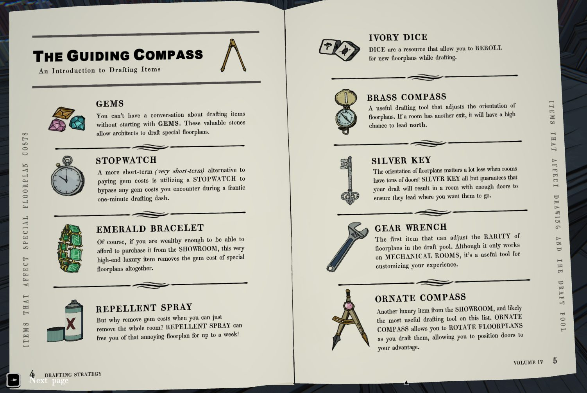
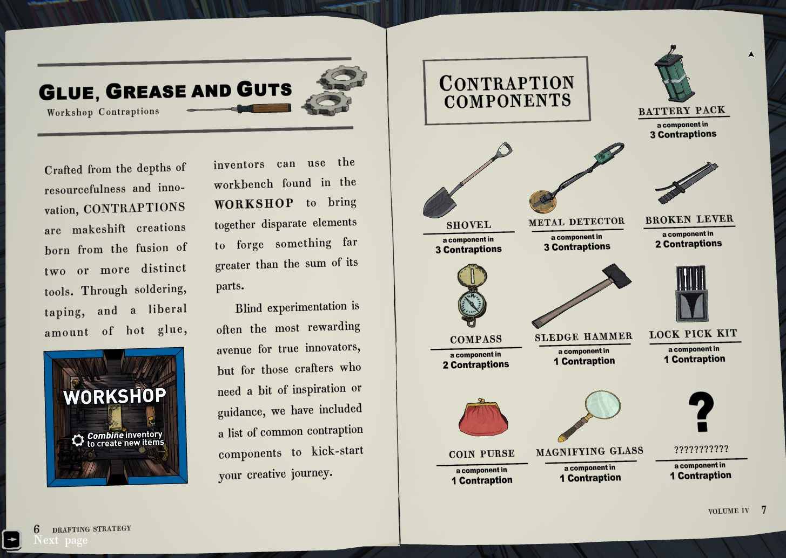
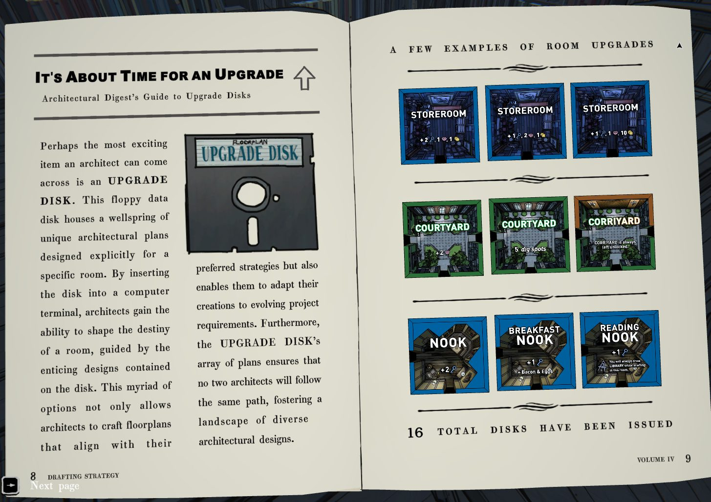
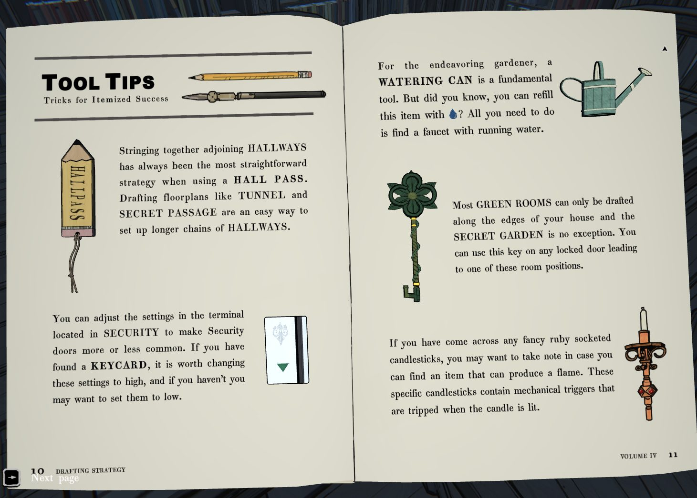
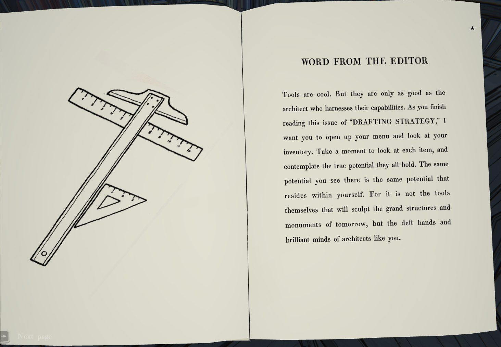

# Журнал «Drafting Strategy», т. IV (Library)
Периодическое издание в библиотеке: *Drafting Strategy — Architectural Digest, Vol. IV, августовский выпуск*. Тема выпуска — предметы. Полный текст — в [en.md](en.md).

## Форзац и формуляр
Штамп: «Эта книга любезно подарена **Simon P. Jones**».

| Дата | Кто брал |
|---|---|
| 25 дек 1993 | Simon P. Jones (красными чернилами) |
| 10 янв 1994 | Simon P. Jones (красными чернилами) |

## Содержание (страницы)
Инструменты ремесла (2) · Путеводный компас: предметы драфта (4) · Клей, смазка и потроха: контрапции Workshop (6) · Пора обновиться: диски улучшения (8) · Советы по инструментам (10) · Слово редактора (13). В оглавлении опечатка «FEAUTRES».

## Предметы драфта (с. 4–5)
- **Gems** — самоцветы позволяют драфтить особые планы.
- **Stopwatch** — на одну минуту лихорадочного драфта отменяет самоцветную цену.
- **Emerald Bracelet** (из Showroom) — навсегда убирает самоцветную цену особых планов.
- **Repellent Spray** — убирает комнату из пула драфта до недели.
- **Ivory Dice** — ревролл планов при драфте.
- **Brass Compass** — если у комнаты есть ещё выход, он с высокой вероятностью ведёт на **север**.
- **Silver Key** — почти гарантирует, что в драфте выпадет комната с достаточным числом дверей.
- **Gear Wrench** — первый предмет, меняющий редкость планов в пуле; работает только на **механических комнатах**.
- **Ornate Compass** (из Showroom) — позволяет **поворачивать** план при драфте.

## Компоненты контрапций (с. 6–7)
Контрапции собираются на верстаке в [Workshop](../../../workshop/solutions.md) из двух и более предметов. В скольких контрапциях участвует предмет:

| Предмет | Контрапций |
|---|---|
| Battery Pack | 3 |
| Shovel | 3 |
| Metal Detector | 3 |
| Broken Lever | 2 |
| Compass | 2 |
| Sledge Hammer | 1 |
| Lock Pick Kit | 1 |
| Coin Purse | 1 |
| Magnifying Glass | 1 |
| ??? (скрыт) | 1 |

## Диски улучшения (с. 8–9)
Upgrade Disk вставляется в компьютерный терминал и открывает набор планов улучшения для конкретной комнаты. **Всего выпущено 16 дисков.** Примеры: Storeroom (+2 ключа/+1 самоцвет/+1 монета; +1 ключ/+2 самоцвета/+1 монета; +1 ключ/+1 самоцвет/+10 монет), Courtyard (+2 самоцвета; 5 мест для копания), Corridor («Corriyard» в тексте) всегда открыт, Nook (+2 ключа), Breakfast Nook (+1 ключ, бекон и яйца), Reading Nook (+1 ключ; при драфте из неё всегда выпадает Library).

## Советы по инструментам (с. 10–11)
- **Hall Pass** — лучше всего цепочки Hallway; планы Tunnel и Secret Passage помогают строить длинные цепочки.
- **Security**: в терминале Security можно сделать охранные двери чаще или реже. Есть Keycard — ставить «high», нет — «low».
- **Watering Can** пополняется водой у крана с текущей водой.
- **Secret Garden** и большинство зелёных комнат драфтятся только по краям дома. Зелёный ключ подходит к любой запертой двери в таких позициях.
- **Подсвечники с рубинами**: нужен предмет, который даёт огонь; в них механические триггеры, срабатывающие, когда свеча зажжена.

## Слово редактора (с. 13)
Инструменты хороши, но стоят ровно столько, сколько архитектор, который ими владеет: откройте инвентарь и подумайте о потенциале каждого предмета, он такой же, как в вас самих.

## Фото

