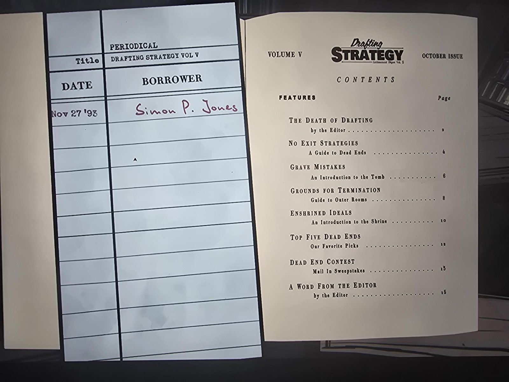
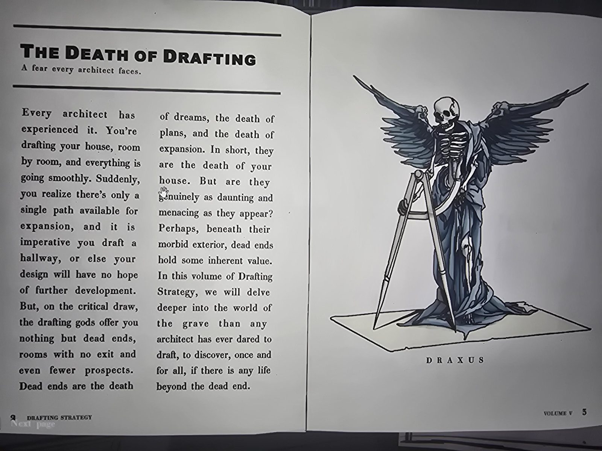
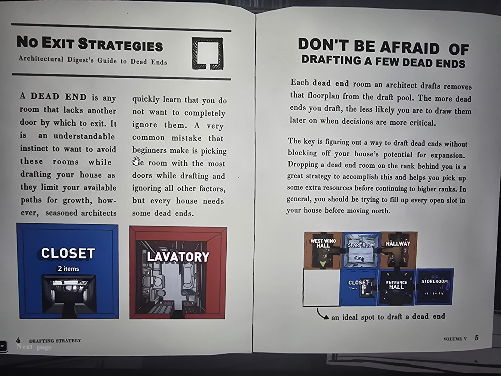
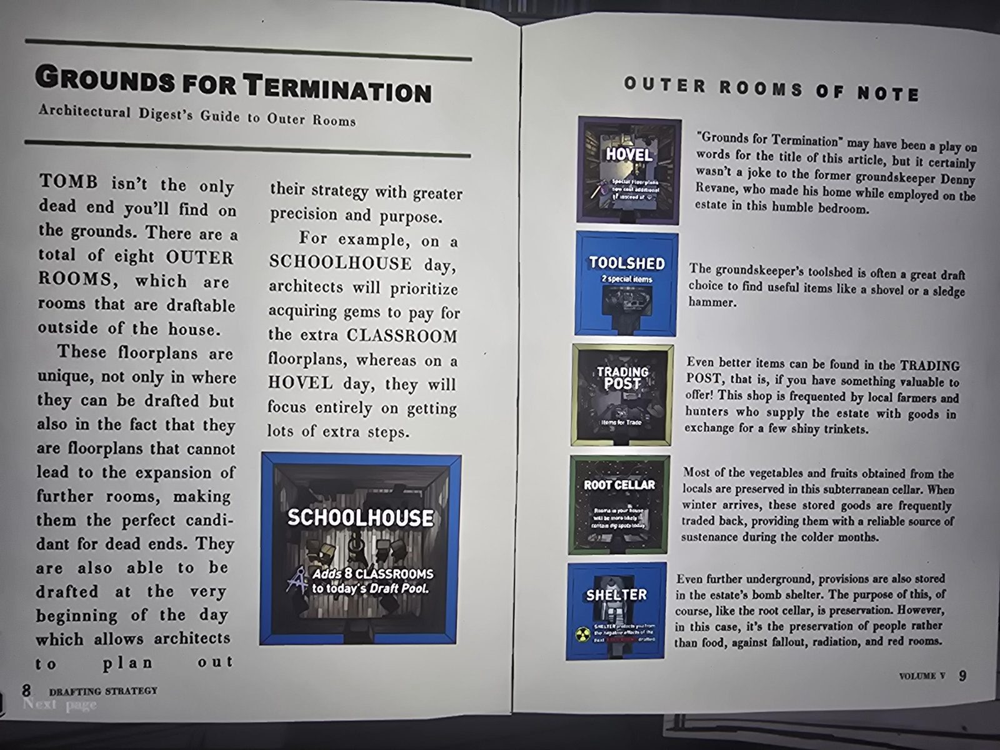
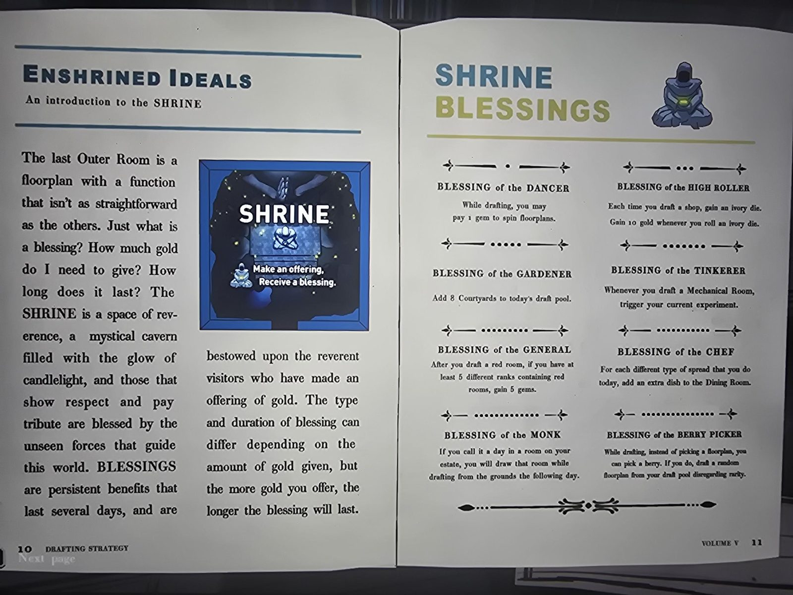
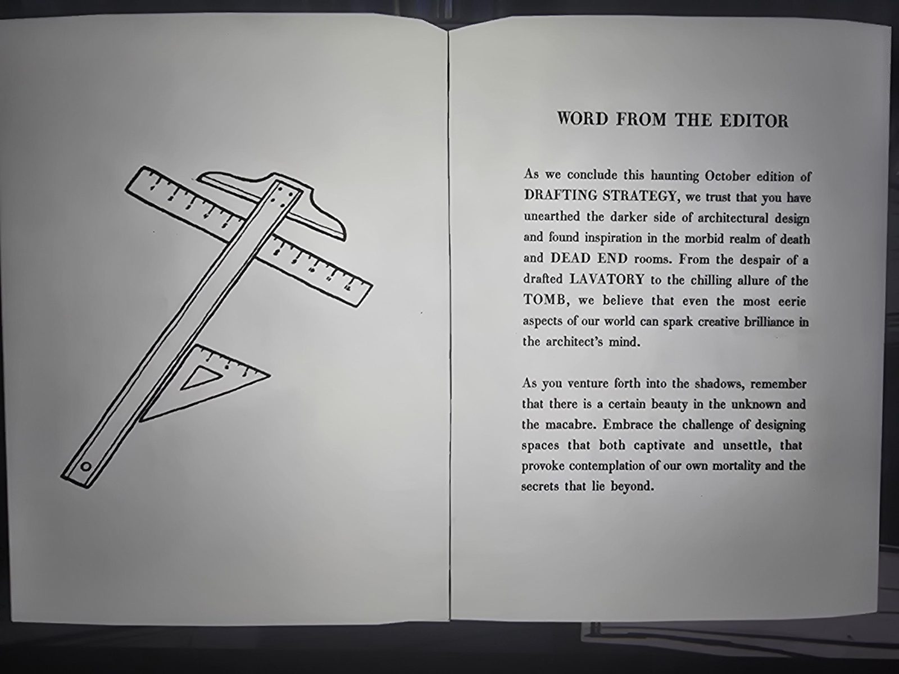

# Drafting Strategy, Vol. V (October Issue, Periodical, Library)
*Drafting Strategy — Architectural Digest Vol. 5*

## Checkout card (PERIODICAL, Title: DRAFTING STRATEGY VOL V)
| Date | Borrower |
|---|---|
| Nov 27 '93 | *Simon P. Jones* (red ink) |

## Contents
FEATURES / Page
- THE DEATH OF DRAFTING — by the Editor ... 2
- NO EXIT STRATEGIES — A Guide to Dead Ends ... 4
- GRAVE MISTAKES — An Introduction to the Tomb ... 6
- GROUNDS FOR TERMINATION — Guide to Outer Rooms ... 8
- ENSHRINED IDEALS — An Introduction to the Shrine ... 10
- TOP FIVE DEAD ENDS — Our Favorite Picks ... 12
- DEAD END CONTEST — Mail In Sweepstakes ... 13
- A WORD FROM THE EDITOR — by the Editor ... 15

## p. 2-3 THE DEATH OF DRAFTING — A fear every architect faces.
Every architect has experienced it. You're drafting your house, room by room, and everything is going smoothly. Suddenly, you realize there's only a single path available for expansion, and it is imperative you draft a hallway, or else your design will have no hope of further development. But, on the critical draw, the drafting gods offer you nothing but dead ends, rooms with no exit and even fewer prospects. Dead ends are the death of dreams, the death of plans, and the death of expansion. In short, they are the death of your house. But are they genuinely as daunting and menacing as they appear? Perhaps, beneath their morbid exterior, dead ends hold some inherent value. In this volume of Drafting Strategy, we will delve deeper into the world of the grave than any architect has ever dared to draft, to discover, once and for all, if there is any life beyond the dead end.

*(Picture: a winged skeleton with drafting compasses, standing on a floorplan. Caption: DRAXUS)*

## p. 4-5 NO EXIT STRATEGIES — Architectural Digest's Guide to Dead Ends
A DEAD END is any room that lacks another door by which to exit. It is an understandable instinct to want to avoid these rooms while drafting your house as they limit your available paths for growth, however, seasoned architects quickly learn that you do not want to completely ignore them. A very common mistake that beginners make is picking the room with the most doors while drafting and ignoring all other factors, but every house needs some dead ends.

*(Pictures: CLOSET — 2 items; LAVATORY)*

**DON'T BE AFRAID OF DRAFTING A FEW DEAD ENDS**
Each dead end room an architect drafts removes that floorplan from the draft pool. The more dead ends you draft, the less likely you are to draw them later on when decisions are more critical.

The key is figuring out a way to draft dead ends without blocking off your house's potential for expansion. Dropping a dead end room on the rank behind you is a great strategy to accomplish this and helps you pick up some extra resources before continuing to higher ranks. In general, you should be trying to fill up every open slot in your house before moving north.

*(Diagram: West Wing Hall, Spare Room, Hallway / Closet, Entrance Hall, Storeroom; an empty slot marked "an ideal spot to draft a dead end")*

## p. 6-7 GRAVE MISTAKES — An introduction to the TOMB
As foreboding as a black-bordered floorplan may seem, TOMB stands out as one of the most straightforward strategies centered around dead ends. This floorplan can only be drafted from the grounds and is considered one of the Outer Rooms. As such, it can be drafted at the very start of the day, allowing architects to know immediately whether their strategy should be focused on dead ends or not. The Tomb itself is a vast crypt filled with shadowy alcoves and creepy recesses. The entire space was designed by early Orindian architects to evoke a sense of mystery and intrigue, perfect for those who are appreciative and skeptical of dead end architecture. The eight Ajeran angels of that early era that are scattered throughout the TOMB's chambers are a memento of times past and you will certainly be seeing a lot of them when employing a TOMB-centered strategy as you will likely be making several visits here throughout the day. A successful TOMB strategy depends on three crucial factors: finding shops, amassing enough steps to allow for return trips to the grounds, and drafting as many dead ends as possible. This strategy is perfect for those who love risk and great rewards.

*(Picture: TOMB — "Each time you draft a Dead End in your house, spread 5 coins in the TOMB." Statue of an angel with a feather duster/staff. Caption: VEIA)*

## p. 8-9 GROUNDS FOR TERMINATION — Architectural Digest's Guide to Outer Rooms
TOMB isn't the only dead end you'll find on the grounds. There are a total of eight OUTER ROOMS, which are rooms that are draftable outside of the house.

These floorplans are unique, not only in where they can be drafted but also in the fact that they are floorplans that cannot lead to the expansion of further rooms, making them the perfect candidant for dead ends. They are also able to be drafted at the very beginning of the day which allows architects to plan out their strategy with greater precision and purpose.

For example, on a SCHOOLHOUSE day, architects will prioritize acquiring gems to pay for the extra CLASSROOM floorplans, whereas on a HOVEL day, they will focus entirely on getting lots of extra steps.

*(Picture: SCHOOLHOUSE — "Adds 8 CLASSROOMS to today's Draft Pool.")*

**OUTER ROOMS OF NOTE**
- HOVEL *(Special Floorplans now cost additional steps instead of gems)*: "Grounds for Termination" may have been a play on words for the title of this article, but it certainly wasn't a joke to the former groundskeeper Denny Revane, who made his home while employed on the estate in this humble bedroom.
- TOOLSHED *(2 special items)*: The groundskeeper's toolshed is often a great draft choice to find useful items like a shovel or a sledge hammer.
- TRADING POST *(Items for Trade)*: Even better items can be found in the TRADING POST, that is, if you have something valuable to offer! This shop is frequented by local farmers and hunters who supply the estate with goods in exchange for a few shiny trinkets.
- ROOT CELLAR *(Rooms in your house will be more likely to contain dig spots today)*: Most of the vegetables and fruits obtained from the locals are preserved in this subterranean cellar. When winter arrives, these stored goods are frequently traded back, providing them with a reliable source of sustenance during the colder months.
- SHELTER *(protects you from the negative effects of the next red room drafted)*: Even further underground, provisions are also stored in the estate's bomb shelter. The purpose of this, of course, like the root cellar, is preservation. However, in this case, it's the preservation of people rather than food, against fallout, radiation, and red rooms.

## p. 10-11 ENSHRINED IDEALS — An introduction to the SHRINE
The last Outer Room is a floorplan with a function that isn't as straightforward as the others. Just what is a blessing? How much gold do I need to give? How long does it last? The SHRINE is a space of reverence, a mystical cavern filled with the glow of candlelight, and those that show respect and pay tribute are blessed by the unseen forces that guide this world. BLESSINGS are persistent benefits that last several days, and are bestowed upon the reverent visitors who have made an offering of gold. The type and duration of blessing can differ depending on the amount of gold given, but the more gold you offer, the longer the blessing will last.

*(Picture: SHRINE — "Make an offering, Receive a blessing.")*

**SHRINE BLESSINGS** *(each is headed by a row of dots, 1, 3, 5, 7, 9... not explained)*
- BLESSING of the DANCER: While drafting, you may pay 1 gem to spin floorplans.
- BLESSING of the HIGH ROLLER: Each time you draft a shop, gain an ivory die. Gain 10 gold whenever you roll an ivory die.
- BLESSING of the GARDENER: Add 8 Courtyards to today's draft pool.
- BLESSING of the TINKERER: Whenever you draft a Mechanical Room, trigger your current experiment.
- BLESSING of the GENERAL: After you draft a red room, if you have at least 5 different ranks containing red rooms, gain 5 gems.
- BLESSING of the CHEF: For each different type of spread that you do today, add an extra dish to the Dining Room.
- BLESSING of the MONK: If you call it a day in a room on your estate, you will draw that room while drafting from the grounds the following day.
- BLESSING of the BERRY PICKER: While drafting, instead of picking a floorplan, you can pick a berry. If you do, draft a random floorplan from your draft pool disregarding rarity.

## p. 12 TOP FIVE DEAD ENDS — As selected by the Editorial Staff of DRAFTING STRATEGY
1. ATTIC (8 items): If TOOLSHED is good, then ATTIC is really good. Even at a steep gem cost this room cannot be passed up. It always pays for itself and more.
2. STUDY: likely the most powerful room for the experienced architect who no longer has difficulty accumulating gems or solving chess portmanteaus.
3. COAT CHECK: More than any other room, COAT CHECK allows architects to center their strategies on a specific item of their choice.
4. HOVEL: The risk may scare off some, but to those who see their steps as an expendable resource and throw caution to the wind, HOVEL is an unbeatable drafting force.
5. SECRET PASSAGE: Surprisingly, this room is actually categorized as a DEAD END, allowing architects to utilize it in both dead-end and color specific strategies.

## p. 13 DEAD END CONTEST — MAIL IN SWEEPSTAKES
ON JANUARY 20TH, 1989, TARRO MARTIZE SHOCKED THE WORLD OF ARCHITECTURE BY DRAFTING NINETEEN DEAD ENDS IN ONE DAY.
CAN YOU BEAT HIS RECORD?
DRAFT TWENTY OR MORE DEAD ENDS IN A SINGLE DAY AND YOU COULD WIN 200 GOLD AND THE TROPHY OF SWEEPSTAKES!
*(Fine print below, illegible in the photo.)*

## p. 15 WORD FROM THE EDITOR
As we conclude this haunting October edition of DRAFTING STRATEGY, we trust that you have unearthed the darker side of architectural design and found inspiration in the morbid realm of death and DEAD END rooms. From the despair of a drafted LAVATORY to the chilling allure of the TOMB, we believe that even the most eerie aspects of our world can spark creative brilliance in the architect's mind.

As you venture forth into the shadows, remember that there is a certain beauty in the unknown and the macabre. Embrace the challenge of designing spaces that both captivate and unsettle, that provoke contemplation of our own mortality and the secrets that lie beyond.

## Photos
   
   
