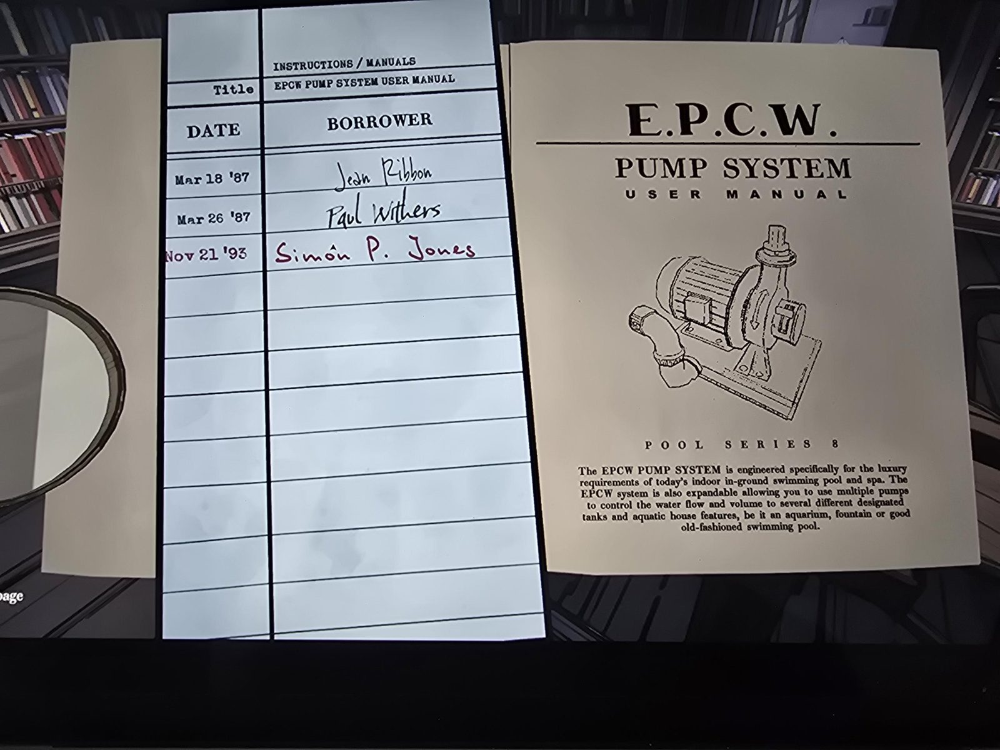
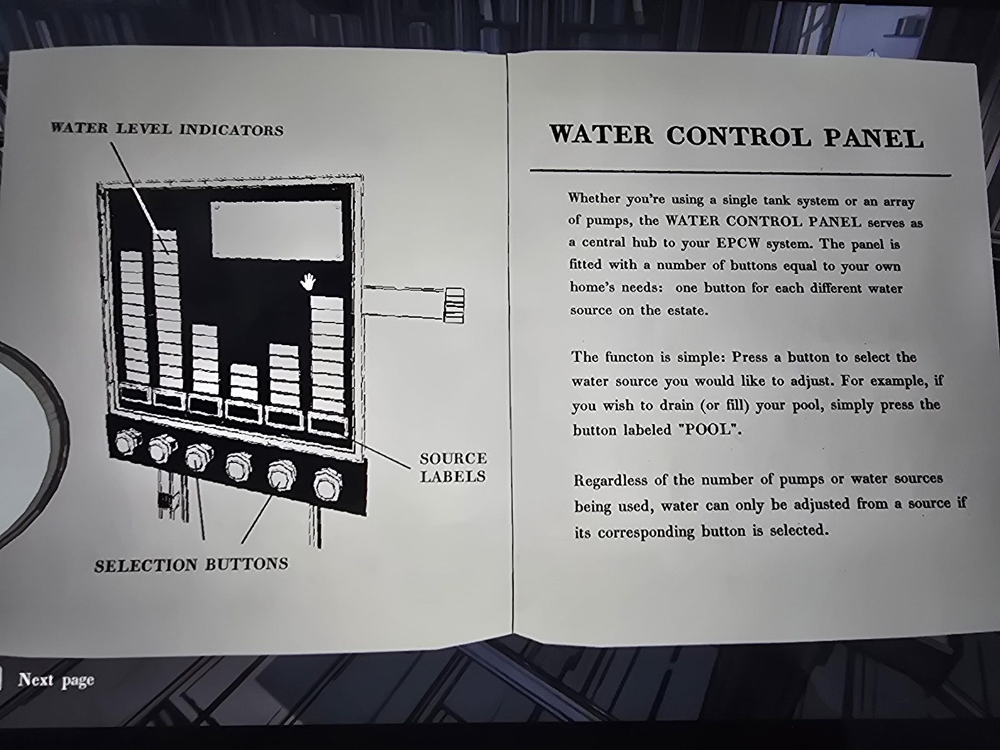
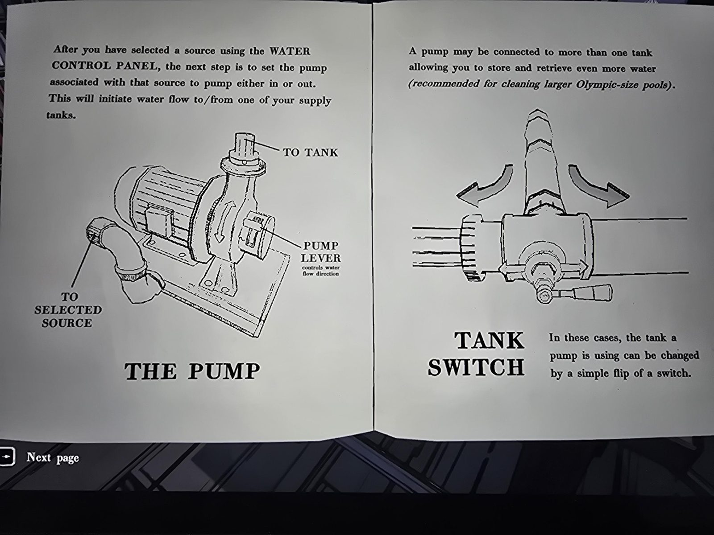
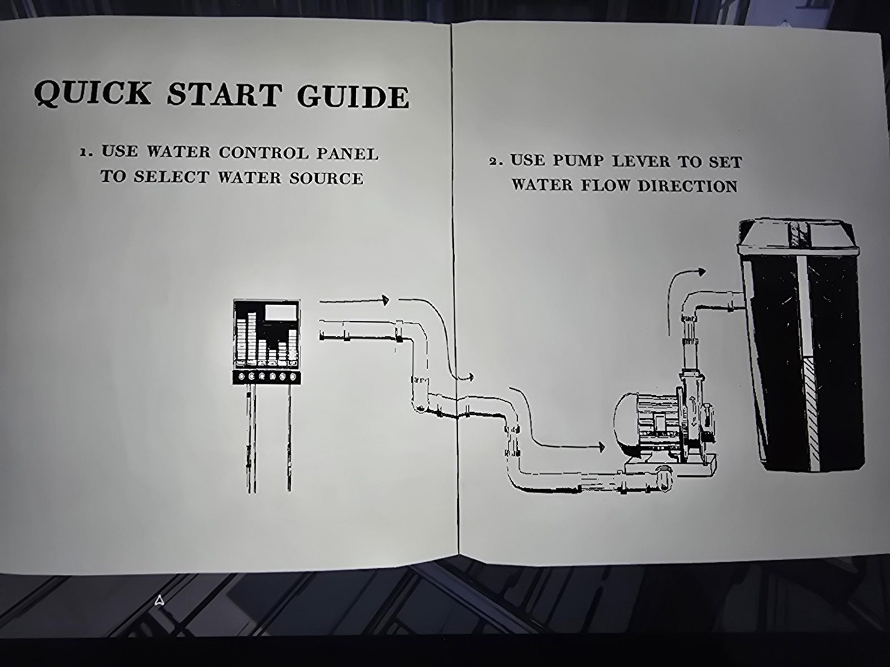

# Книга «EPCW Pump System User Manual» (Library)
Руководство пользователя насосной системы **E.P.C.W.**, серия Pool Series 8. Раздел библиотеки **«Инструкции / руководства»**.

Система EPCW спроектирована для роскошных требований внутренних бассейнов и спа. Расширяемая: несколько насосов управляют потоком и объёмом воды в разные назначенные **баки** и «водные» элементы дома: аквариум, фонтан или обычный бассейн.

## Формуляр
| Дата | Кто брал |
|---|---|
| 18 мар 1987 | Jean Ribbon |
| 26 мар 1987 | Paul Withers |
| 21 ноя 1993 | Simon P. Jones (красные чернила) |

## Содержание
- **Water Control Panel (панель управления водой).** Центральный узел системы. **Одна кнопка на каждый источник воды** в поместье (на схеме шесть кнопок и шесть столбцов индикаторов уровня воды с подписями источников). Нажмите кнопку нужного источника, например «POOL», чтобы слить или залить его. Воду можно менять **только у выбранного источника**, чья кнопка нажата.
- **The Pump (насос).** После выбора источника на панели **рычаг насоса** (Pump Lever) задаёт направление: насос качает **внутрь или наружу** (к баку / от выбранного источника).
- **Tank Switch (переключатель бака).** Насос можно подключить к нескольким бакам (рекомендуется для очистки больших олимпийских бассейнов); бак меняется **переключателем**.
- **Quick Start Guide:** 1) Панелью выбрать источник воды. 2) Рычагом насоса задать направление потока.

## Заметка
- Объясняет схему из [Pump Room](../../../pump-room/solutions.md): выбор источника кнопкой, направление насоса рычагом, переключатель бака. Связь с Reservoir (уровень воды 13): [Reservoir](../../../abandoned-mine/reservoir/solutions.md).
- Опечатка в оригинале: «functon».

## Photos / Фото
01 — титул и формуляр; 02 — панель; 03 — насос и переключатель бака; 04 — Quick Start.

