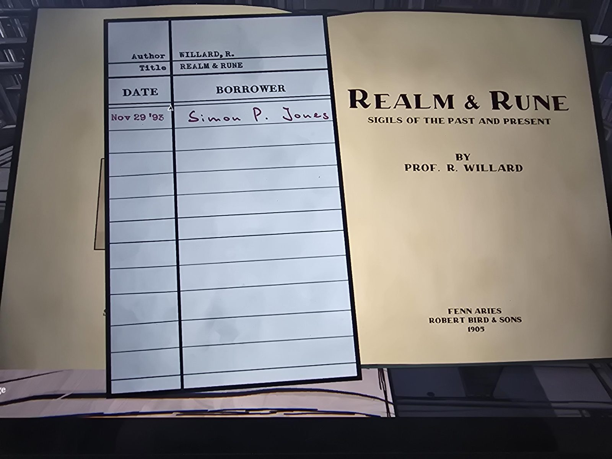
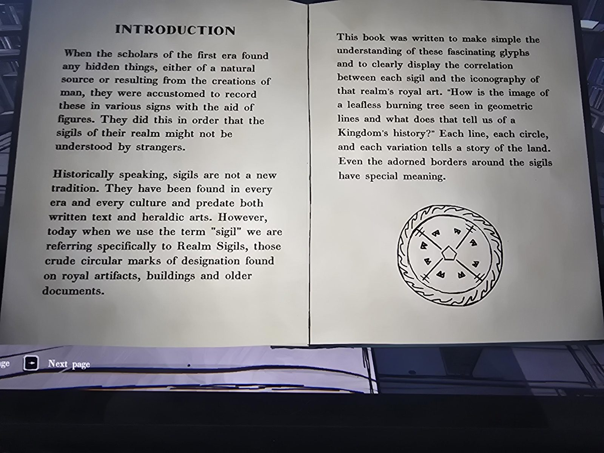
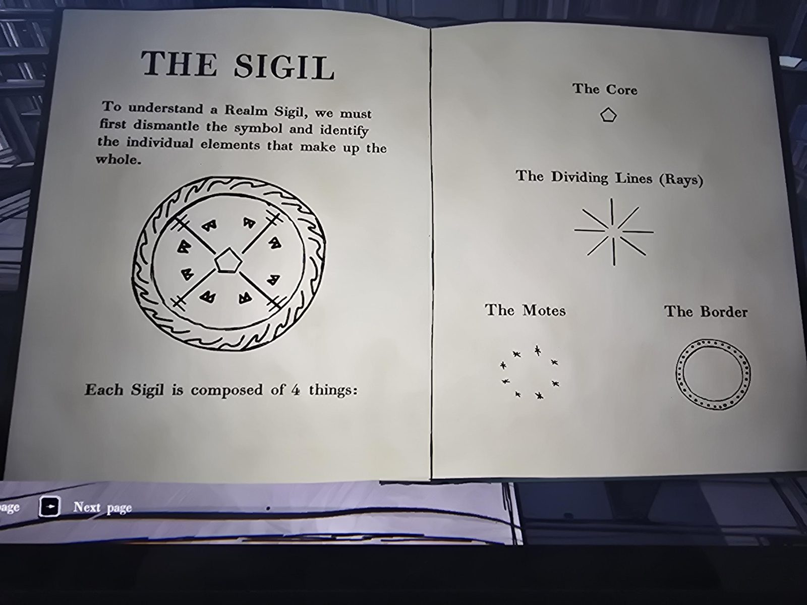
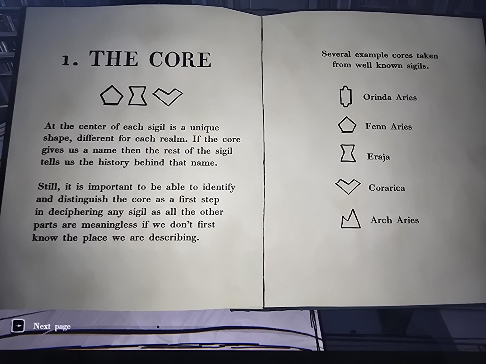
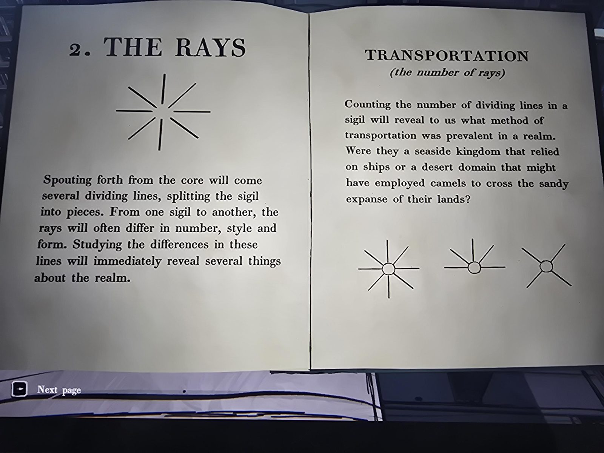
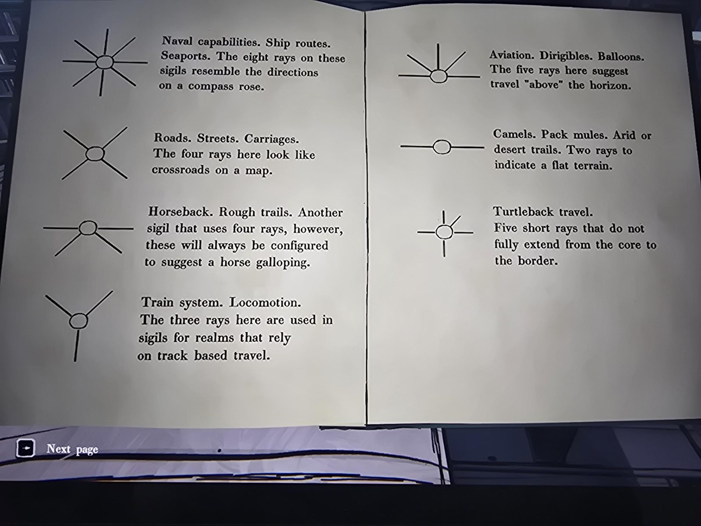
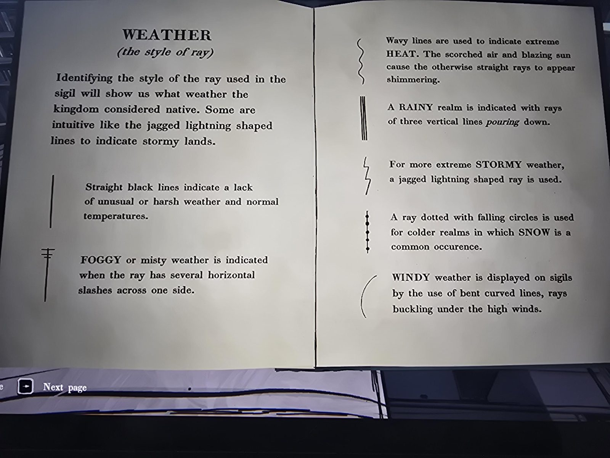
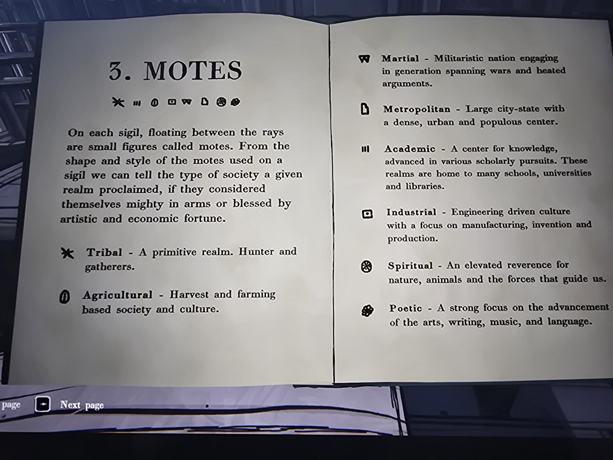
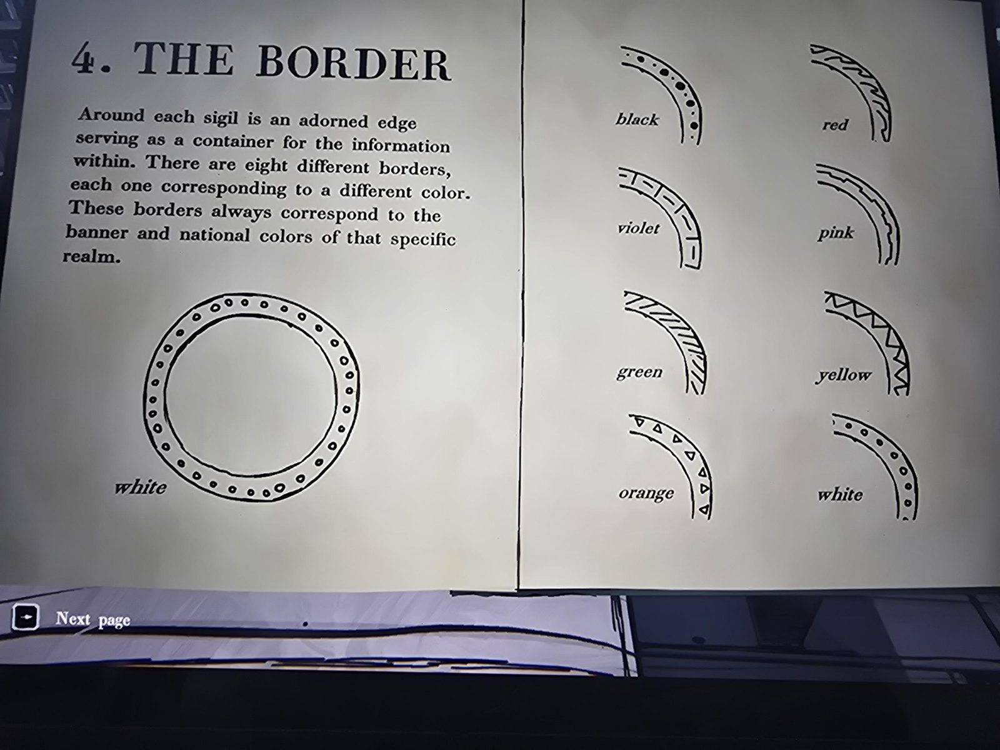
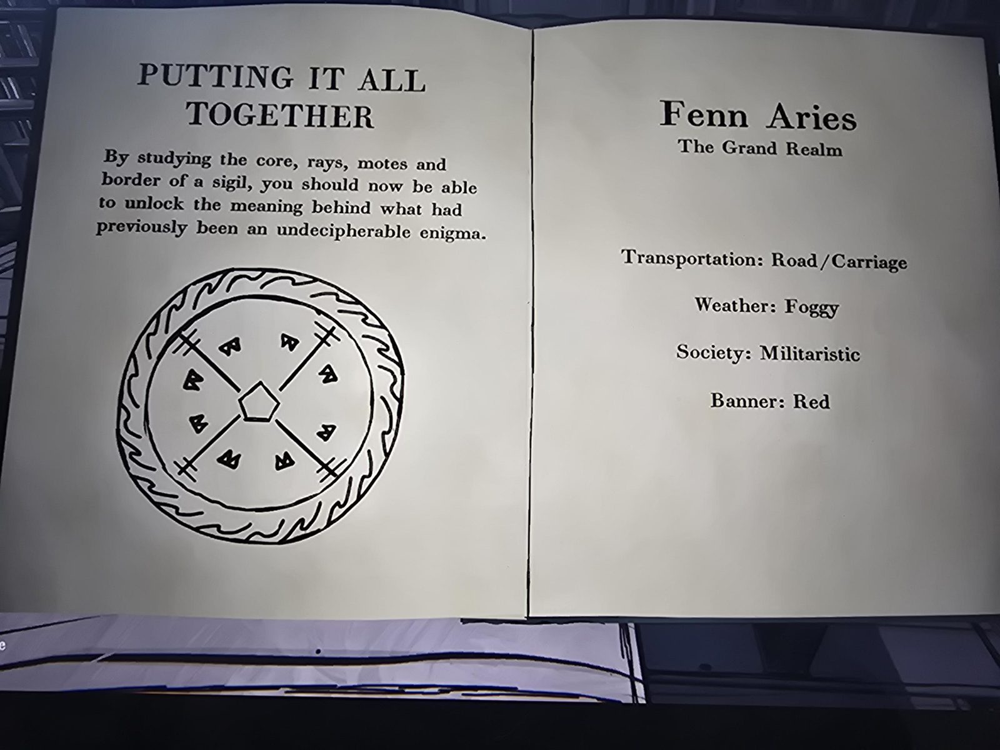

*(Library card glued inside the cover)*
Author: WILLARD, R.
Title: REALM & RUNE
DATE / BORROWER: Nov 29 '93 — Simon P. Jones *(handwritten)*

*(Title page)*
REALM & RUNE
SIGILS OF THE PAST AND PRESENT
BY PROF. R. WILLARD
FENN ARIES
ROBERT BIRD & SONS
1905

## INTRODUCTION
When the scholars of the first era found any hidden things, either of a natural source or resulting from the creations of man, they were accustomed to record these in various signs with the aid of figures. They did this in order that the sigils of their realm might not be understood by strangers.

Historically speaking, sigils are not a new tradition. They have been found in every era and every culture and predate both written text and heraldic arts. However, today when we use the term "sigil" we are referring specifically to Realm Sigils, those crude circular marks of designation found on royal artifacts, buildings and older documents.

This book was written to make simple the understanding of these fascinating glyphs and to clearly display the correlation between each sigil and the iconography of that realm's royal art. "How is the image of a leafless burning tree seen in geometric lines and what does that tell us of a Kingdom's history?" Each line, each circle, and each variation tells a story of the land. Even the adorned borders around the sigils have special meaning.

## THE SIGIL
To understand a Realm Sigil, we must first dismantle the symbol and identify the individual elements that make up the whole.

Each Sigil is composed of 4 things:
The Core · The Dividing Lines (Rays) · The Motes · The Border

## 1. THE CORE
At the center of each sigil is a unique shape, different for each realm. If the core gives us a name then the rest of the sigil tells us the history behind that name.

Still, it is important to be able to identify and distinguish the core as a first step in deciphering any sigil as all the other parts are meaningless if we don't first know the place we are describing.

Several example cores taken from well known sigils.
- *(elongated shape with notches)* Orinda Aries
- *(pentagon)* Fenn Aries
- *(hourglass)* Eraja
- *(chevron / heart-like check)* Corarica
- *(crown-like peaks)* Arch Aries

## 2. THE RAYS
Spouting forth from the core will come several dividing lines, splitting the sigil into pieces. From one sigil to another, the rays will often differ in number, style and form. Studying the differences in these lines will immediately reveal several things about the realm.

### TRANSPORTATION (the number of rays)
Counting the number of dividing lines in a sigil will reveal to us what method of transportation was prevalent in a realm. Were they a seaside kingdom that relied on ships or a desert domain that might have employed camels to cross the sandy expanse of their lands?

- *(8 rays)* Naval capabilities. Ship routes. Seaports. The eight rays on these sigils resemble the directions on a compass rose.
- *(4 rays, X shape)* Roads. Streets. Carriages. The four rays here look like crossroads on a map.
- *(4 rays, two horizontal and two downward)* Horseback. Rough trails. Another sigil that uses four rays, however, these will always be configured to suggest a horse galloping.
- *(3 rays)* Train system. Locomotion. The three rays here are used in sigils for realms that rely on track based travel.
- *(5 rays)* Aviation. Dirigibles. Balloons. The five rays here suggest travel "above" the horizon.
- *(2 rays, horizontal)* Camels. Pack mules. Arid or desert trails. Two rays to indicate a flat terrain.
- *(5 short rays)* Turtleback travel. Five short rays that do not fully extend from the core to the border.

### WEATHER (the style of ray)
Identifying the style of the ray used in the sigil will show us what weather the kingdom considered native. Some are intuitive like the jagged lightning shaped lines to indicate stormy lands.

- *(straight line)* Straight black lines indicate a lack of unusual or harsh weather and normal temperatures.
- *(line with horizontal slashes at one end)* FOGGY or misty weather is indicated when the ray has several horizontal slashes across one side.
- *(wavy line)* Wavy lines are used to indicate extreme HEAT. The scorched air and blazing sun cause the otherwise straight rays to appear shimmering.
- *(three vertical lines)* A RAINY realm is indicated with rays of three vertical lines *pouring* down.
- *(lightning line)* For more extreme STORMY weather, a jagged lightning shaped ray is used.
- *(line dotted with circles)* A ray dotted with falling circles is used for colder realms in which SNOW is a common occurence.
- *(curved line)* WINDY weather is displayed on sigils by the use of bent curved lines, rays buckling under the high winds.

## 3. MOTES
On each sigil, floating between the rays are small figures called motes. From the shape and style of the motes used on a sigil we can tell the type of society a given realm proclaimed, if they considered themselves mighty in arms or blessed by artistic and economic fortune.

- *(asterisk)* Tribal - A primitive realm. Hunter and gatherers.
- *(circle with oval)* Agricultural - Harvest and farming based society and culture.
- *(W shape)* Martial - Militaristic nation engaging in generation spanning wars and heated arguments.
- *(folded page shape)* Metropolitan - Large city-state with a dense, urban and populous center.
- *(three bars)* Academic - A center for knowledge, advanced in various scholarly pursuits. These realms are home to many schools, universities and libraries.
- *(square with dot)* Industrial - Engineering driven culture with a focus on manufacturing, invention and production.
- *(circle with marks)* Spiritual - An elevated reverence for nature, animals and the forces that guide us.
- *(blot)* Poetic - A strong focus on the advancement of the arts, writing, music, and language.

## 4. THE BORDER
Around each sigil is an adorned edge serving as a container for the information within. There are eight different borders, each one corresponding to a different color. These borders always correspond to the banner and national colors of that specific realm.

*(Example ring: white. Eight border arcs, labelled:)* black (dots of varying size), red (wavy flame lines), violet (segments), pink (double jagged line), green (diagonal hatching), yellow (zigzag), orange (small triangles), white (small circles).

## PUTTING IT ALL TOGETHER
By studying the core, rays, motes and border of a sigil, you should now be able to unlock the meaning behind what had previously been an undecipherable enigma.

*(Sigil: pentagon core, 4 rays with cross-ticks at the ends, 8 "W" motes, red flame border.)*

Fenn Aries
The Grand Realm

Transportation: Road/Carriage
Weather: Foggy
Society: Militaristic
Banner: Red

## Photos
         
