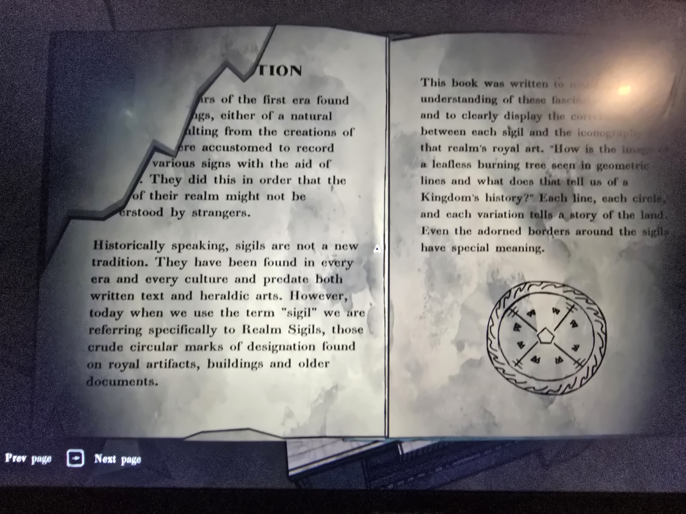
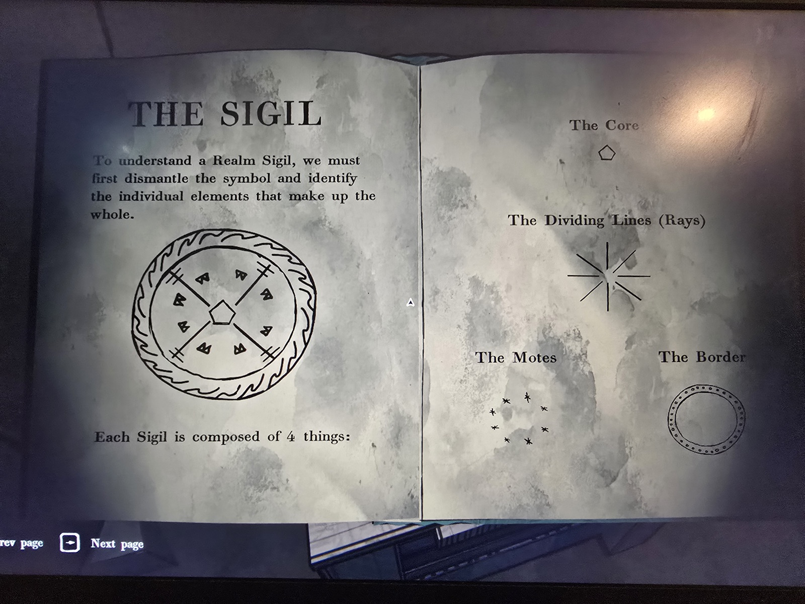
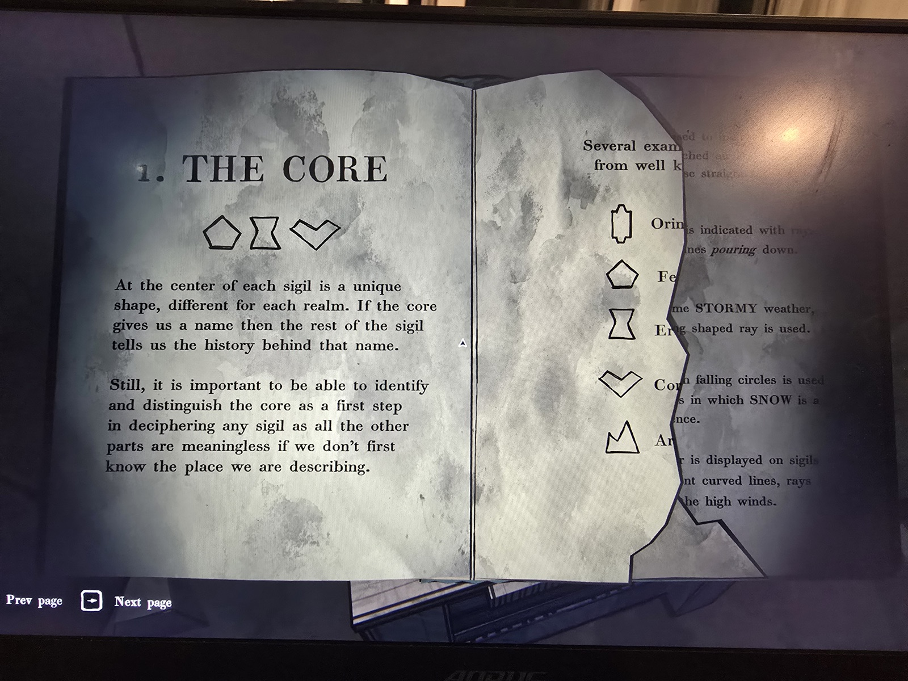
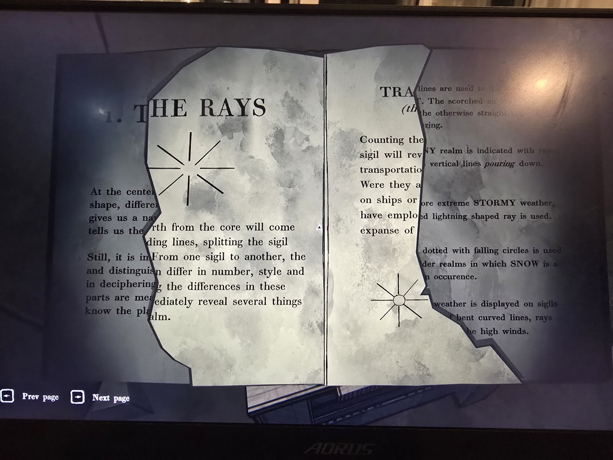
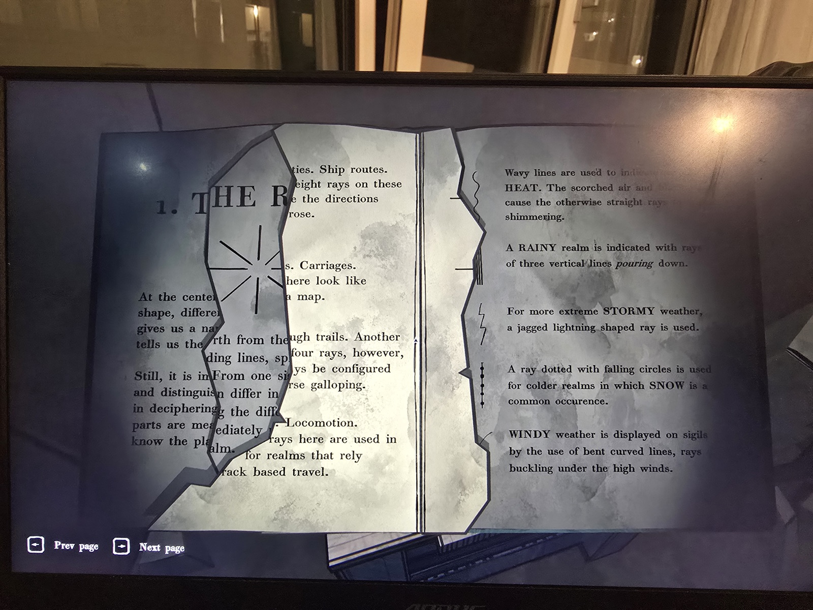
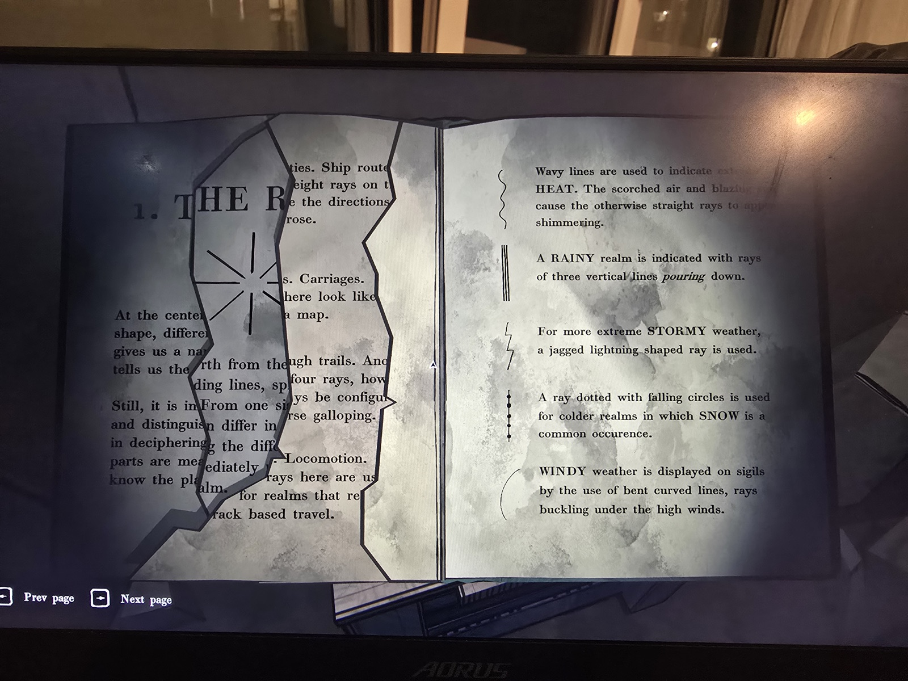
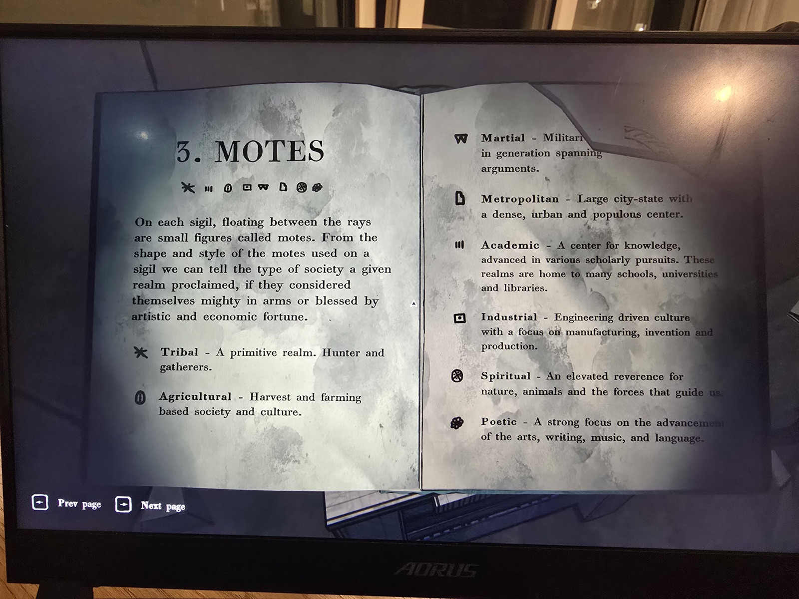
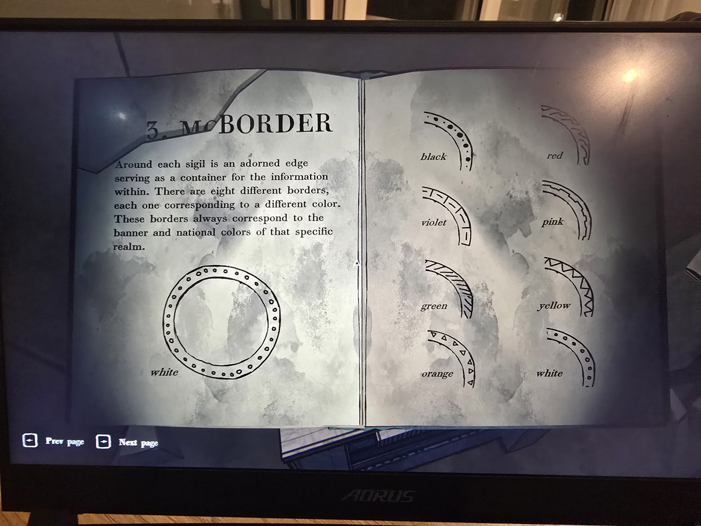
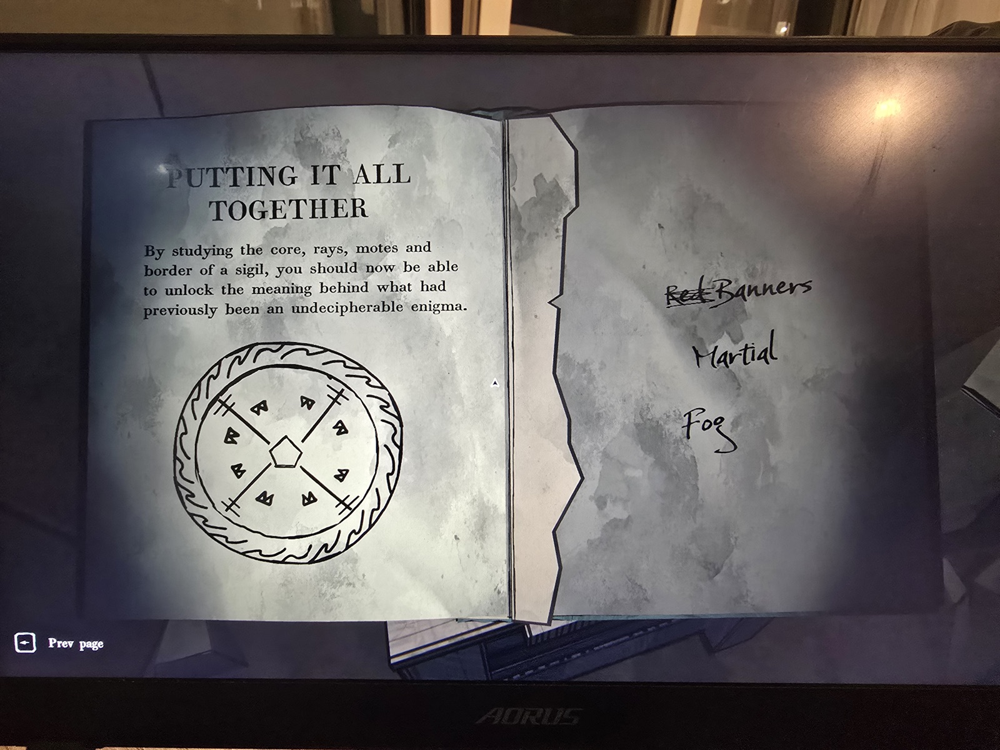

**Книга о сигилах царств** (обложку не сфотографировали — вероятно, «Realm & Rune», о которой говорилось в Room 46). Часть страниц порвана.

**Сигил состоит из 4 частей:**
1. **Ядро** (центральная фигура) = **какое это царство**. По обрывку: вытянутый шестиугольник — Orin[da Aries], **пятиугольник — Fe[nn Aries]**, **песочные часы — Er[aja]**, **сердце/галочка — Cor[arica]**, **гора/корона — Ar[ch Aries]**.
2. **Лучи**: их **число** = основной транспорт (8 — корабли, «роза ветров»; кареты, «как на карте»; 4 — лошади, «тропы»; локомотивы — рельсы). **Форма** = погода: волнистые — жара, три вертикальные черты — дождь, молния — шторм, точки на луче — снег, изогнутые — ветер.
3. **Мотыльки** (значки между лучами) = тип общества: ✱ племенное · зерно — аграрное · **W — военное** · здание — метрополия · III — академическое · квадрат с точкой — индустриальное · колесо — духовное · клякса/цветок — поэтическое.
4. **Кайма** = цвет знамени царства (8 цветов): чёрная — точки разного размера, **красная — волны/пламя**, фиолетовая — штрихи-блоки, розовая — ступеньки, зелёная — косая штриховка, жёлтая — зигзаг, оранжевая — треугольнички, белая — кружки.

**Пример в книге:** пятиугольник (Fenn Aries), 4 луча, 8 мотыльков «W», красная кайма. Рядом от руки ответ: ~~Red~~ **Banners / Martial / Fog** (знамёна / военное / туман).

*Заметка: ключ к карте 8 царств (Room 46) и шкатулкам Мора Джай. Совпадения с цветами: пятиугольник = Fenn Aries = красный (шкатулка), гора = Arch Aries = жёлтый, сердце = оранжевый, песочные часы = фиолетовый (лист раскраски) → **сердце = Corarica = оранжевый, песочные часы = Eraja = фиолетовый** (выведено, не проверено). Книга найдена, судя по фону, не в Library — комната не записана.*

## Photos / Фото

