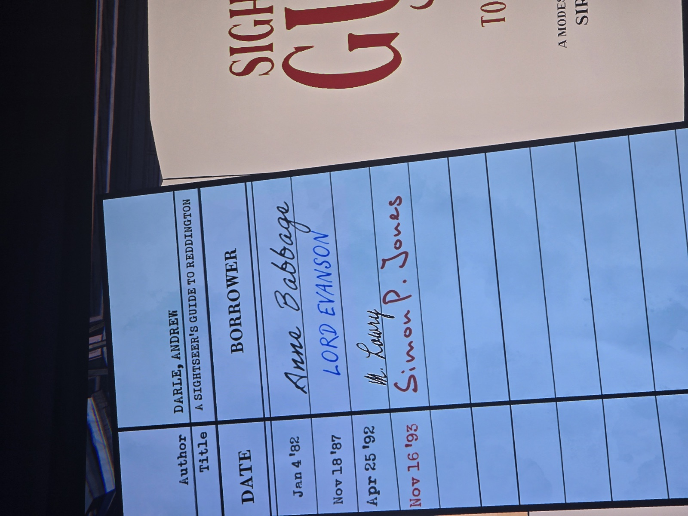
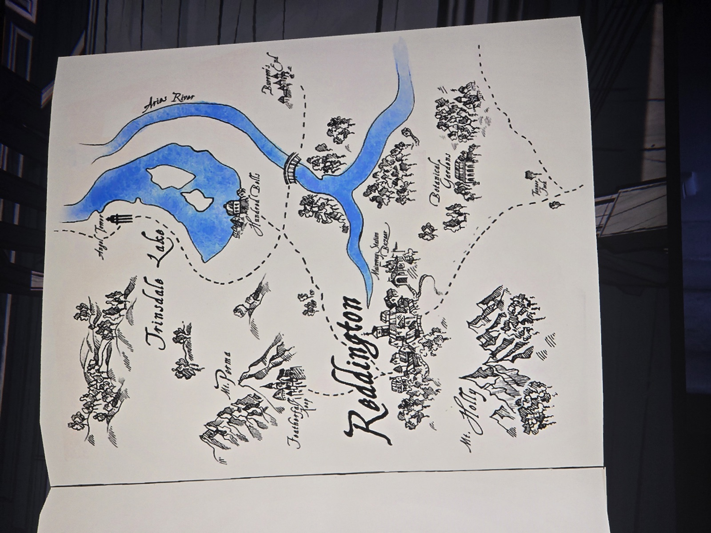

A SIGHTSEER'S GUIDE TO REDDINGTON — Darle, Andrew. ("A modes[t]…", "Sir…" on the cover — partly cut off.)

Checkout card:
| Date | Borrower |
|---|---|
| Jan 4 '82 | Anne Babbage |
| Nov 18 '87 | LORD EVANSON (blue ink) |
| Apr 25 '92 | M. Lowry |
| Nov 16 '93 | Simon P. Jones (red ink) |

Map of Reddington: Trinsdale Lake (with two islands), Angel Tower, Mt. Perma, Featherfall Keep, Hundred Bells (on the lake shore), Aries River (with bridge), Burrow's End, Reddington, Mainway Station Bazaar, Botanical Gardens, Mt. Holly, Tanner Fork.

## Photos / Фото

