# Swim Bird

*(Photo 01: left page — library card pocket; right page — title page)*

**SWIM BIRD**
BY
MARION MARIGOLD

RUFFINGTON RED PUBLISHING
1985

## Library card (photo 02)
Author: MARIGOLD, MARION
Title: SWIM BIRD

| DATE | BORROWER |
|---|---|
| Jul 2 '85 | *Herbert S. Sinclair* (signature) |
| Jul 12 '85 | *Mrs. Peterson* |
| Nov 1 '85 | *Mrs. Peterson* (faint) |
| Dec 24 '85 | SIMON (childish block letters) |
| Jan 26 '86 | *Mrs. Peterson* |
| Apr 1 '86 | *Anne Babbage* |
| Mar 2 '87 | DET. BON MARGLE |
| Nov 13 '93 | *Simon P. Jones* (dark red ink) |

## Text (left page / right page)
**(03)**
I am a **DARE BIRD**!
A daring and brave bird!
/
Diving so deep bird,
A ride on the wave bird!

**(04)**
There is not a dare
I would not do.
/
There is not a depth
I would not dive to.

**(05)**
However, my friends
Are not very open
/
To the idea that I like
the sky less than the ocean.

**(06)**
Bird in the sky,
**Not in the sea!**
/
That is what they say
when looking at me.

**(07)**
You are not sea bird.
You are not swim bird.
/
If you are friend bird,
Fly in the wind, bird.

**(08)**
And shouldn't you always
Listen to friends?
/
For they know me best,
or so they pretend.

**(09)**
So I **dare** not dive,
and I **dare** not swim.
/
And I **dare** not step foot
in the ocean again.

**(10)**
And I **dare** not smile,
and I **dare** not laugh.
/
For they will do it for me,
and on my behalf.

**(11)**
And I **dare** not dream,
and I **dare** not speak
/
For maybe my friends,
Won't like the real me.

**(12)**
And I will say goodbye
to my dreams and the sea
/
And wonder why daring
feels just like defeat.

## Photos / Фото
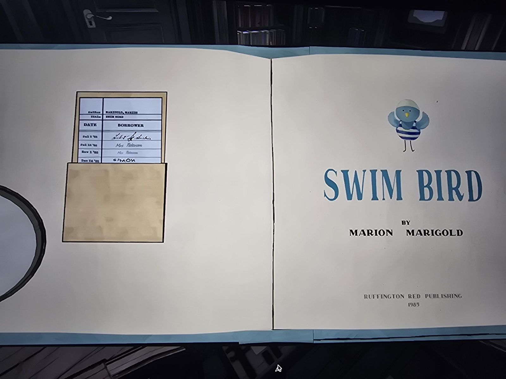
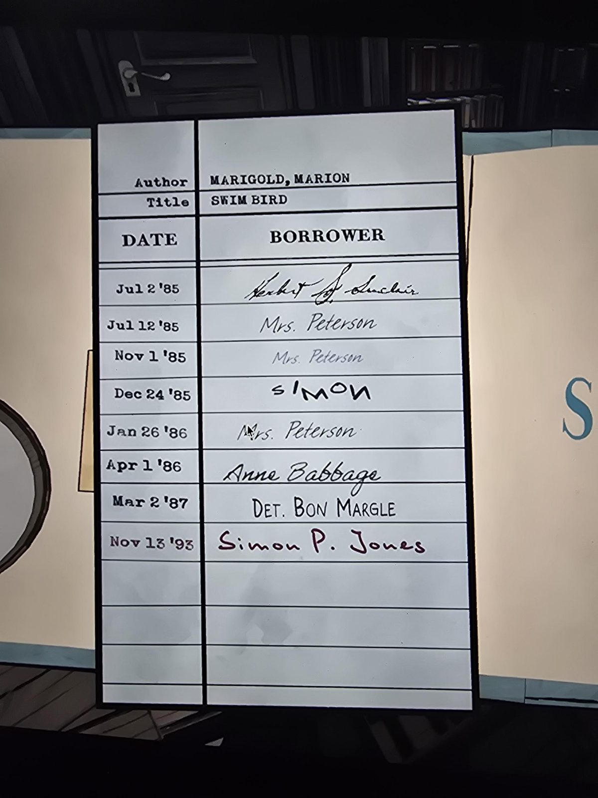
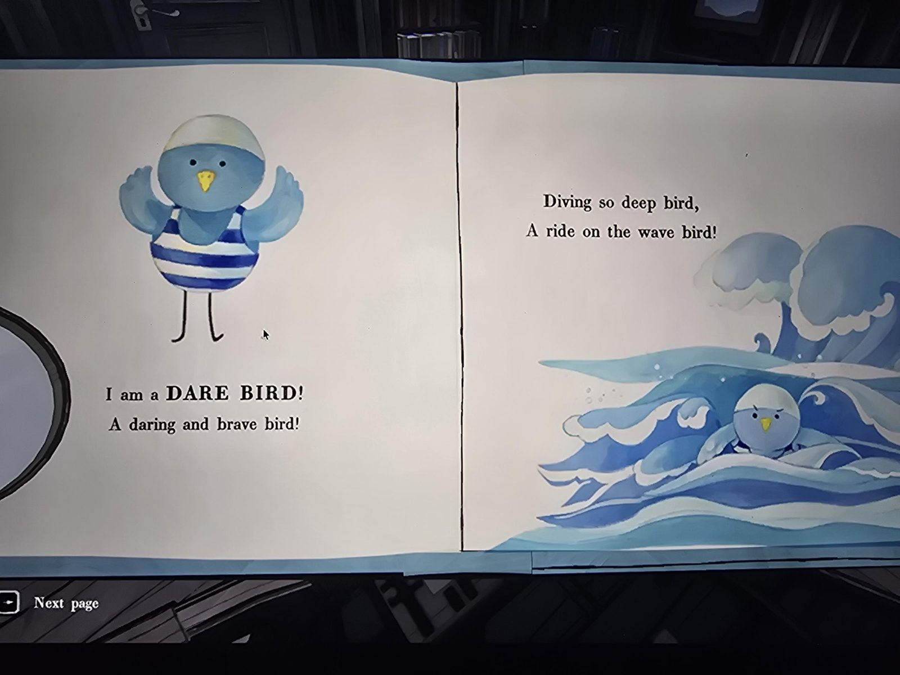
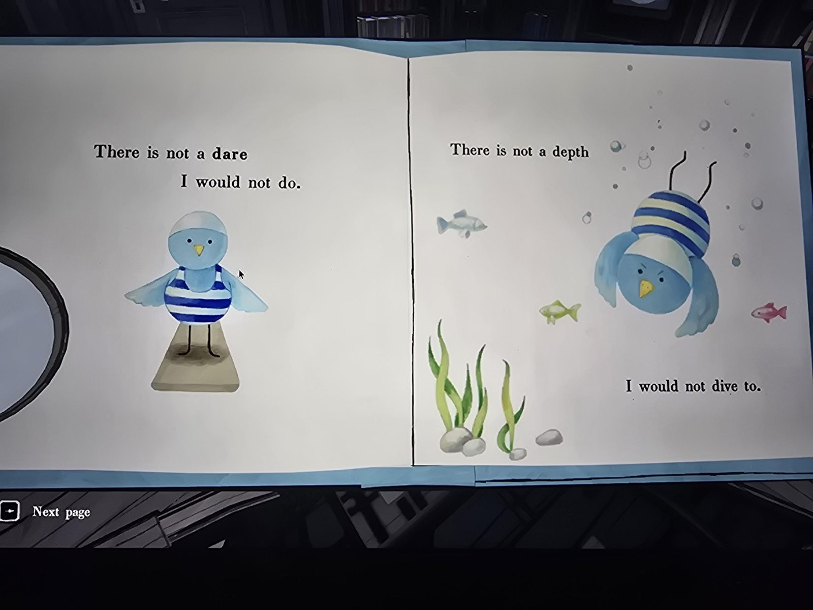
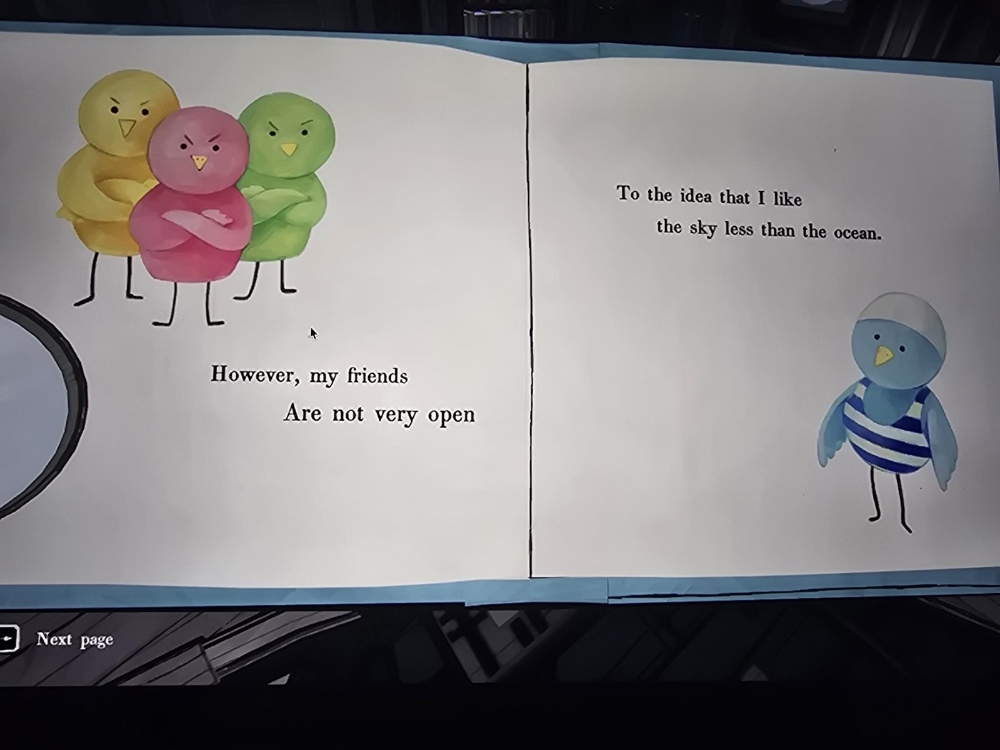
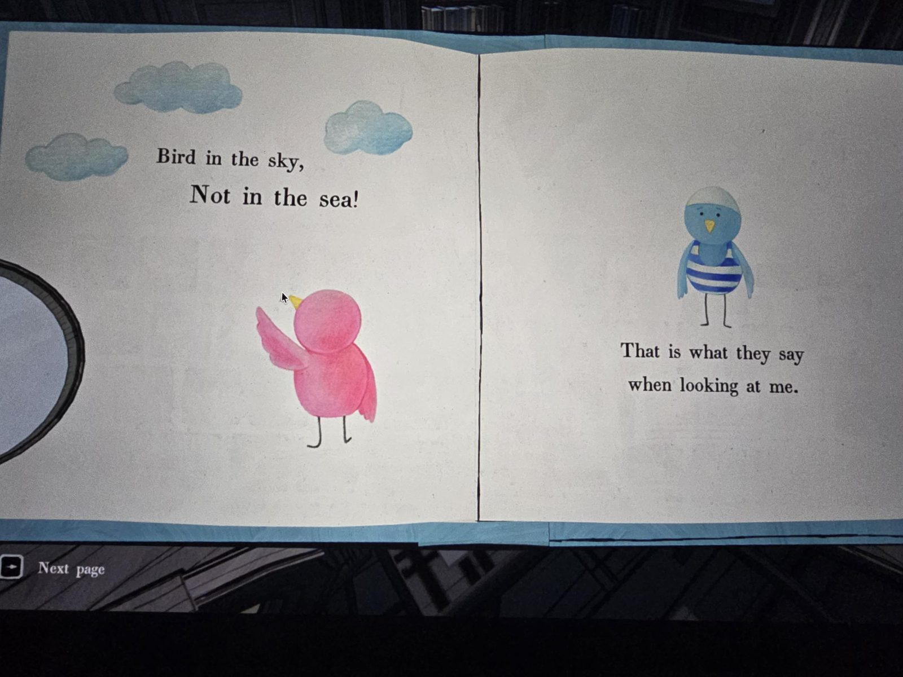
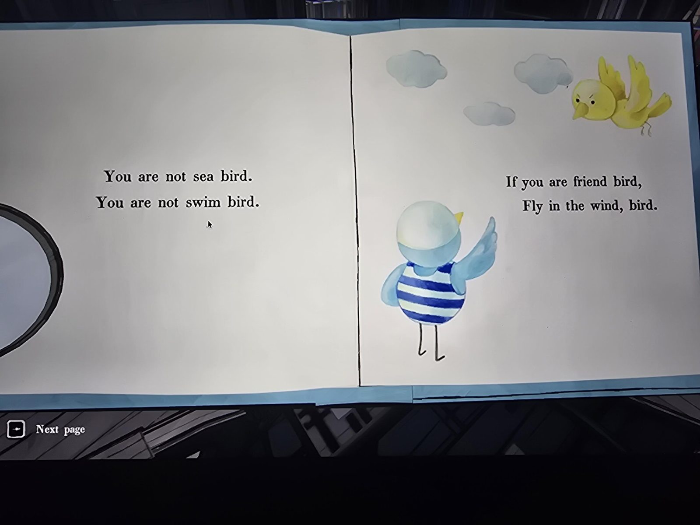
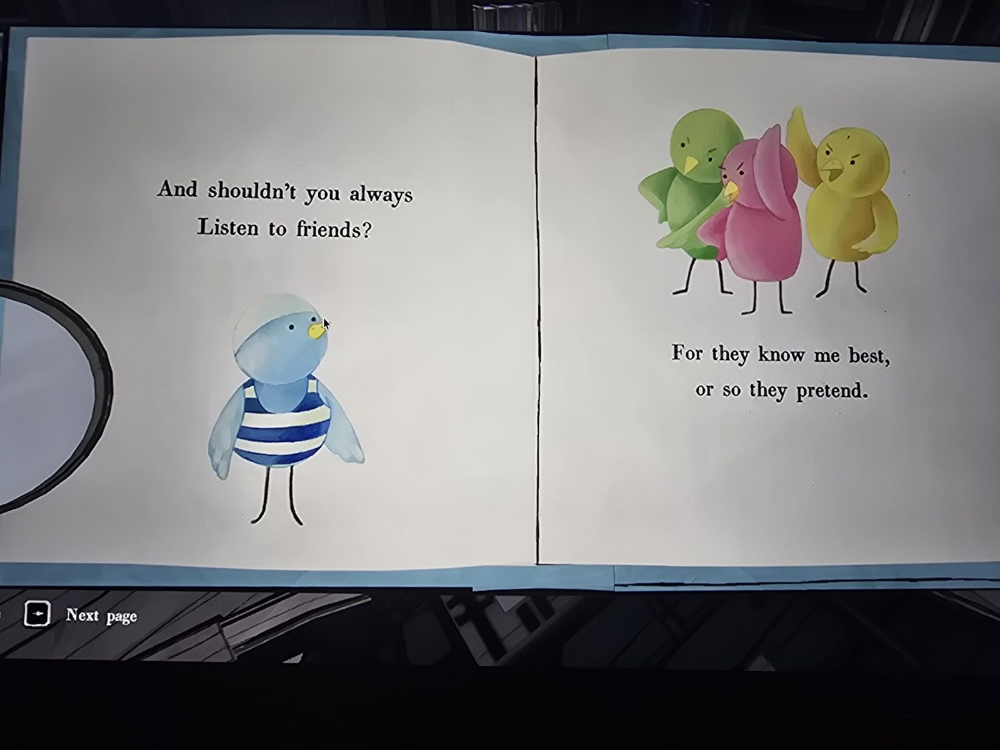
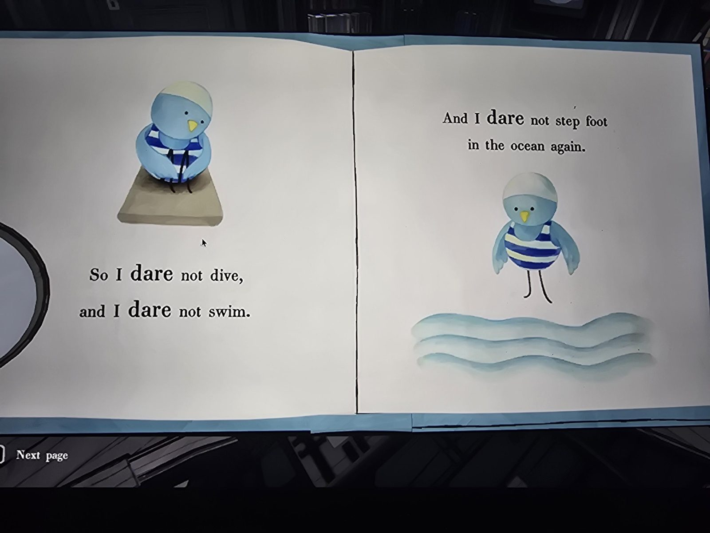
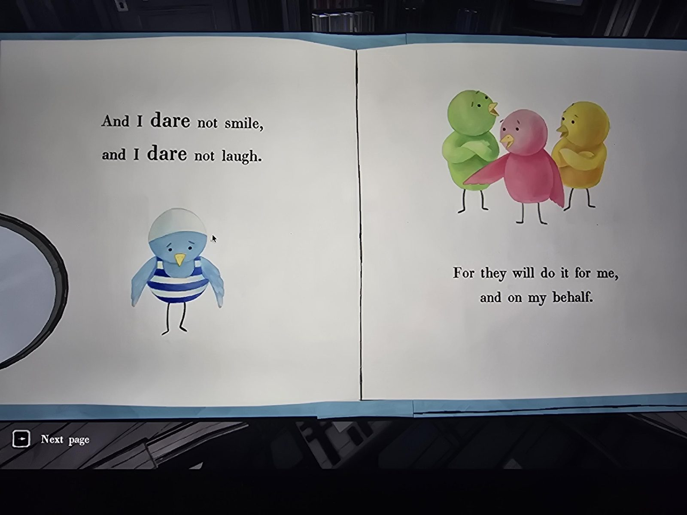
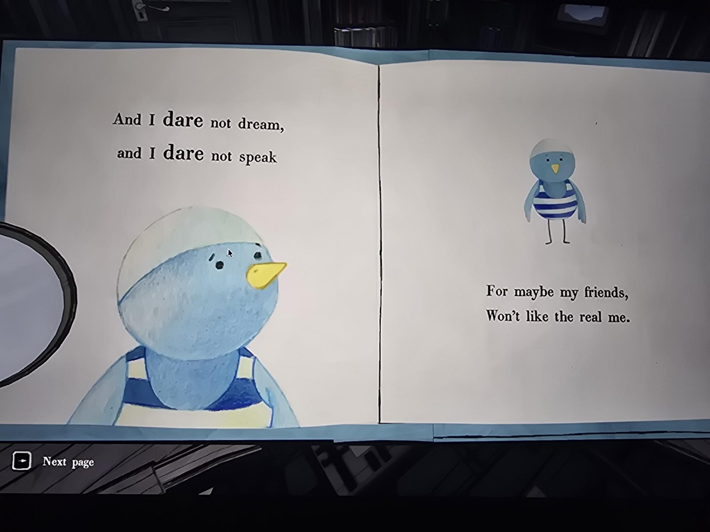
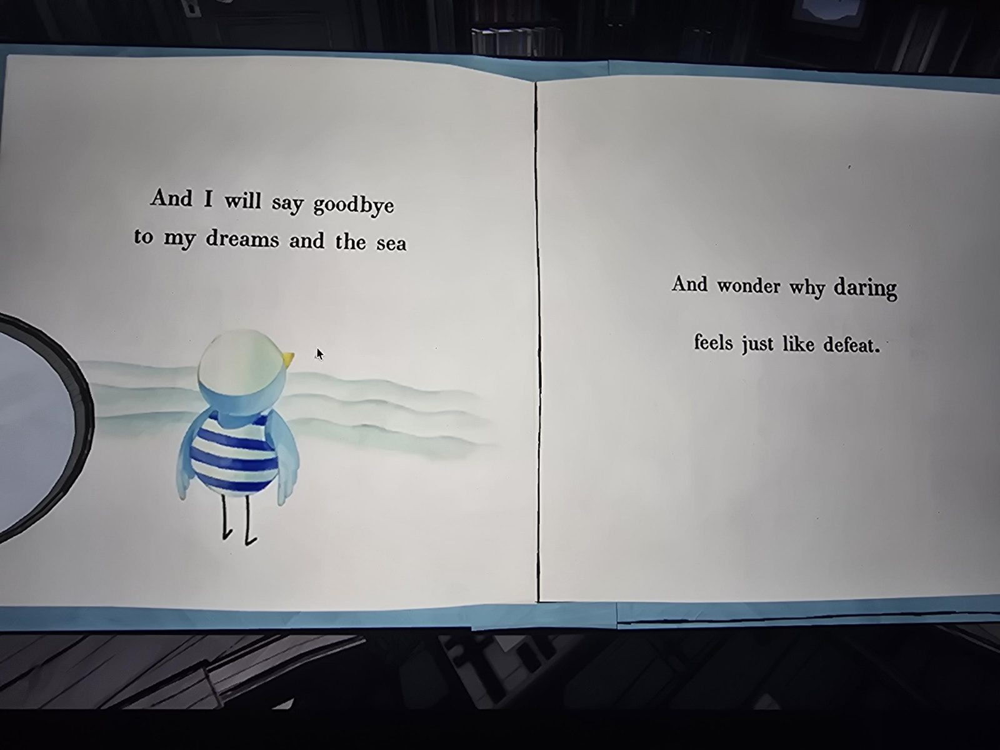

