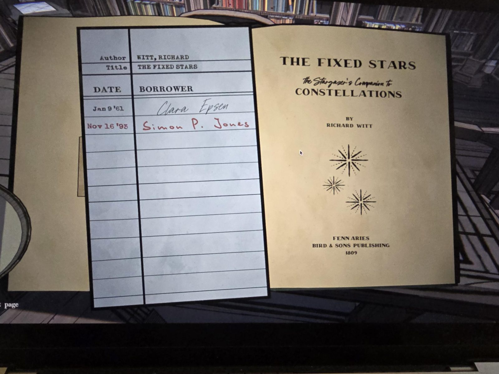

# Книга «The Fixed Stars» (Library)
Экземпляр в библиотеке. Ричард Витт, «Спутник звездочёта: созвездия», Fenn Aries, Bird & Sons Publishing, **1809**. По словам пользователя, **содержание идентично** книге из [Observatory](../../../observatory/docs/the-fixed-stars-book/ru.md) (таблица созвездий и эффектов там); здесь сфотографирован только титул и формуляр.

## Формуляр (карточка выдачи)
Автор: Witt, Richard. Название: The Fixed Stars.

| Дата | Кто брал |
|---|---|
| 9 янв 1961 | Клара Эпсен (чёрными чернилами) |
| 16 ноя 1993 | Саймон П. Джонс (красными чернилами) |

## Заметка
- Фамилия **Эпсен** совпадает с бюстом лорда Уильяма Эпсена в [Foyer](../../../foyer/solutions.md).

## Photos / Фото

