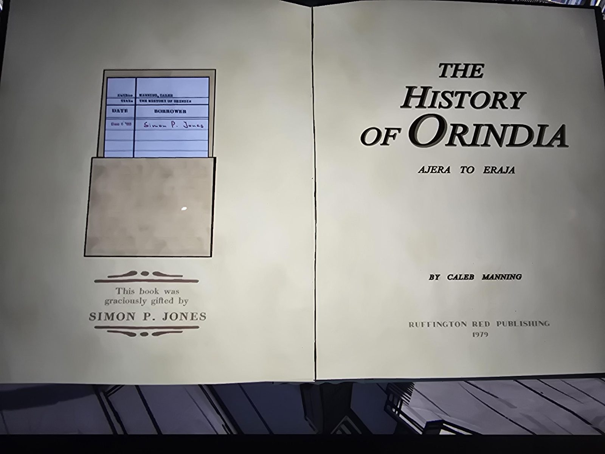
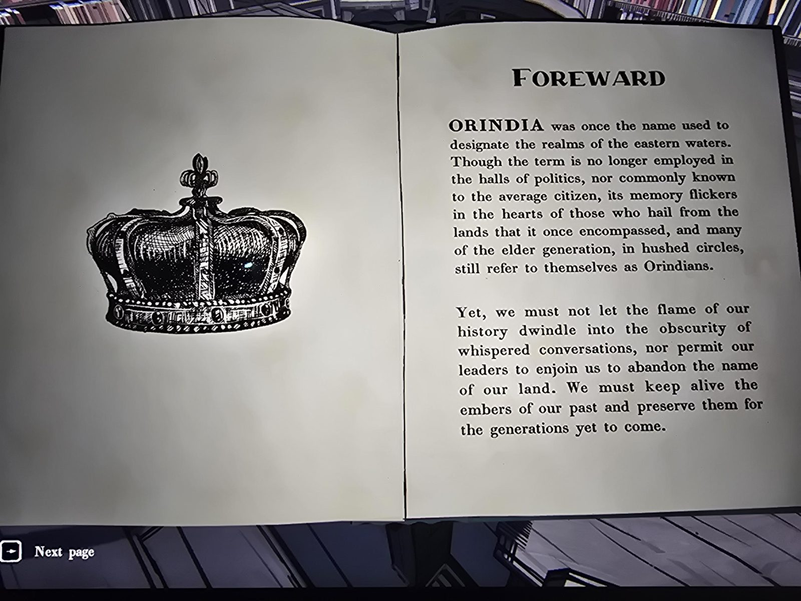
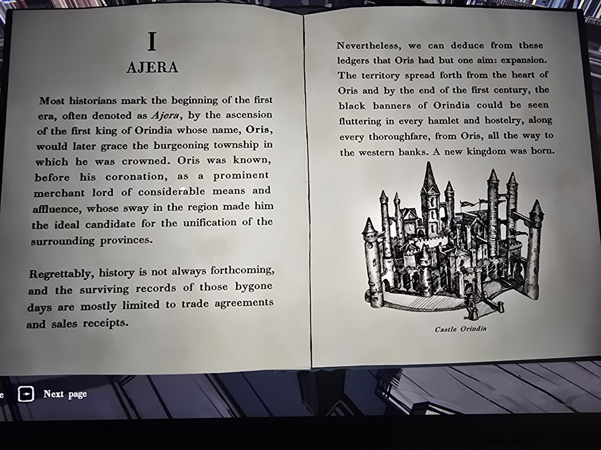
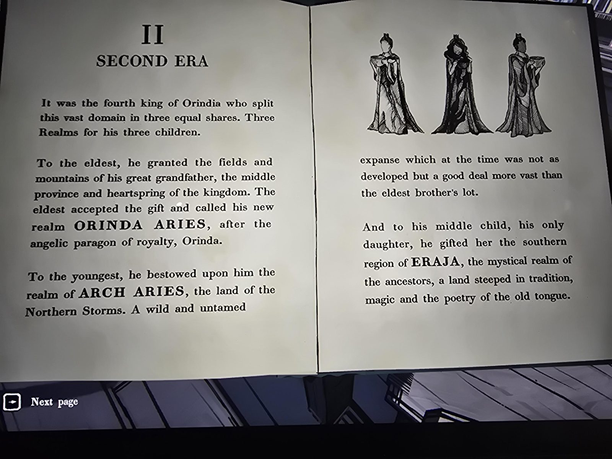
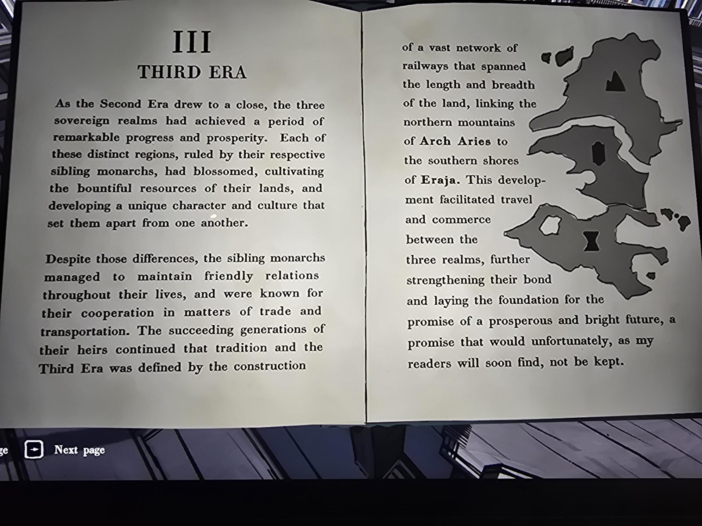
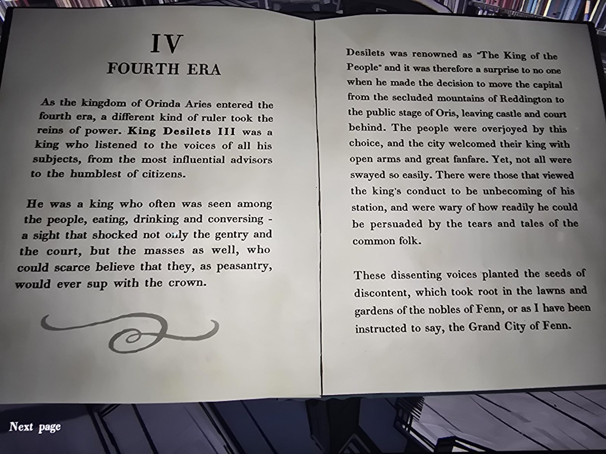
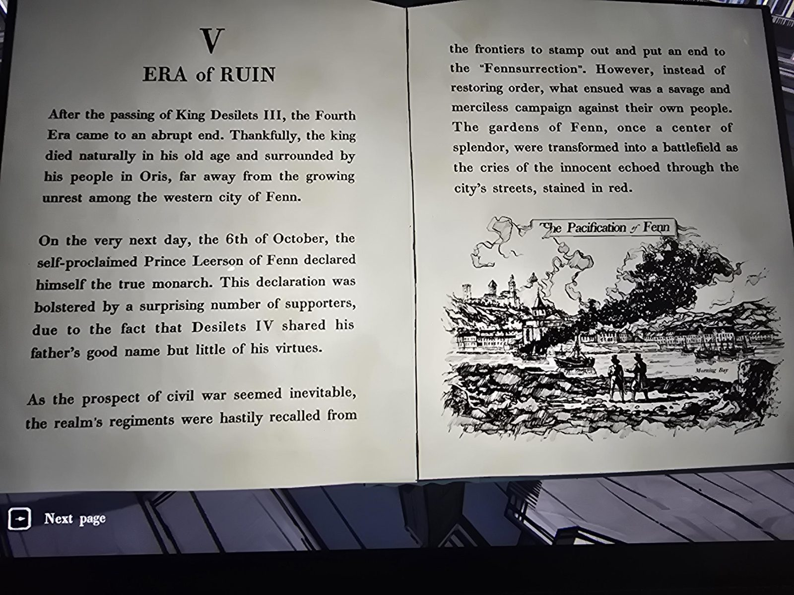
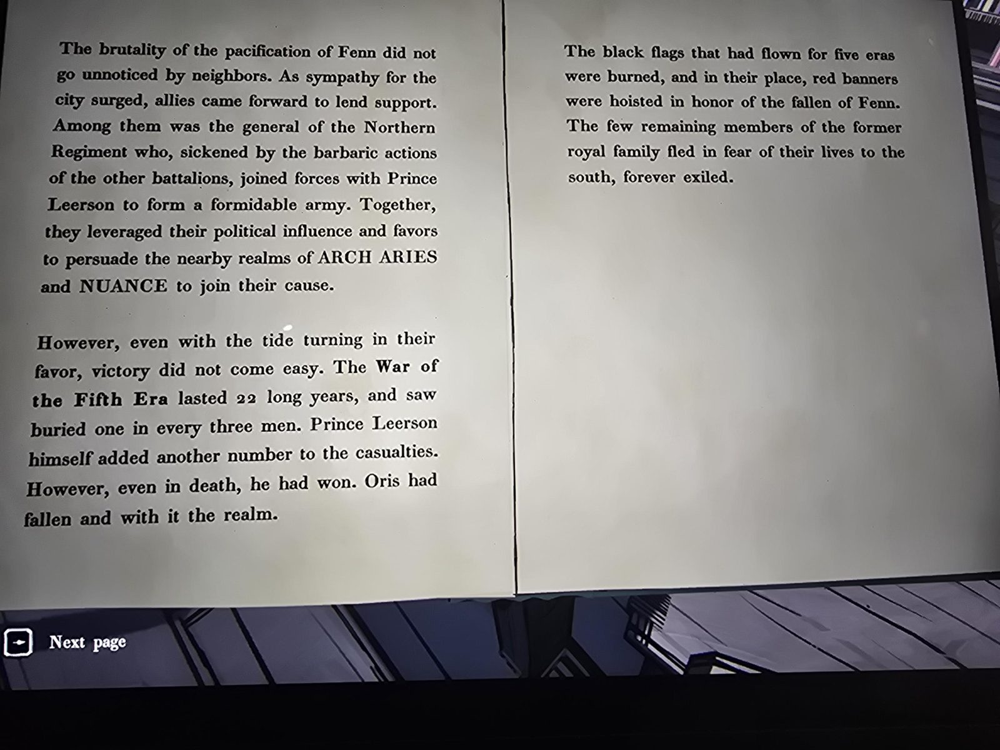
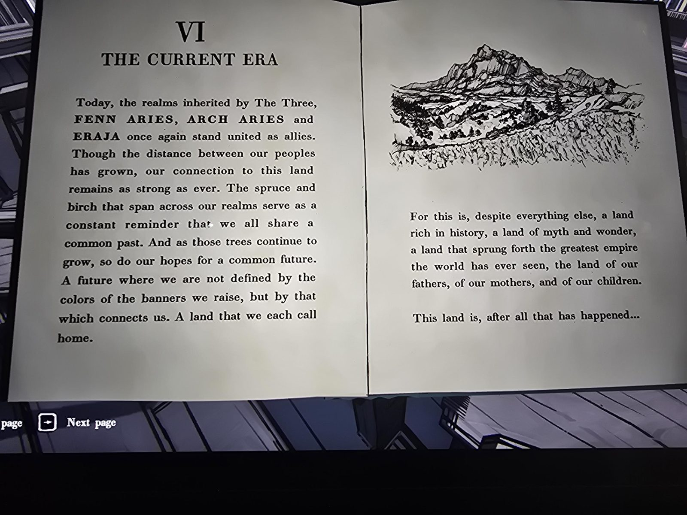
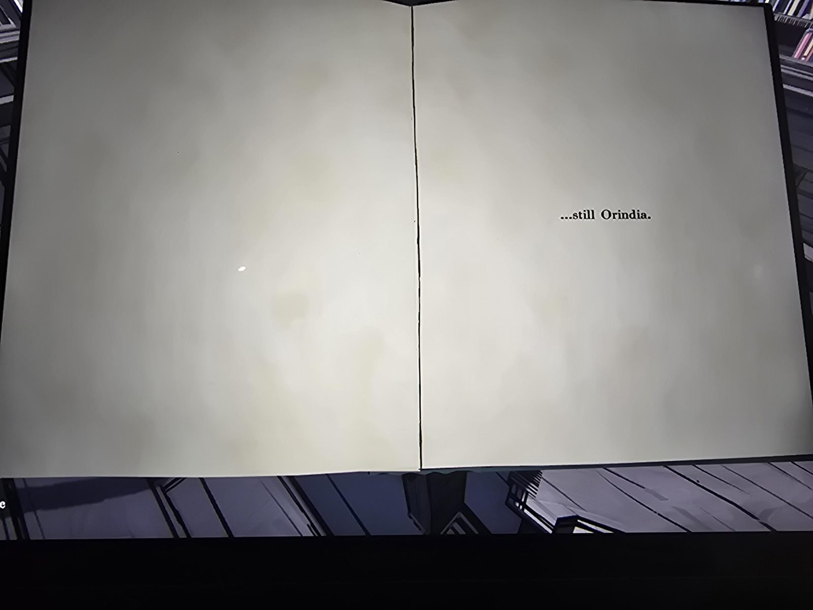

# Книга «The History of Orindia» — первое издание, полная версия (Library)
Калеб Мэннинг, «История Ориндии: от Аджеры до Эраджи», Ruffington Red Publishing, **1979**. Это **полная, неотредактированная версия** книги; отредактированное издание — [здесь](../the-history-of-orindia/ru.md). Куплена в [Bookshop](../../../bookshop/solutions.md), теперь стоит в Library.

## Формуляр и дарственная
В кармашке карточка: автор Manning, Caleb; название The History of Orindia; единственная запись в графе «Borrower» красными чернилами — **Саймон П. Джонс** (дата мелкая, нечитаема). Надпись: «Эта книга была любезно подарена Саймоном П. Джонсом».

## Содержание
- **Foreward (предисловие).** Ориндией когда-то называли царства восточных вод. Термин не употребляется в политике и неизвестен рядовому гражданину, но живёт в сердцах тех, кто родом из этих земель; старшее поколение в узком кругу всё ещё называет себя ориндийцами. «Мы не должны позволить пламени нашей истории угаснуть в шёпотах и не должны позволять лидерам велеть нам отказаться от имени нашей земли». Иллюстрация: корона.
- **I. Аджера (Ajera).** Начало первой эры — воцарение первого короля Ориндии; его имя, **Орис (Oris)**, позже получил город, где его короновали. До коронации — знатный купец-лорд, идеальный кандидат на объединение окрестных провинций. Сохранились лишь торговые договоры и чеки, но из них видно, что цель Ориса — расширение: к концу первого века **чёрные знамёна Ориндии** висели в каждой деревне и трактире, от Ориса до западных берегов. Родилось новое королевство. Иллюстрация: «Castle Orindia».
- **II. Вторая эра.** Четвёртый король разделил владения на три равные доли для трёх детей. Старшему — поля и горы прадеда, срединная провинция и «родник» королевства; он назвал её **ORINDA ARIES** в честь ангельского образца королевской власти, **Orinda**. Младшему — **ARCH ARIES**, земля Северных Бурь, дикая и необжитая, но гораздо обширнее доли старшего. Средней, единственной дочери, — южный **ERAJA**, мистическое царство предков, земля традиций, магии и поэзии старого языка. Иллюстрация: три фигуры в мантиях с чашами.
- **III. Третья эра.** Расцвет трёх царств; правители-родичи дружили, сотрудничали в торговле и транспорте; их наследники продолжили. Эру определило строительство сети железных дорог от северных гор Arch Aries до южных берегов Eraja. Обещание светлого будущего, которое, как скоро узнает читатель, «не будет сдержано». Иллюстрация: карта трёх земель с символами.
- **IV. Четвёртая эра.** В королевстве Orinda Aries правит **Дезилетс III** (Desilets III): слушает всех подданных, ест и пьёт с народом, «Король народа». Он переносит столицу из уединённых гор **Реддингтона** в Орис. Недовольные («поступки недостойны его положения», его легко убедить слезами и рассказами простолюдинов) посеяли семена недовольства в садах знати **Фенна** — «как мне велено говорить, Великого города Фенн».
- **V. Эра Руин.** Дезилетс III умер своей смертью в Орисе; на следующий день, **6 октября**, самопровозглашённый принц **Леерсон из Фенна** объявил себя истинным монархом (Дезилетс IV носил имя отца, но не его добродетели). Полки отозвали с границ подавить «Феннсурекцию», но вместо порядка начался жестокий поход против собственного народа («Умиротворение Фенна», бухта Morning Bay). Генерал Северного полка перешёл к Леерсону; они убедили **ARCH ARIES** и **NUANCE** присоединиться. **22 года** Войны Пятой эры, погиб каждый третий мужчина; Леерсон умер, но «даже в смерти победил: Орис пал, а с ним и королевство». Чёрные флаги пяти эр сожгли, подняли **красные знамёна** в честь павших Фенна; остатки королевской семьи бежали на юг, в вечное изгнание.
- **VI. Нынешняя эра.** Царства «Трёх» — **FENN ARIES, ARCH ARIES и ERAJA** — снова союзники. Ели и берёзы по всем землям напоминают об общем прошлом; будущее — не по цветам знамён, а по тому, что соединяет. Последняя страница: «Эта земля, после всего случившегося… …всё ещё Ориндия.» Иллюстрация: горный пейзаж.

## Заметка
- Отличия от [редакции](../the-history-of-orindia/ru.md): здесь целиком даны имена Орис, Reddington, «Король народа», Orinda Aries, Orinda (ангел), предисловие и последняя страница.

## Photos / Фото
01 — титул и формуляр; 02 — Foreward; 03 — I; 04 — II; 05 — III; 06 — IV; 07–08 — V; 09 — VI; 10 — последняя страница.

