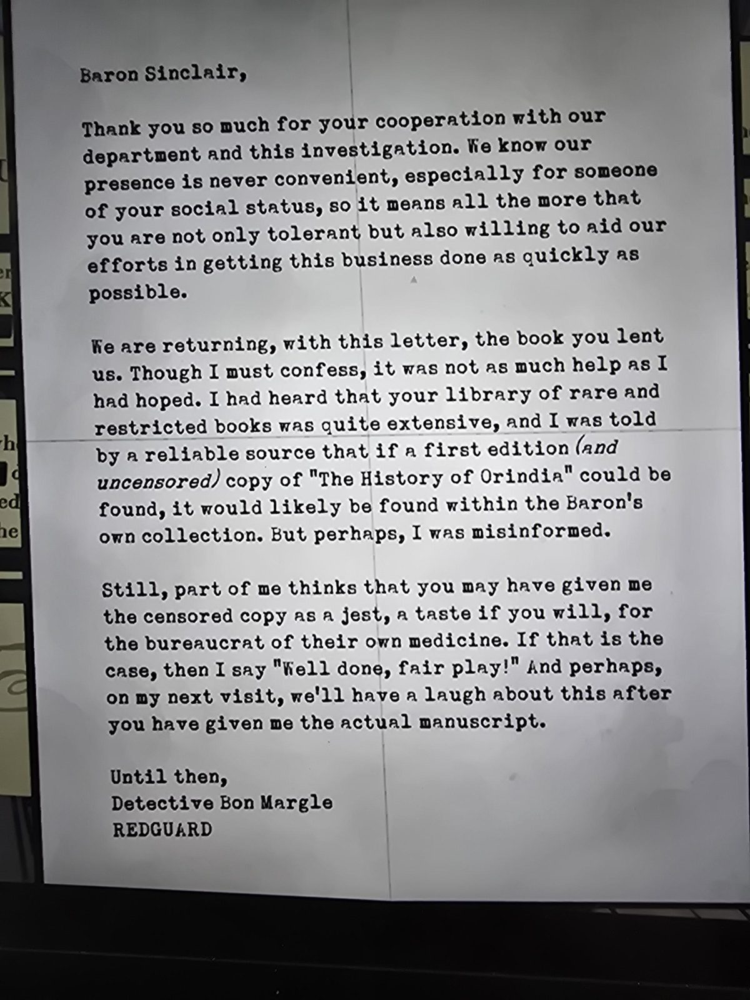

# Письмо детектива Бона Маргла барону Синклеру
К книге [«The History of Orindia»](../ru.md). Где найдено — пока не записано.

Маргл (**REDGUARD**) благодарит барона за содействие расследованию и **возвращает книгу**, которую барон ему одолжил: она оказалась не такой полезной, как он надеялся. Ему говорили, что в личной коллекции барона должен быть **первый, нецензурированный экземпляр** «Истории Ориндии» — «но, возможно, меня неверно информировали». Он подозревает, что барон нарочно дал цензурированный экземпляр в шутку («дать бюрократам их же лекарство»): «Отлично сыграно!». В следующий визит они посмеются — «после того как вы отдадите мне настоящую рукопись».

## Заметка
- В формуляре Маргл брал книгу 2 марта и 3 сентября 1987 — вероятно, это те самые визиты.
- Открыто: где **настоящий первый экземпляр / рукопись** (в коллекции барона?).

## Photos / Фото

