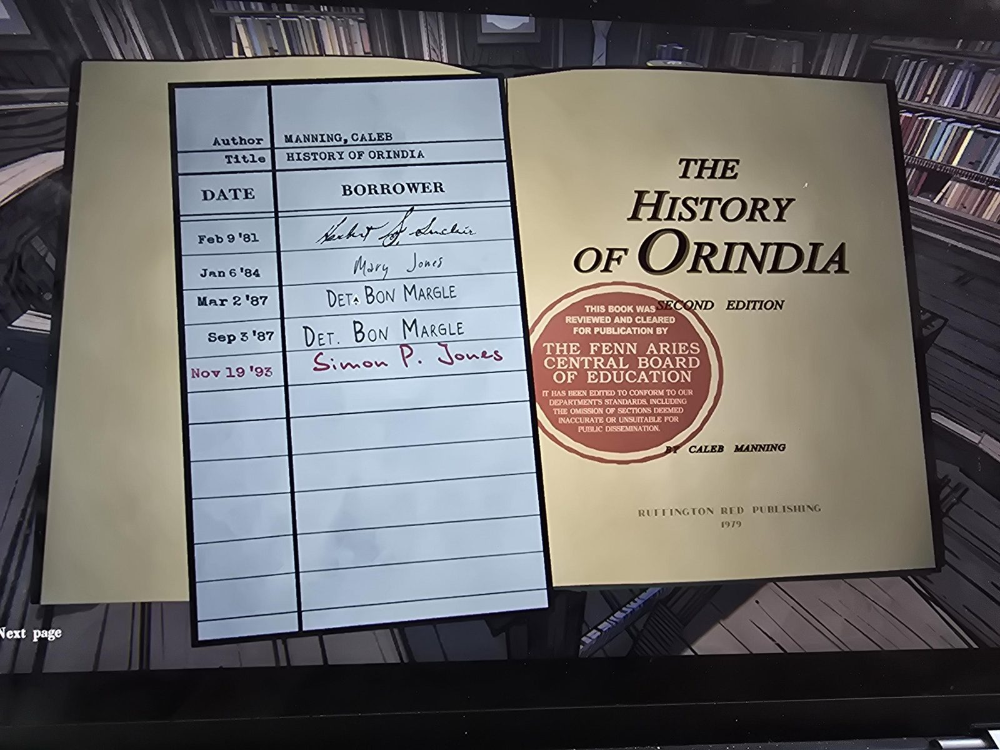
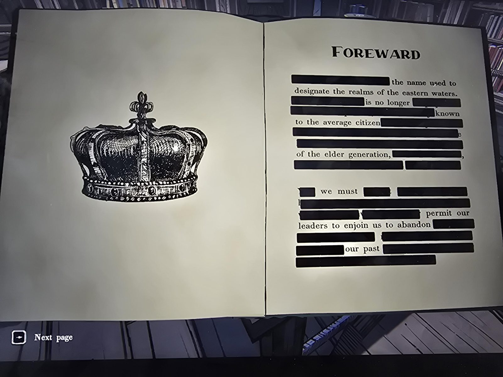
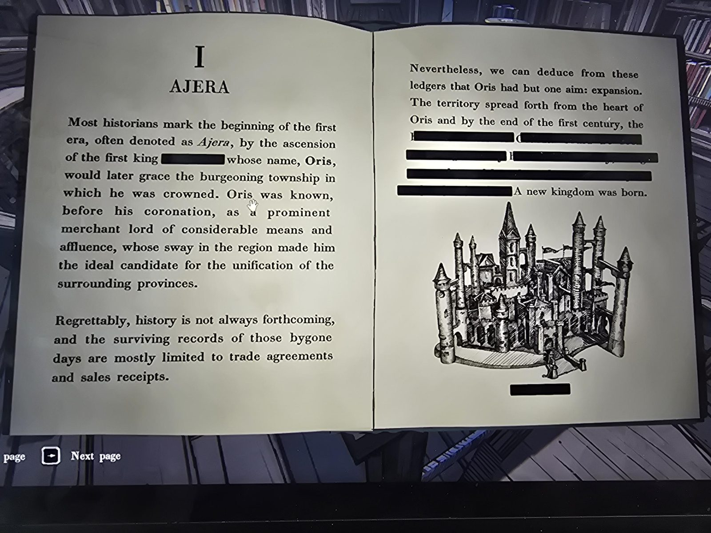
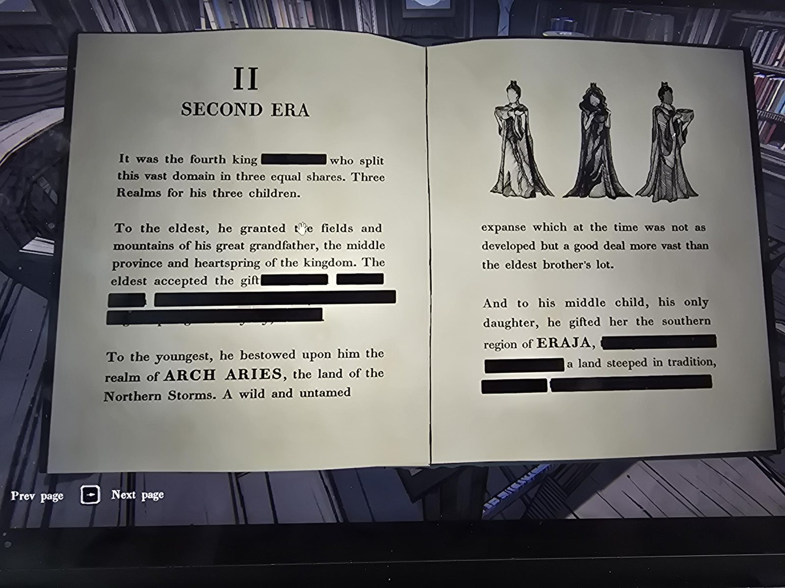
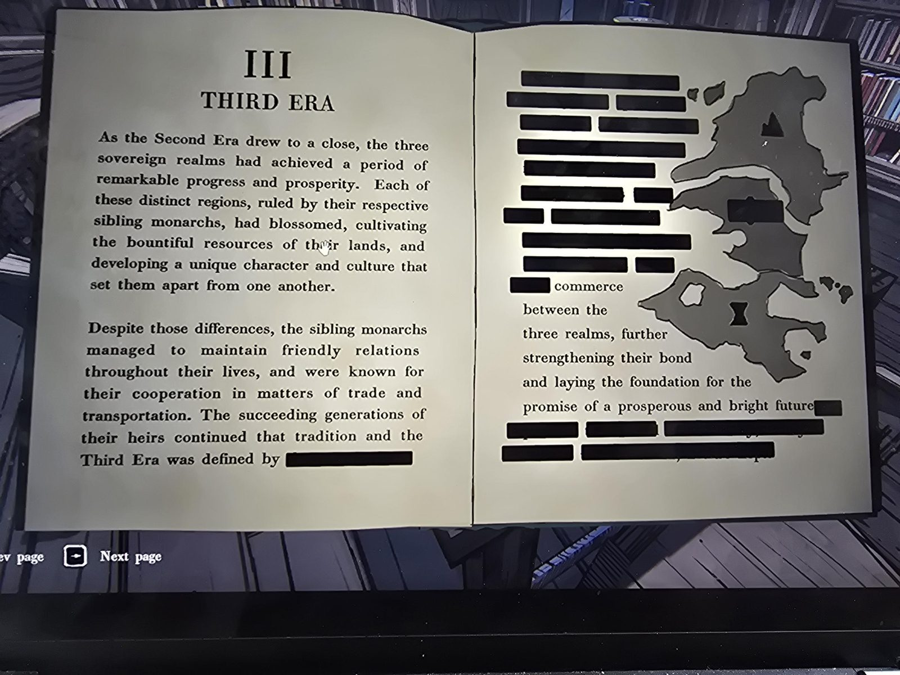
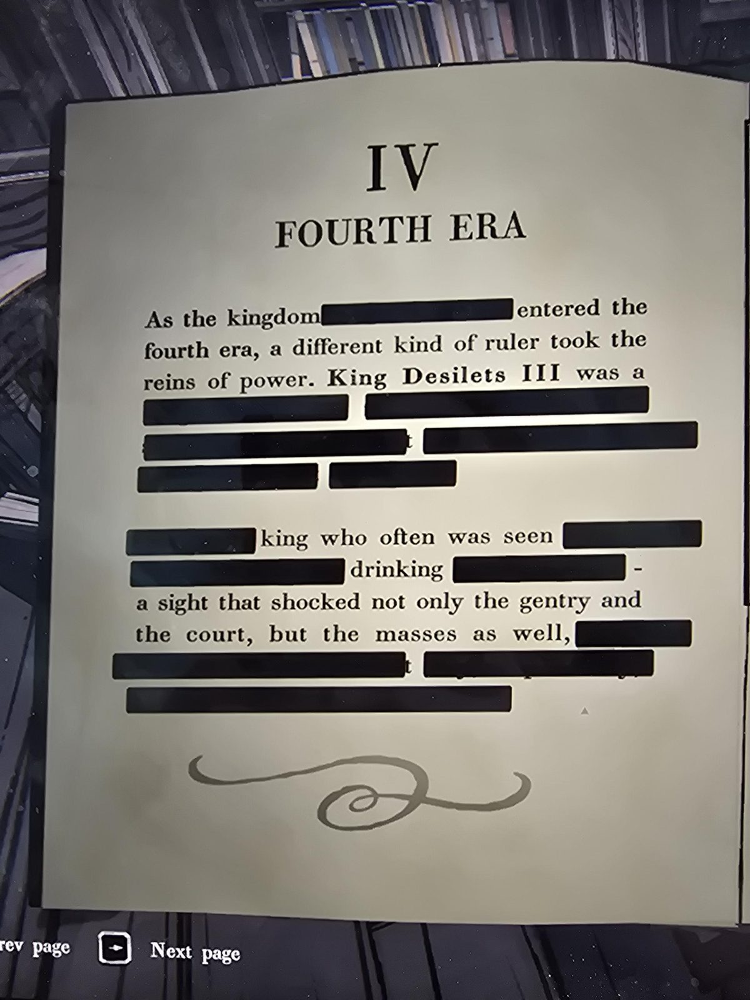
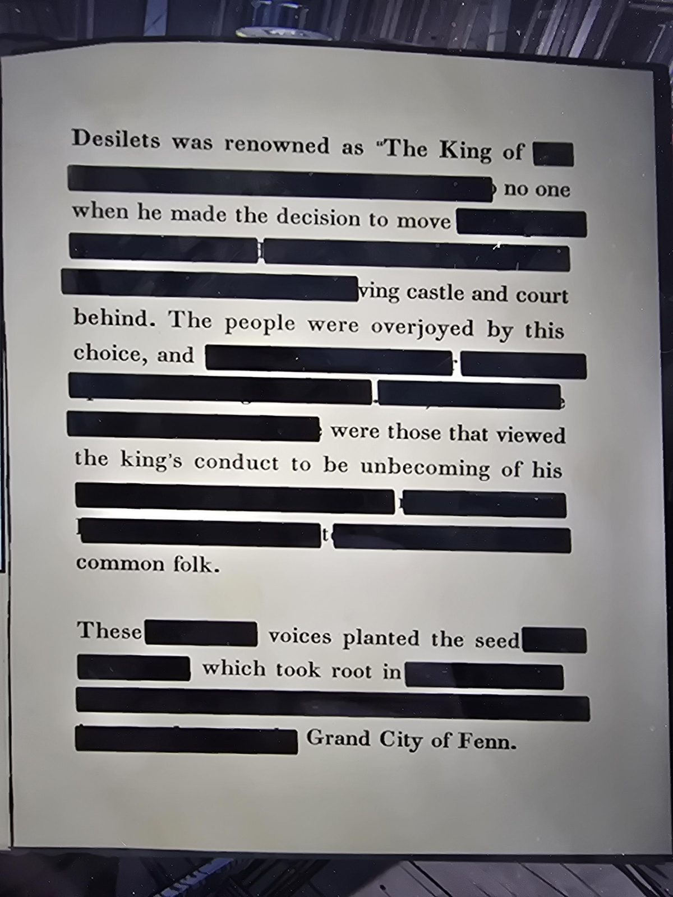
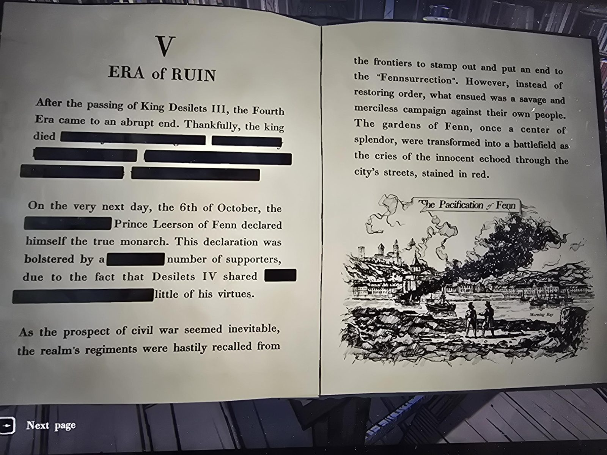
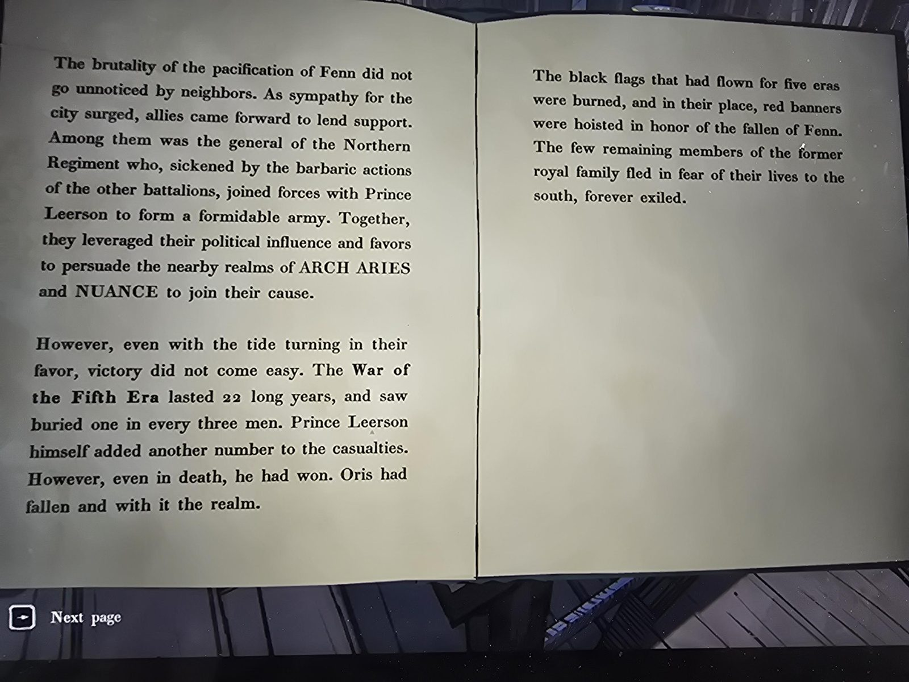

# Книга «The History of Orindia» (Library)
Калеб Мэннинг, «История Ориндии», **второе издание**, Ruffington Red Publishing, **1979**. Красный штамп: книга одобрена Центральным советом образования Fenn Aries и **отредактирована** — убраны разделы, признанные «неточными или непригодными для публичного распространения». Поэтому большая часть текста зачёркнута. **Полная версия этой книги:** [первое издание](../the-history-of-orindia-first-edition/ru.md).
Письмо детектива Маргла к этой книге — [рядом](letter-margle/ru.md).

## Формуляр
| Дата | Кто брал |
|---|---|
| 9 фев 1981 | Герберт С. Синклер (подпись) |
| 6 янв 1984 | Мэри Джонс |
| 2 мар 1987 | Дет. Бон Маргл |
| 3 сен 1987 | Дет. Бон Маргл |
| 19 ноя 1993 | Саймон П. Джонс (красные чернила) |

## Содержание (видимое)
- **Предисловие** — почти всё закрашено: название земель «восточных вод» уже не знакомо рядовому гражданину; «нам не следует позволять лидерам заставлять нас отказываться от нашего прошлого».
- **I. Эра Аджера (Ajera).** Первый король (имя закрашено), по имени которого назван город **Орис (Oris)**, — до коронации богатый купец-лорд, объединивший окрестные провинции. Сохранились в основном торговые договоры и чеки. Цель Ориса — расширение; к концу первого века родилось новое королевство.
- **II. Вторая эра.** Четвёртый король разделил владения на три царства для трёх детей: старшему — поля и горы прадеда, срединную провинцию (названия закрашены); младшему — **ARCH ARIES**, земля Северных Бурь, дикая, необжитая, но обширная; средней, единственной дочери, — южный **ERAJA**, «земля, наполненная традициями». Иллюстрация: три фигуры в мантиях.
- **III. Третья эра.** Три царства процветали под правлением братьев и сестры, дружили, сотрудничали в торговле и транспорте; их наследники продолжили это. Карта трёх земель.
- **IV. Четвёртая эра.** Король **Дезилетс III** (Desilets) — необычный правитель, которого видели пьющим (шок для двора и простого народа); известен как «Король […]»; уехал, оставив замок и двор; народ радовался, но были и те, кто счёл это недостойным. Эти голоса «посеяли семя» в Великом городе **Фенн**.
- **V. Эра Руин.** После смерти Дезилетса III 6 октября принц **Леерсон из Фенна** объявил себя истинным монархом (Дезилетс IV мало походил на отца). Полки отозвали с границ давить «Феннсурекцию», но вместо порядка начали жестокую расправу над собственным народом («Умиротворение Фенна»). Генерал Северного полка перешёл к Леерсону, к ним присоединились **ARCH ARIES** и **NUANCE**. Война Пятой эры длилась **22 года**, погиб каждый третий мужчина, Леерсон умер, но «даже в смерти победил: Орис пал, а с ним и королевство». Чёрные флаги пяти эр сожгли, подняли **красные знамёна** в честь павших Фенна; остатки королевской семьи бежали на юг, в вечное изгнание.

## Заметка
- Транскрипция последней страницы местами приблизительная — сверить по фото 09.
- Красные знамёна и «Красная гвардия» — вероятно, продолжение этой истории ([газетные вырезки](../../../archives/docs/newspaper-clippings-album/ru.md), [timeline](../../../../story/timeline.md)). Сам Мэннинг — писатель, друг Мэри, арестованный Красной гвардией.
- Маргл брал книгу дважды в 1987; Мэри — в 1984.

## Photos / Фото
01 — титул и формуляр; 02 — предисловие; 03 — I; 04 — II; 05 — III; 06–07 — IV; 08–09 — V.

