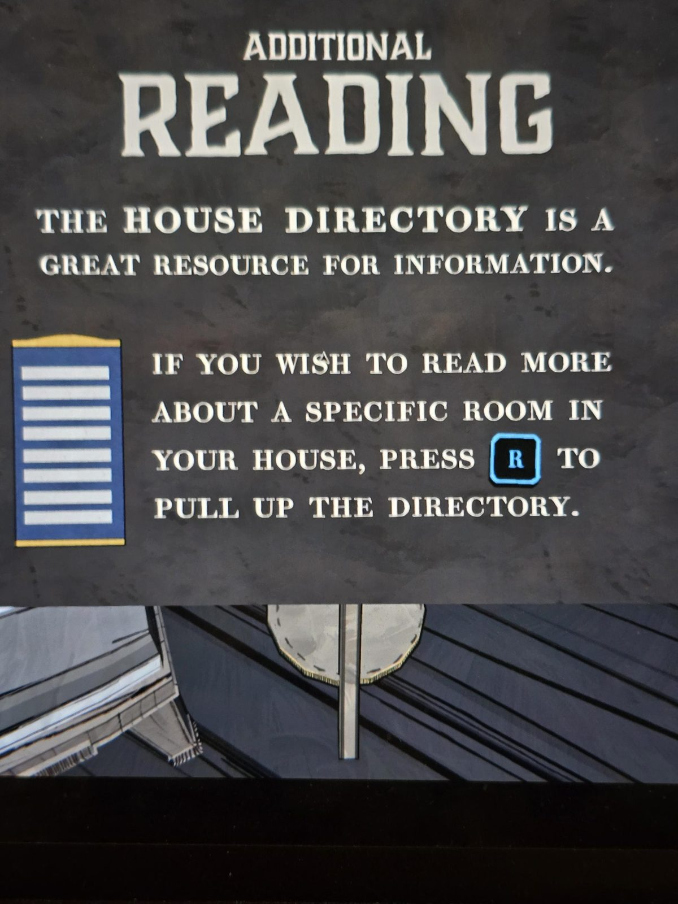

# Табличка-обучение: «Дополнительное чтение»
Табличка в Library.

**ДОПОЛНИТЕЛЬНОЕ ЧТЕНИЕ**

**СПРАВОЧНИК ДОМА (HOUSE DIRECTORY)** — отличный источник информации.

ЧТОБЫ ПРОЧИТАТЬ ПОДРОБНЕЕ О КОНКРЕТНОЙ КОМНАТЕ В ДОМЕ, НАЖМИ **[R]** И ОТКРОЙ СПРАВОЧНИК.

## Заметка
- Клавиша **R** — справочник по всем комнатам (описания и эффекты).

## Photos / Фото

