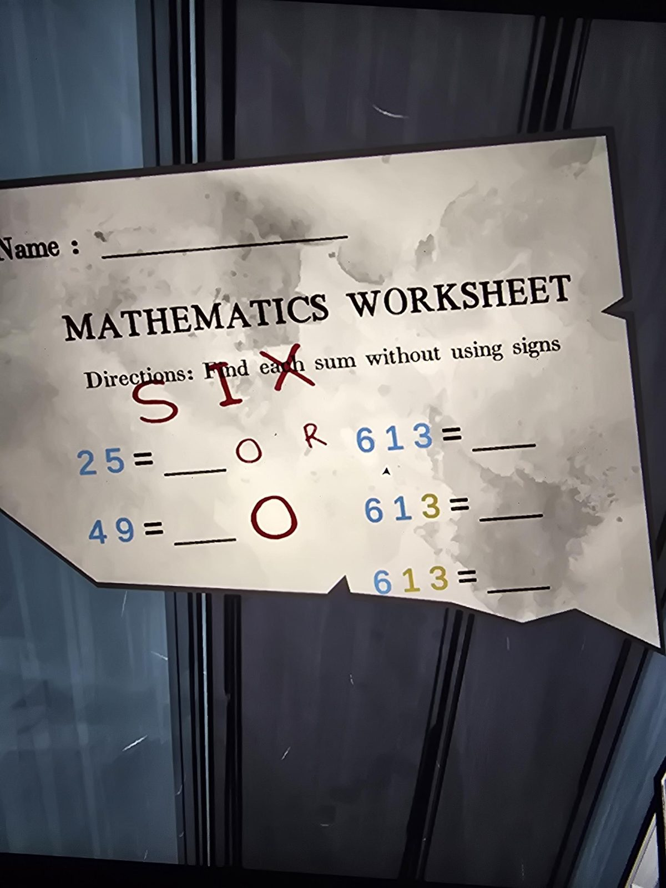

# Математический лист: «найди сумму без знаков»
Locker Room. «Mathematics Worksheet. Directions: Find each sum without using signs» («найди каждую сумму, не используя знаки»). Цвет цифры задаёт действие, как в [Grade 2 Classroom](../../../classroom/solutions.md).

| Пример | Цвета цифр |
|---|---|
| 25 | синие |
| 49 | синие |
| 613 | все синие |
| 613 | 6, 1 синие; 3 жёлтая |
| 613 | 6 синяя; 1, 3 жёлтые |

Красным от руки: **SIX** поверх «Find each», рядом с первой строкой буквы **O**, **R**, у второй строки крупная **O**.

## Photos / Фото

