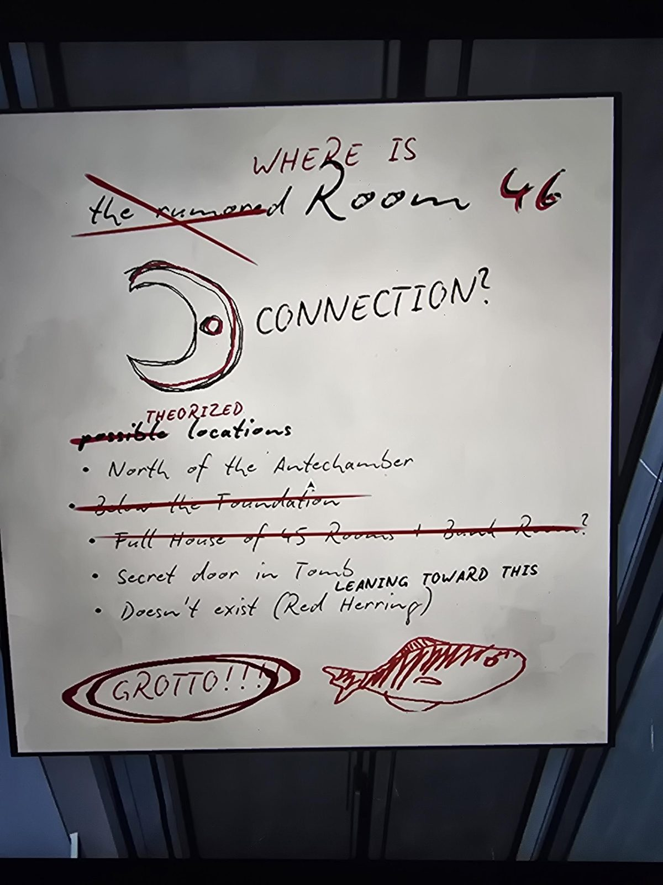

# Доска: где Room 46
Locker Room. Рукописная доска; чёрный текст дополнен и исправлен красным.

**ГДЕ ~~слухами окружённая~~ Room 46** (красным «WHERE IS» и «46», «the rumored» зачёркнуто).
- Рисунок: полумесяц с точкой, подпись **CONNECTION?** (связь).
- **Предполагаемые** (red: «theorized», слово «possible» зачёркнуто) места:
  - к северу от Antechamber;
  - ~~под Foundation~~ (зачёркнуто);
  - ~~полный дом из 45 комнат + задняя комната?~~ (зачёркнуто);
  - тайная дверь в Tomb: красным **«склоняюсь к этому»**;
  - не существует (красная селёдка / «Red Herring»).
- Красным в овале: **GROTTO!!!** и рисунок рыбы (красная селёдка).

## Заметка
- Красные пометки рукописные.
- См. [Room 46](../../../room-46/solutions.md), [Antechamber](../../../antechamber/solutions.md), [Tomb](../../../tomb/solutions.md), [Blackbridge Grotto](../../../blackbridge-grotto/solutions.md).

## Photos / Фото

