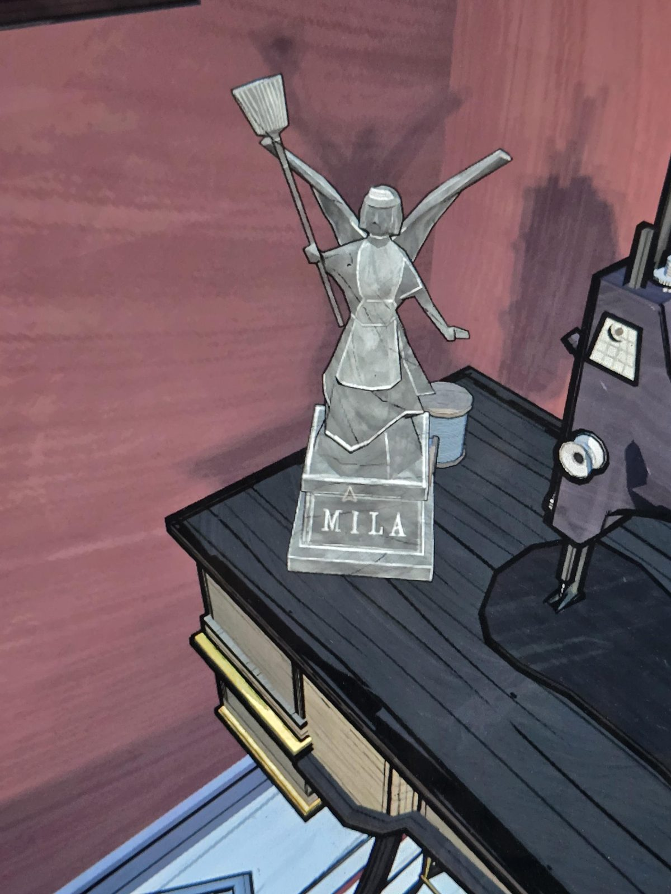

# Статуэтка «MILA»
Статуэтка на столе у швейной машинки в Maid's Chamber: крылатая горничная с метлой в поднятой руке. На постаменте: **MILA**.

## Заметка
- Горничная с метлой и крыльями похожа на витраж **V** в [Chapel](../../../chapel/docs/stained-glass/ru.md). Возможно, витражи изображают реальных слуг, и горничная — это **Мила**.

## Photos / Фото

