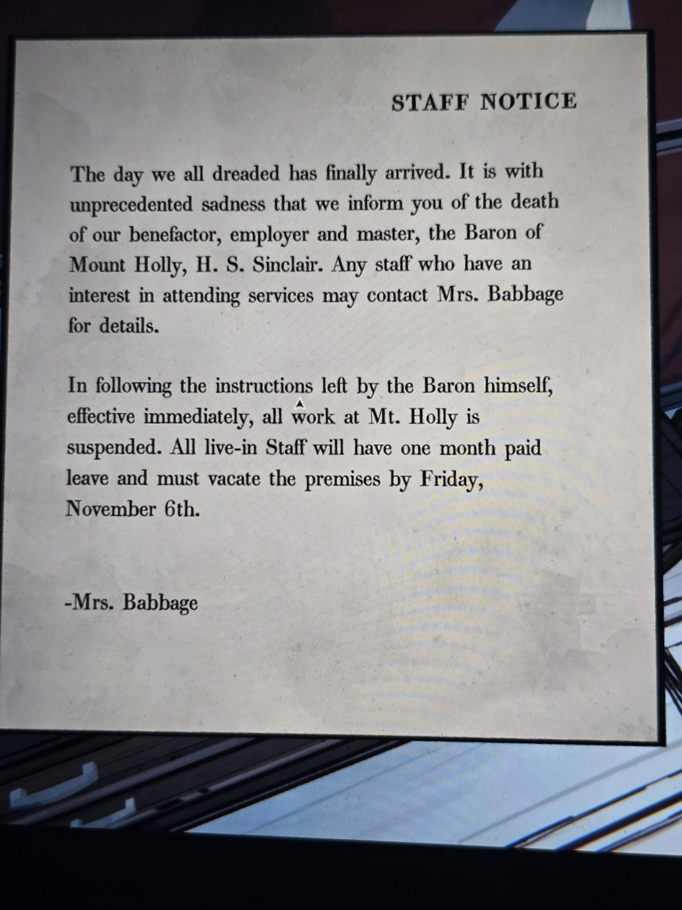

# Объявление для персонала: смерть барона
Лист в Maid's Chamber.

**ОБЪЯВЛЕНИЕ ДЛЯ ПЕРСОНАЛА**

День, которого мы все боялись, наконец настал. С беспримерной скорбью сообщаем о смерти нашего благодетеля, работодателя и хозяина, **барона Маунт-Холли, Х. С. Синклера**. Желающие присутствовать на похоронах могут обратиться за подробностями к миссис Бэббидж.

Согласно указаниям, оставленным самим бароном, с этого момента вся работа в Маунт-Холли **приостанавливается**. Весь проживающий персонал получает месяц оплачиваемого отпуска и должен покинуть поместье **до пятницы, 6 ноября**.

— Миссис Бэббидж

## Заметка
- Герберт умер незадолго до **пятницы 6 ноября** (год не указан). Поэтому в доме нет прислуги, когда приезжает Саймон.
- Герберт — **барон Маунт-Холли**.

## Photos / Фото

