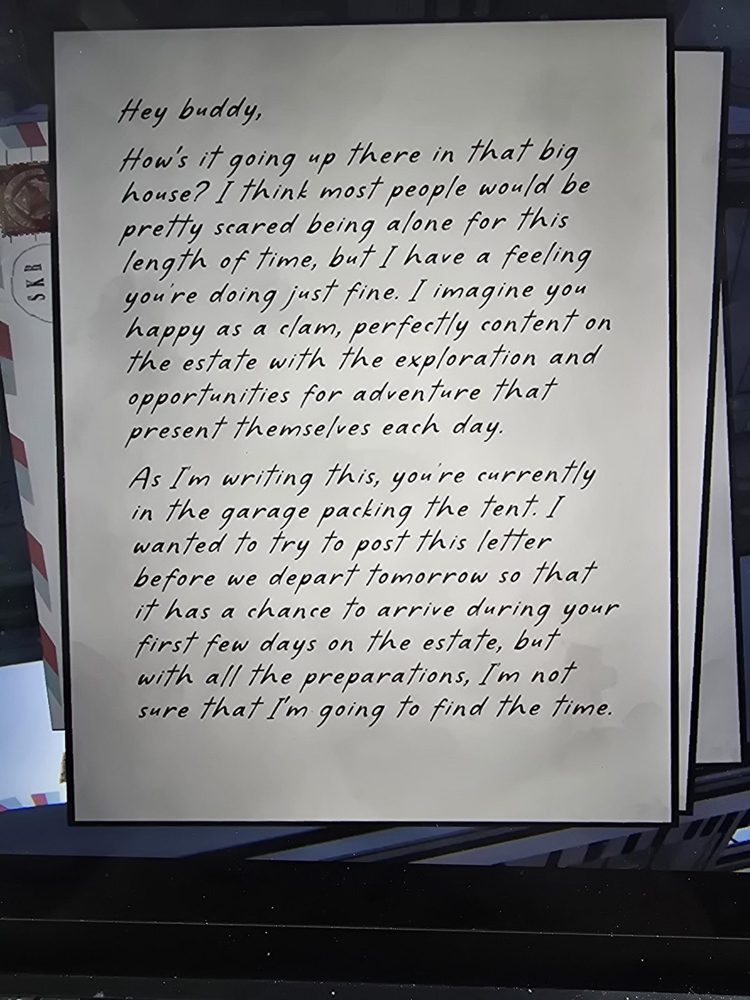
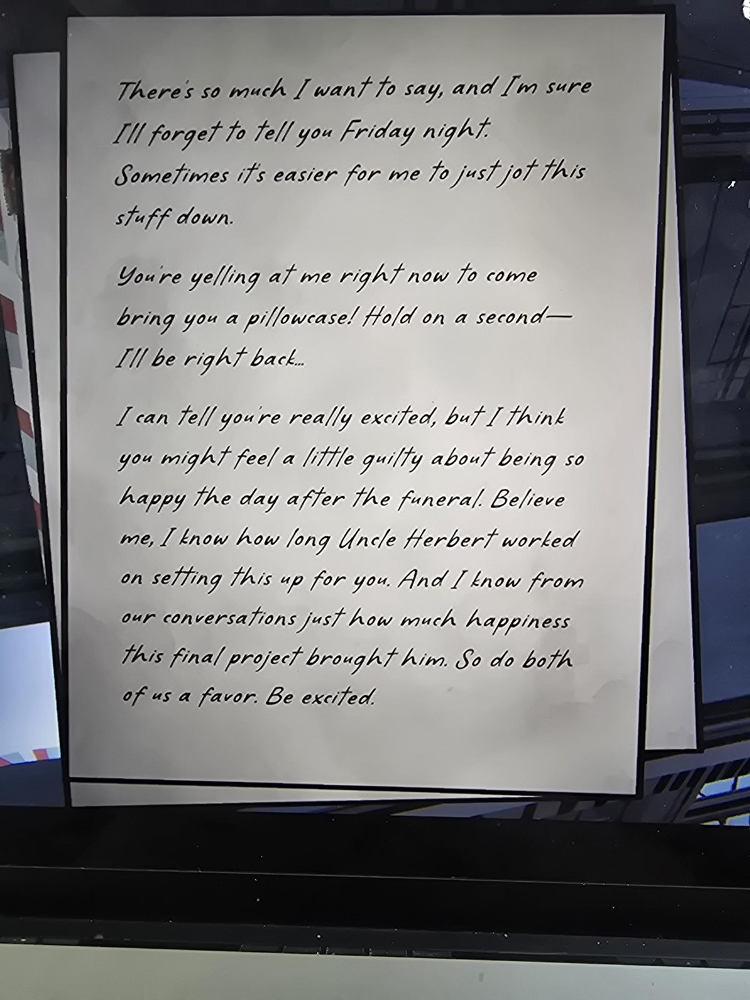
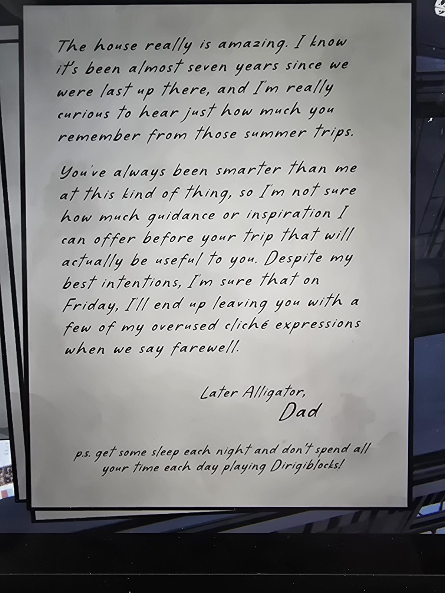

Hey buddy,

How's it going up there in that big house? I think most people would be pretty scared being alone for this length of time, but I have a feeling you're doing just fine. I imagine you happy as a clam, perfectly content on the estate with the exploration and opportunities for adventure that present themselves each day.

As I'm writing this, you're currently in the garage packing the tent. I wanted to try to post this letter before we depart tomorrow so that it has a chance to arrive during your first few days on the estate, but with all the preparations, I'm not sure that I'm going to find the time.

There's so much I want to say, and I'm sure I'll forget to tell you Friday night. Sometimes it's easier for me to just jot this stuff down.

You're yelling at me right now to come bring you a pillowcase! Hold on a second— I'll be right back...

I can tell you're really excited, but I think you might feel a little guilty about being so happy the day after the funeral. Believe me, I know how long Uncle Herbert worked on setting this up for you. And I know from our conversations just how much happiness this final project brought him. So do both of us a favor. Be excited.

The house really is amazing. I know it's been almost seven years since we were last up there, and I'm really curious to hear just how much you remember from those summer trips.

You've always been smarter than me at this kind of thing, so I'm not sure how much guidance or inspiration I can offer before your trip that will actually be useful to you. Despite my best intentions, I'm sure that on Friday, I'll end up leaving you with a few of my overused cliché expressions when we say farewell.

Later Alligator,
Dad

p.s. get some sleep each night and don't spend all your time each day playing Dirigiblocks!

## Photos / Фото

