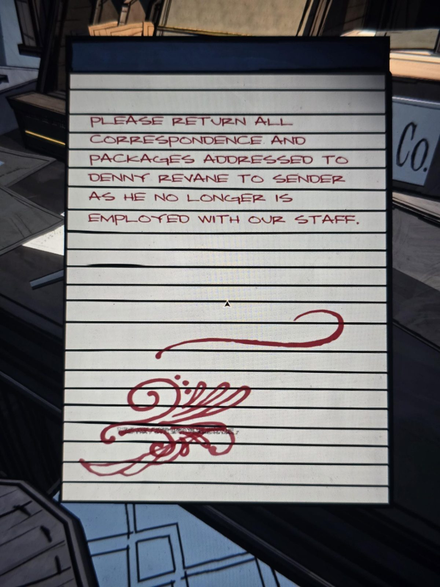
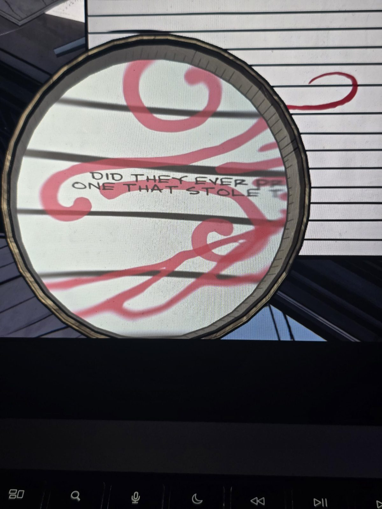
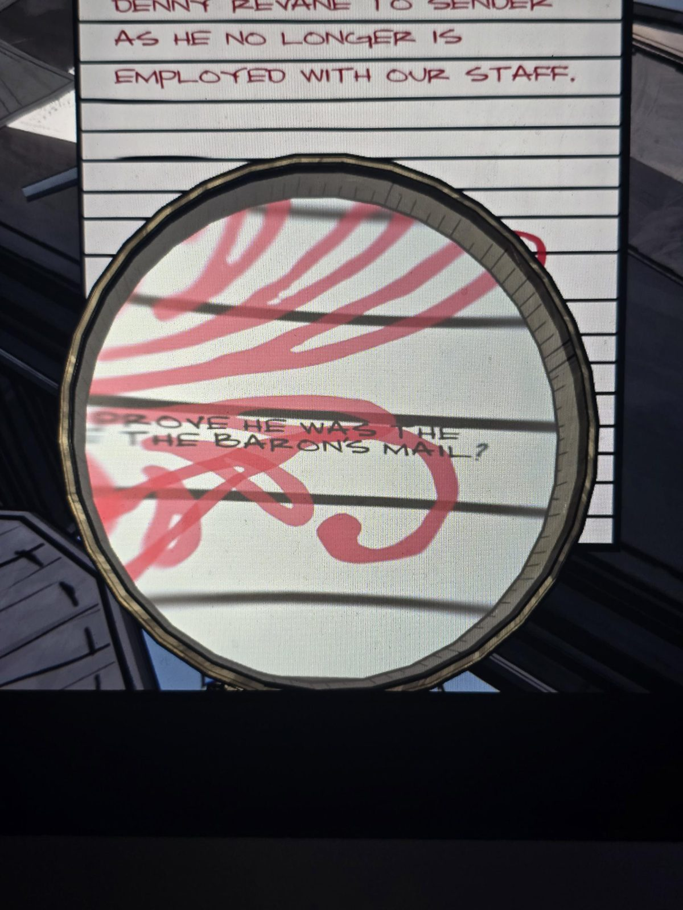

# Записка про Денни Ревейна (+ скрытый текст)
Блокнот в Mail Room, текст красным.

ВСЮ КОРРЕСПОНДЕНЦИЮ И ПОСЫЛКИ НА ИМЯ **ДЕННИ РЕВЕЙНА** ПРОСЬБА ВОЗВРАЩАТЬ ОТПРАВИТЕЛЮ, ТАК КАК ОН БОЛЬШЕ НЕ РАБОТАЕТ В НАШЕМ ШТАТЕ.

*Под красными завитушками мелкий чёрный текст (через лупу):*

**ТАК ДОКАЗАЛИ ЛИ, ЧТО ЭТО ОН УКРАЛ ПОЧТУ БАРОНА?**

## Заметка
- **Денни Ревейн** — бывший сотрудник, уволен; подозревался в краже почты барона. Ср. [письмо вымогателя X](../../../office/docs/x-parting-letter-red-infinity/ru.md): красные письма украли у Герберта. Возможно, Денни — один из X (догадка).
- Красный текст сверху, чёрный мелкий снизу.

## Photos / Фото

