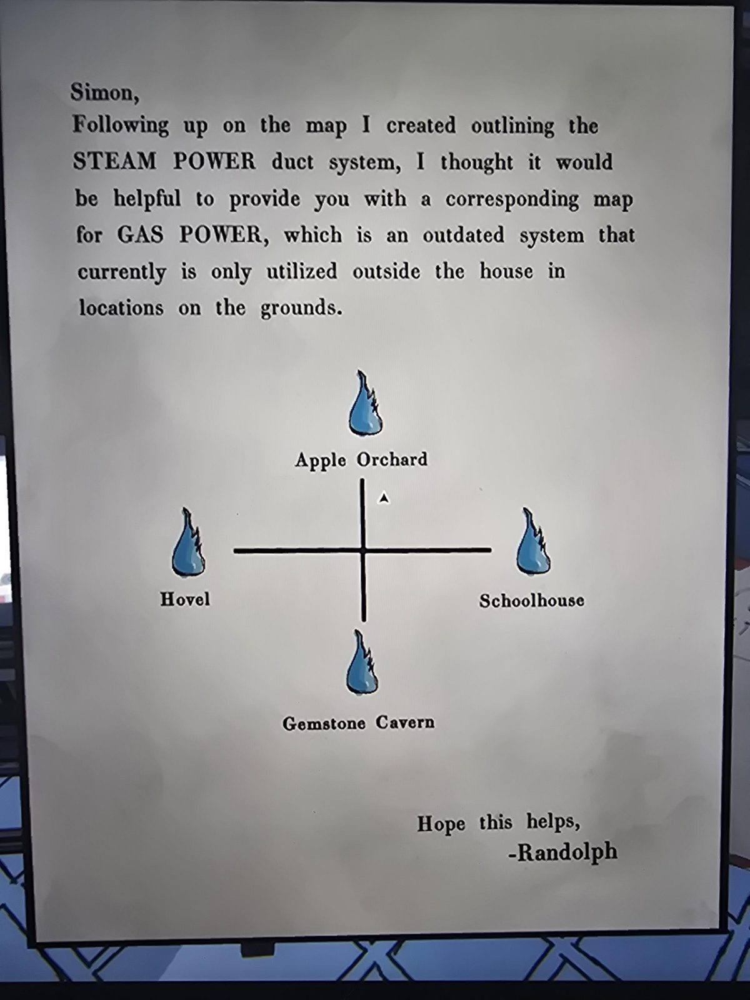

# Письмо Рэндольфа: карта газового питания (Gas Power)
Mail Room.

«Саймон, вслед за картой паровых каналов (STEAM POWER) подумал, что полезна будет и соответствующая карта **GAS POWER**: это устаревшая система, которая сейчас используется только **вне дома, на территории (grounds)**. Надеюсь, поможет. — Рэндольф»

**Схема:** крест с синим пламенем на каждом конце: **сверху Apple Orchard, слева Hovel, справа Schoolhouse, снизу Gemstone Cavern**.

## Заметка
- Четыре места совпадают с вентилями газа в [четырёх огнях](../../../../puzzles/gas-flames.md) (там Gemstone Cavern, Apple Orchard, Hovel, Schoolhouse). Положение на схеме (крест) возможно соответствует расположению огней; не проверено.

## Photos / Фото

