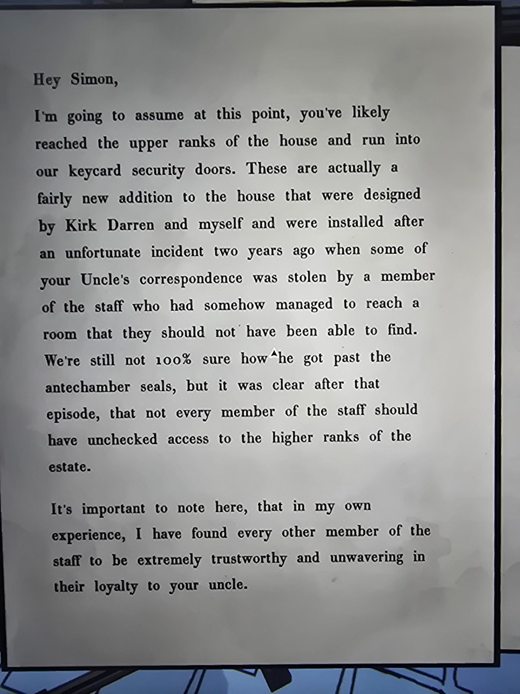
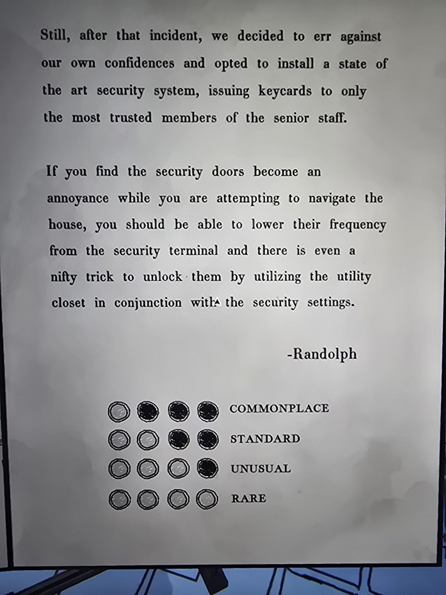

# Письмо Рэндольфа: двери с карточками (Keycard Security Doors)
Mail Room. Два листа.

«Привет, Саймон. Полагаю, ты уже добрался до верхних «рангов» дома и наткнулся на наши **двери с карточками**. Это сравнительно новое дополнение, спроектированное **Кирком Дарреном** и мной, установленное после неприятного случая **два года назад**: кто-то из персонала сумел дойти до комнаты, которую не должен был найти, и украл часть переписки твоего дяди. Мы до сих пор не уверены, как он прошёл **печати Antechamber**; после этого стало ясно, что не у каждого сотрудника должен быть неограниченный доступ в верхние ранги поместья.

Остальных сотрудников я считаю очень надёжными и верными твоему дяде.

Тем не менее мы поставили современную систему безопасности, а **карточки выдали только самым доверенным старшим сотрудникам**.

Если двери мешают, ты можешь **снизить их частоту** на **терминале Security**; есть и «хитрый приём» открывать их через **Utility Closet** вместе с настройками безопасности. — Рэндольф»

**Схема (4 строки по 4 кружка):** COMMONPLACE ○●●●, STANDARD ○○●●, UNUSUAL ○○○●, RARE ○○○○ (● = закрашенный). Как это читать (вероятно, чем реже комната, тем меньше закрашенных/«заполненных» кружков), в письме не сказано; **догадка, не проверено**.

## Заметка
- Связаны [Security](../../../security/solutions.md) (терминал, настройки частоты дверей) и [Utility Closet](../../../utility-closet/solutions.md) (щиток), [инструкция DCPOWER](../randolph-vac-instructions/ru.md).
- «Печати Antechamber» ср. [Antechamber](../../../antechamber/solutions.md).
- Как именно разблокировать двери через Utility Closet, пока не записано.

## Photos / Фото
 
