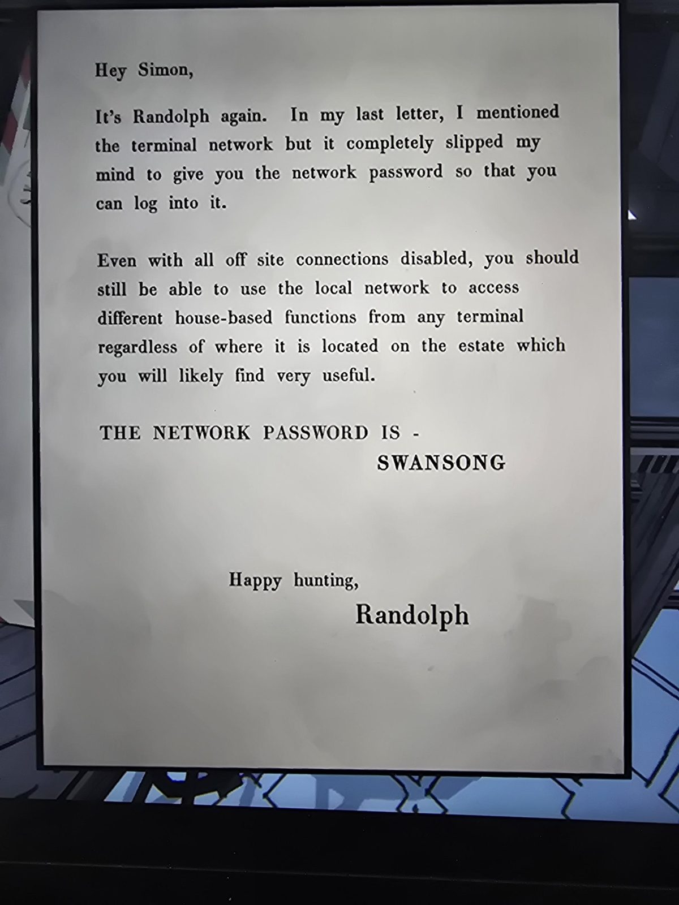

# Второе письмо Рэндольфа: пароль сети
Ещё одно письмо в Mail Room, после [первого](../randolph-moore-letter/ru.md).

Привет, Саймон,

Это снова Рэндольф. В прошлом письме я упомянул терминальную сеть, но совершенно забыл дать тебе **пароль сети**, чтобы ты мог войти.

Даже при отключённых внешних соединениях ты всё равно сможешь использовать **локальную сеть** и с любого терминала в поместье получать доступ к разным функциям дома — наверняка найдёшь это очень полезным.

**ПАРОЛЬ СЕТИ — SWANSONG**

Удачной охоты,
Рэндольф

## Заметка
- Пароль **SWANSONG** ✅ проверен в игре (терминалы Laboratory, Office). Это письмо — второе подтверждение: раньше пароль был найден на [объявлении в Security](../../../security/docs/staff-notice-terminals/ru.md) через лупу.
- Терминалы дают доступ к «функциям дома» через локальную сеть из любого места.

## Photos / Фото

