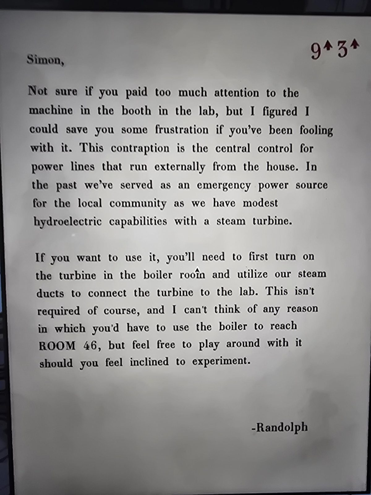

# Третье письмо Рэндольфа: линии электропередачи
Письмо в Mail Room, после [первого](../randolph-moore-letter/ru.md) и [второго](../randolph-letter-2-password/ru.md). В правом верхнем углу красным: **9↑ 3↑**.

Саймон,

Не уверен, обратил ли ты внимание на машину в кабинке в лаборатории, но решил избавить тебя от лишней досады, если ты с ней возился. Эта штуковина — **центральное управление линиями электропередачи, идущими из дома наружу**. Раньше мы служили **аварийным источником энергии для местного сообщества**: у нас скромная **гидроэлектрическая** мощность с **паровой турбиной**.

Чтобы ею воспользоваться, нужно сначала **включить турбину в Boiler Room** и **паровыми каналами соединить турбину с лабораторией**. Это, конечно, не обязательно, и я не могу придумать, зачем бы тебе понадобился бойлер, чтобы добраться до **ROOM 46**, но если захочется поэкспериментировать, не стесняйся.

— Рэндольф

## Заметка
- Речь о машине в кабинке [Laboratory](../../../laboratory/solutions.md) и красном блоке [Boiler Room](../../../boiler-room/solutions.md): питание лаборатории от котельной.
- Красная пометка **9↑ 3↑** совпадает с уже найденным в Laboratory решением «**push three up after nine**» (рычаги 9, затем 3), см. [Laboratory](../../../laboratory/solutions.md). Здесь это только запись на письме, про рычаги в тексте ничего нет.
- Рэндольф намекает, что до **комнаты 46** можно добраться и без котельной: запись про это письмо в других местах не найдена. Питание от котельной: [boiler-power](../../../../puzzles/boiler-power.md).

## Photos / Фото

