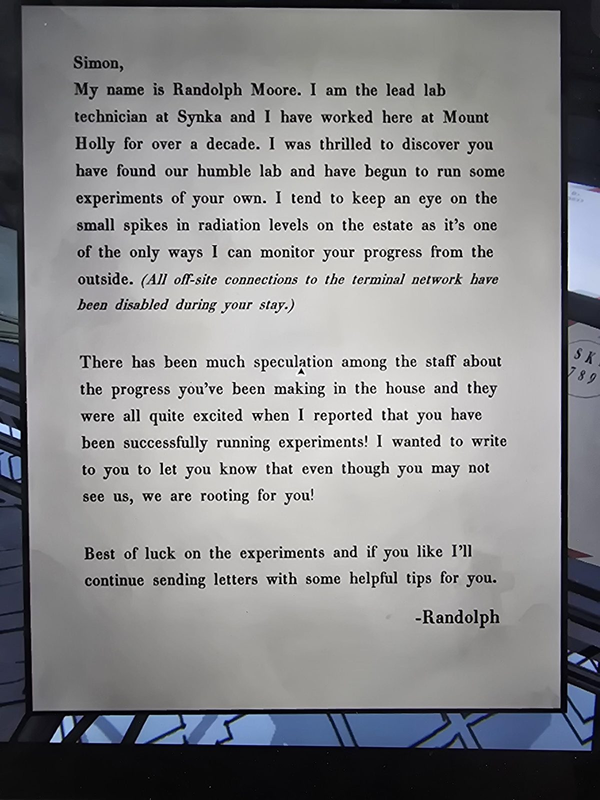

# Письмо Рэндольфа Мура
Новое письмо, пришло в Mail Room после того, как Саймон нашёл лабораторию и начал опыты.

Саймон,
Меня зовут **Рэндольф Мур**. Я старший лаборант **Synka** и больше десяти лет работаю здесь, в Mount Holly. Я был в восторге, узнав, что ты нашёл нашу скромную лабораторию и начал собственные эксперименты. Я слежу за небольшими всплесками радиации на территории — это один из немногих способов наблюдать за твоим прогрессом снаружи. *(Все внешние подключения к терминальной сети отключены на время твоего пребывания.)*

Среди персонала много спекуляций о твоём прогрессе в доме, и все очень обрадовались, когда я сообщил, что ты успешно проводишь эксперименты! Хочу написать, чтобы ты знал: даже если ты нас не видишь, мы за тебя болеем!

Удачи с экспериментами, и если хочешь, я буду и дальше присылать письма с полезными советами.

— Рэндольф

## Заметка
- Рэндольф упоминается и в Laboratory: «Lab Technician: Randolph M.» на [графиках нагрева](../../../laboratory/docs/heating-cooling-curves/ru.md), его же зовут в [письмах 1987](../../../laboratory/docs/terminal-emails-1987/ru.md) и в [админских логах](../../../blackbridge-grotto/docs/admin-logs/ru.md) («Randolph, shouldn't notice anything»). Тот же ли это человек — вероятно (лаборант Synka, Randolph M.), но не подтверждено.
- Штемпель на конверте: «SK… 789» (видно частично).
- Обещает **ещё письма с советами**.

## Photos / Фото

