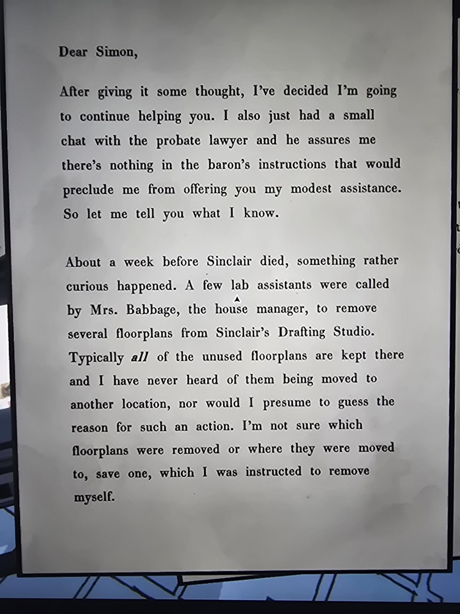
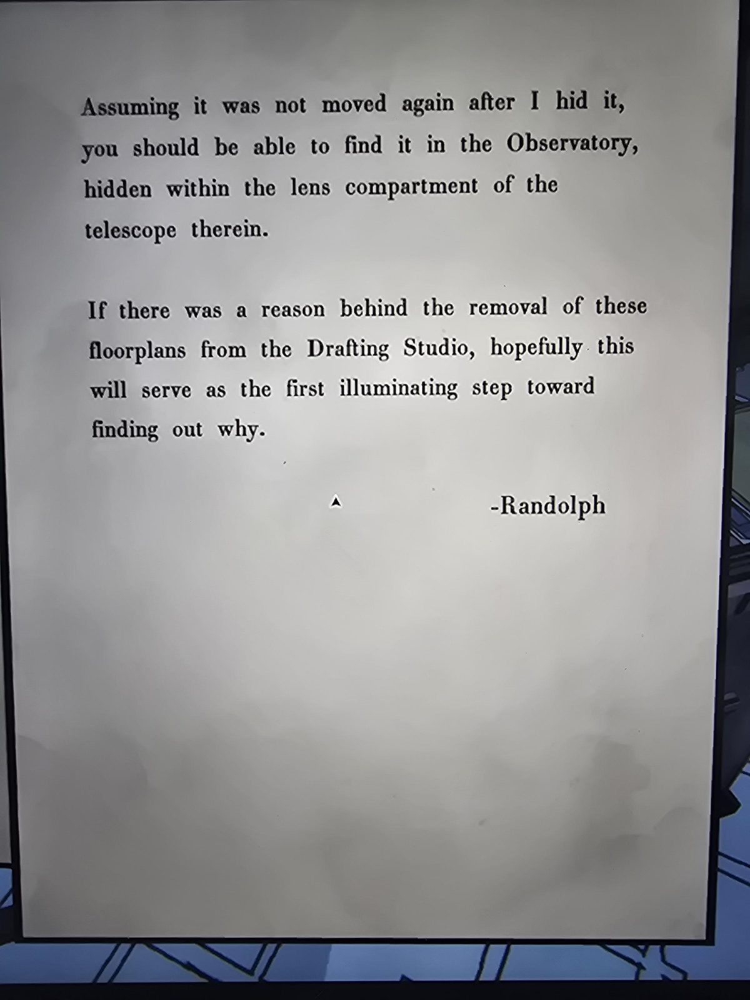

# Письмо Рэндольфа: пропавшие планы этажей и телескоп в Observatory
Mail Room. Два листа.

«Дорогой Саймон, подумав, я решил продолжать помогать. Я поговорил с нотариусом по наследству: в указаниях барона нет ничего, что запрещало бы мне скромную помощь. Расскажу, что знаю.

Примерно за неделю до смерти Синклера случилось странное: несколько лаборантов по вызову **миссис Бэббидж** (управляющей домом) **вынесли несколько планов этажей из Drafting Studio Синклера**. Обычно **все** неиспользованные планы хранятся там, и я не слышал, чтобы их куда-то переносили. Не знаю, какие планы убрали и куда их дели, кроме одного, который велели убрать **мне самому**.

Если его потом не перепрятали, он должен быть в **Observatory, в отсеке для линз телескопа**.

Если у изъятия планов была причина, возможно, это первый шаг к тому, чтобы выяснить, какая. — Рэндольф»

## Заметка
- Секретный план этажа **Planetarium** найден в отсеке для линз телескопа в [Observatory](../../../observatory/solutions.md). См. [секретные планы](../../../../puzzles/secret-floorplans.md).
- Ср. секретные планы этажей: [puzzles/secret-floorplans.md](../../../../puzzles/secret-floorplans.md), [Drafting Studio](../../../drafting-studio/solutions.md).

## Photos / Фото
 
