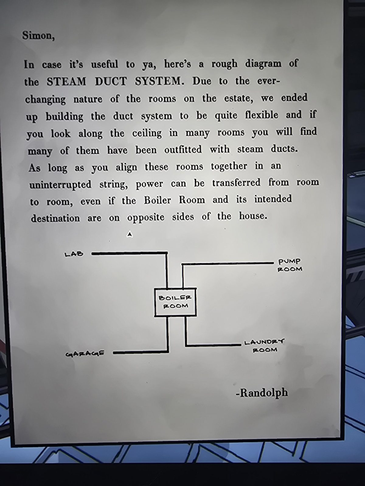

# Письмо Рэндольфа: схема паропроводов (Steam Duct System)
Mail Room.

«Саймон, на случай, если пригодится: грубая схема **системы паровых каналов**. Из-за вечно меняющихся комнат поместья мы сделали систему каналов очень гибкой: если посмотреть на потолок во многих комнатах, видно, что в них проложены паровые каналы. Пока вы выстраиваете такие комнаты **непрерывной цепочкой**, питание можно передавать от комнаты к комнате, даже если Boiler Room и нужная комната находятся на противоположных сторонах дома. — Рэндольф»

**Схема:** Boiler Room в центре, от неё линии к **Lab**, **Pump Room**, **Garage** и **Laundry Room**.

## Заметка
- Это та же идея, что в [питании от Boiler Room](../../../../puzzles/boiler-power.md) (Lab, Laundry Room, Pump Room) и в [письме про линии электропередачи](../randolph-letter-3-power-lines/ru.md); Garage на схеме есть, а в той таблице нет (сверить).
- Важно: цепочка комнат с каналами должна быть **непрерывной**.

## Photos / Фото

