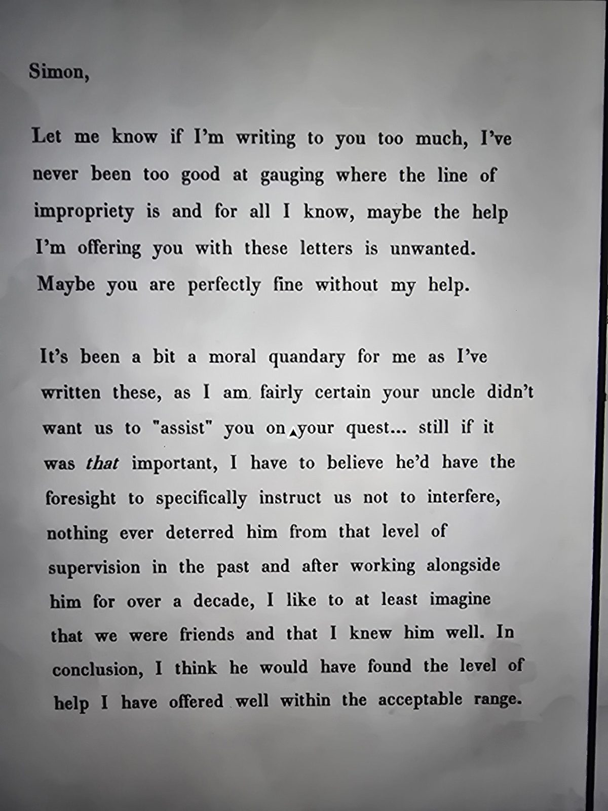
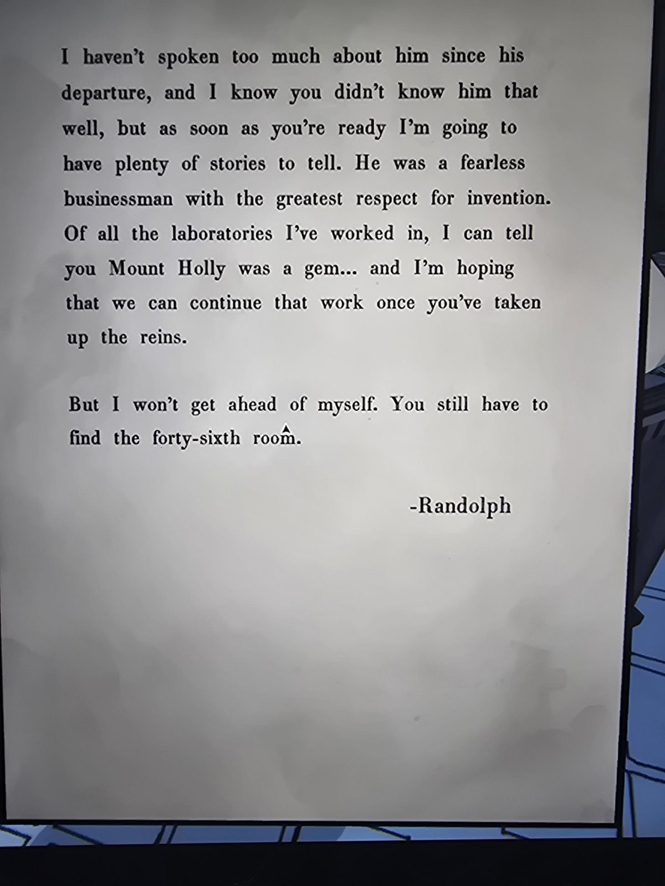

# Письмо Рэндольфа: «не слишком ли я пишу?» и 46-я комната
Mail Room. Два листа.

«Саймон, дай знать, если я пишу слишком часто: я никогда не умел чувствовать, где проходит черта приличия, и, возможно, моя помощь тебе не нужна. Может, ты прекрасно справляешься и без неё.

Для меня это было моральной дилеммой: я почти уверен, что твой дядя не хотел, чтобы мы «помогали» тебе в твоём квесте… но если бы это было *настолько* важно, он бы догадался прямо запретить нам вмешиваться: раньше его ничто не останавливало от такого надзора. Проработав с ним больше десяти лет, я хочу думать, что мы были друзьями и я хорошо его знал. В итоге, по-моему, он счёл бы мою помощь вполне допустимой.

Я мало говорил о нём после его отъезда, и я знаю, что ты его не очень знал, но, когда будешь готов, у меня найдётся много историй. Он был бесстрашным бизнесменом с огромным уважением к изобретениям. Из всех лабораторий, где я работал, Mount Holly была жемчужиной… и я надеюсь, что мы продолжим эту работу, когда ты возьмёшь бразды правления.

Но не буду забегать вперёд. Тебе ещё предстоит **найти сорок шестую комнату**. — Рэндольф»

## Заметка
- Рэндольф работал с бароном больше десяти лет; он «лабораторный техник» ([первое письмо](../randolph-moore-letter/ru.md)).
- Ср. [Room 46](../../../room-46/solutions.md).

## Photos / Фото
 
