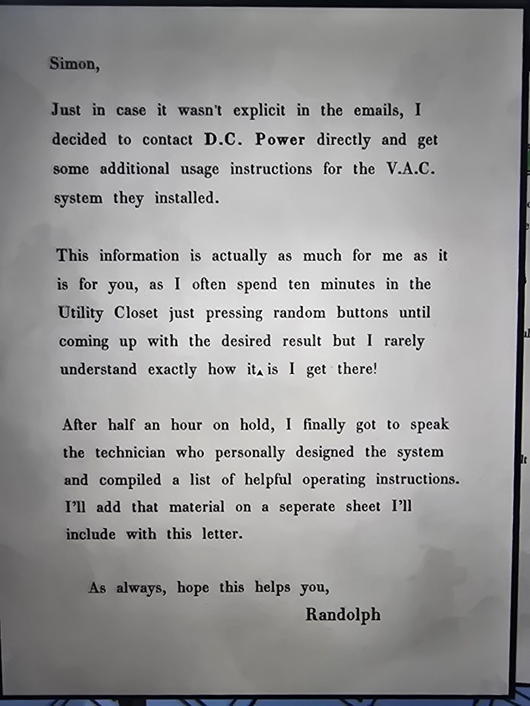
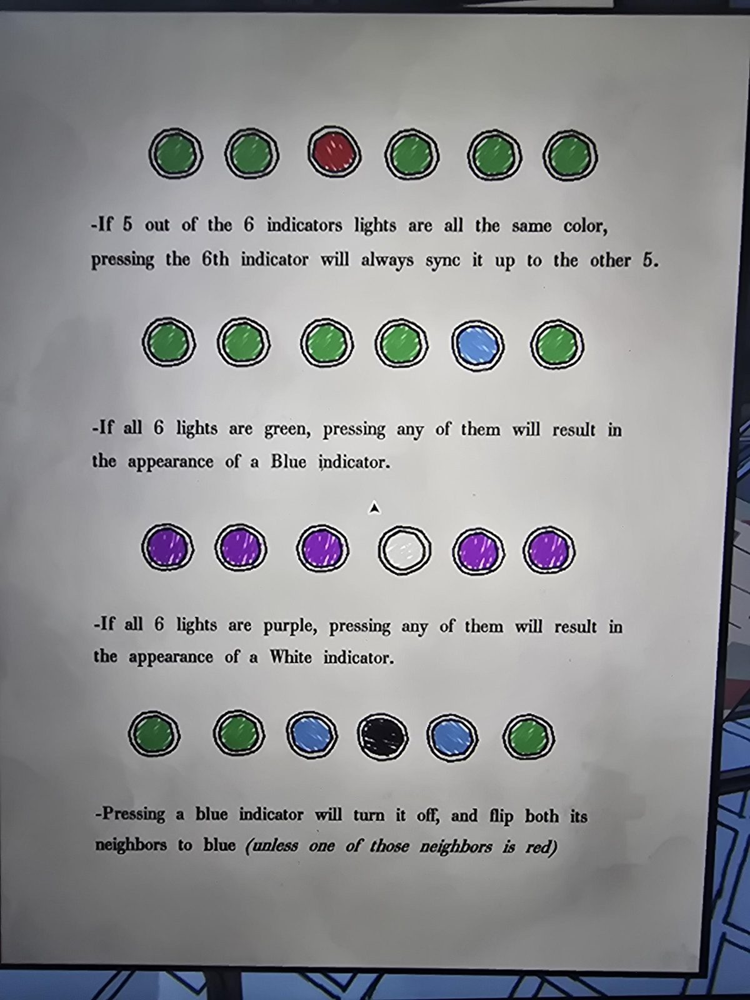

# Письмо Рэндольфа и памятка: инструкция V.A.C. (щиток Utility Closet)
Mail Room. Письмо и отдельный лист с правилами.

«Саймон, на случай, если в письмах это не было явно: я связался напрямую с **D.C. Power** и получил дополнительные инструкции по системе **V.A.C.**, которую они установили. Это нужно не только тебе, но и мне: я часто по десять минут жму в Utility Closet случайные кнопки, пока не получу нужное, и редко понимаю, как это вышло! После получаса на удержании я поговорил с техником, который сам проектировал систему, и составил список правил на отдельном листе. — Рэндольф»

## Правила индикаторов (шесть лампочек)
1. **Пять из шести одного цвета** (на рисунке 5 зелёных и 1 красный): нажатие **шестой** лампочки **всегда** выравнивает её по остальным пяти.
2. **Все шесть зелёные**: нажатие любой даёт **синий** индикатор.
3. **Все шесть фиолетовые**: нажатие любой даёт **белый** индикатор.
4. **Нажатие синего** выключает его (чёрный) и **переключает обоих соседей в синий** (кроме случая, если сосед **красный**).

## Заметка
- Это полная версия того, что кратко написано в [инструкции щитка](../utility-room-fusebox-manual/ru.md); ответ последовательности записан в [Utility Closet](../../../utility-closet/solutions.md) и [Office](../../../office/solutions.md).
- Для двери с карточками: [письмо про Keycard](../randolph-keycard-doors/ru.md).

## Photos / Фото
 
