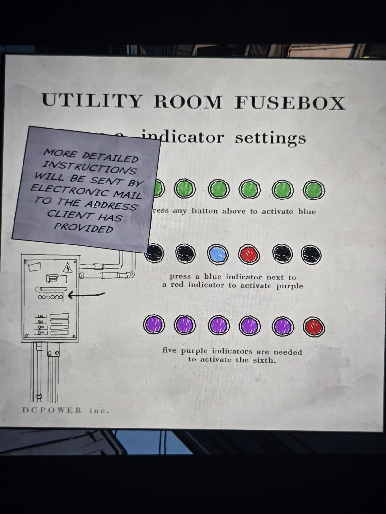

# Инструкция к щитку Utility Room
Лист в Mail Room. Производитель **DCPOWER inc.**

**ЩИТОК UTILITY ROOM — настройки индикаторов**

*Стикер:* Более подробные инструкции будут высланы **электронной почтой** на адрес, указанный клиентом.

1. *(шесть зелёных)* — нажми любую кнопку выше, чтобы включить **синий**.
2. *(чёрный, чёрный, синий, красный, чёрный, чёрный)* — нажми **синий индикатор рядом с красным**, чтобы включить **фиолетовый**.
3. *(пять фиолетовых, один красный)* — нужно **пять фиолетовых**, чтобы включился **шестой**.

## Заметка
- Подсказка к щитку в Utility Room (шесть индикаторов). Полную инструкцию, видимо, можно найти в почте на терминале (ср. табличку «почта только через Security»).

## Photos / Фото

