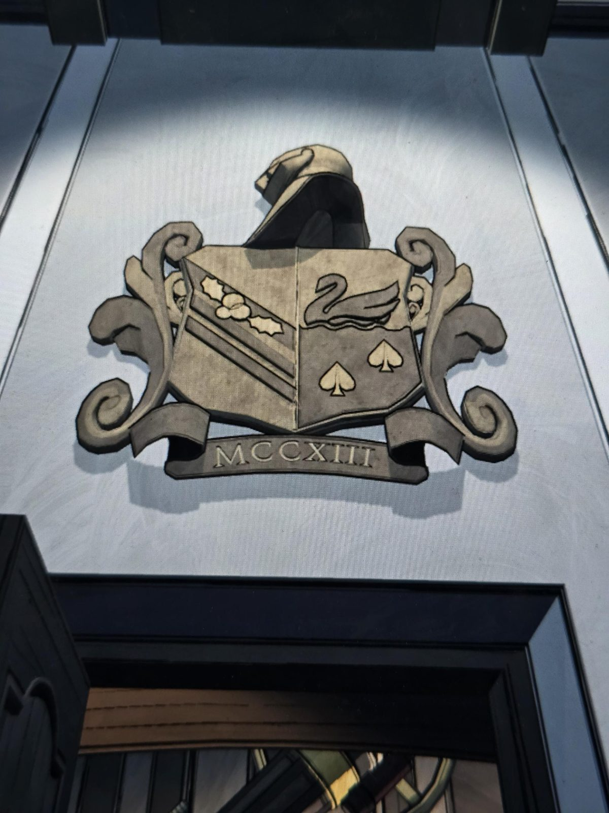

# Герб «MCCXIII» (Master Bedroom)
Герб на стене над проёмом: шлем над разделённым щитом, по бокам завитки. Лента: **MCCXIII** (= 1213).

- Слева: остролист с ягодами на косой полосе (Sinclair).
- Справа: лебедь над водой и **две пики** (Epsen).

## Заметка
- Тот же герб, что в [Wine Cellar](../../../wine-cellar/docs/coat-of-arms-mccxiii/ru.md) (две пики, а не три, как на древе).

## Photos / Фото

