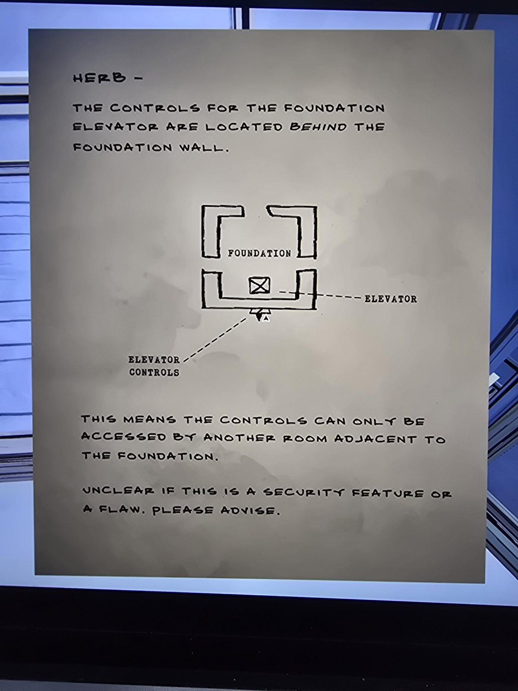

# Записка «Herb»: управление лифтом Foundation
Master Bedroom. Печатная записка с схемой, адресована **Herb** (Герберту).

ГЕРБ —

Управление **лифтом Foundation** находится **за стеной** Foundation.

*(Схема: комната FOUNDATION, внутри неё лифт (ящик с крестом); «ELEVATOR CONTROLS» отмечены снаружи, за нижней стеной.)*

Это значит, что к управлению можно попасть **только из другой комнаты, прилегающей к Foundation**.

Неясно, особенность безопасности это или недостаток. Прошу уточнить.

## Заметка
- Подсказка: пульт лифта Foundation доступен из **соседней** комнаты (с нижней стороны от Foundation на схеме). Ср. «Foundation Elevator» на [карте подземелья](../../../abandoned-mine/reservoir/docs/underground-map/ru.md).
- Не решено: где этот пульт и как включить лифт.

## Photos / Фото

