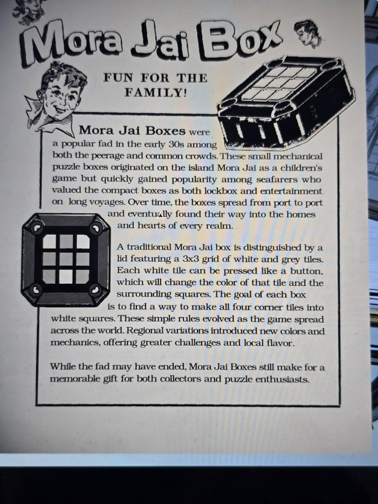

# Реклама «Mora Jai Box»
Страница-реклама с картинками (Master Bedroom). Заголовок: **«Развлечение для всей семьи!»**

**Коробки Mora Jai** были популярным увлечением в начале 30-х среди и знати, и простого народа. Эти небольшие механические головоломки возникли на острове **Mora Jai** как детская игра, но быстро стали популярны у моряков, ценивших компактные коробки и как сейф-шкатулку, и как развлечение в долгих плаваниях. Со временем коробки расходились из порта в порт и попали в дома и сердца **каждого королевства**.

Традиционная коробка отличается крышкой с сеткой **3×3 из белых и серых плиток**. Каждую **белую** плитку можно нажать как кнопку: меняется цвет этой плитки и **окружающих** квадратов. **Цель каждой коробки: сделать все четыре угловые плитки белыми.** Простые правила развивались по мере распространения игры. Региональные варианты добавили **новые цвета и механики**, больше сложности и местного колорита.

Хотя мода прошла, коробки Mora Jai остаются запоминающимся подарком для коллекционеров и любителей головоломок.

## Заметка
- Правила и список найденных коробок: [Mora Jai](../../../../puzzles/mora-jai/README.md). Эта страница описывает **традиционную** коробку (цель — белые углы), у остальных региональные цвета и механики.

## Photos / Фото

