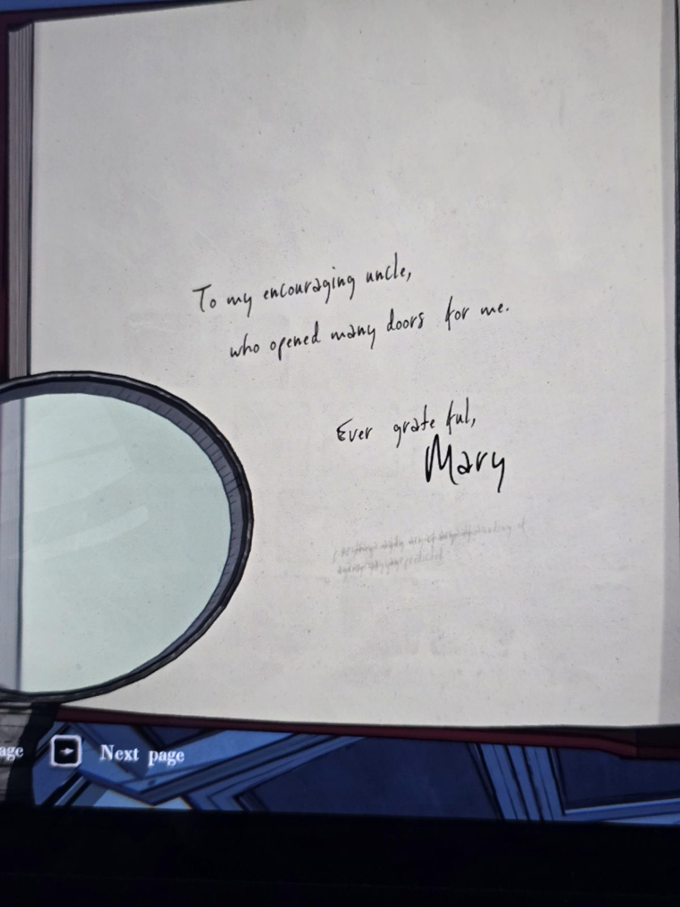
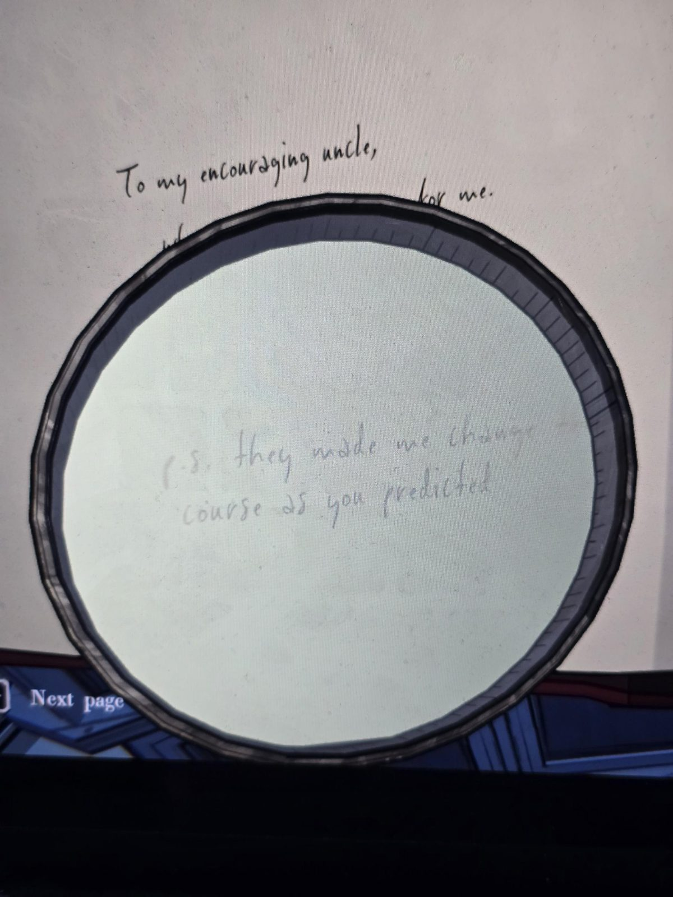
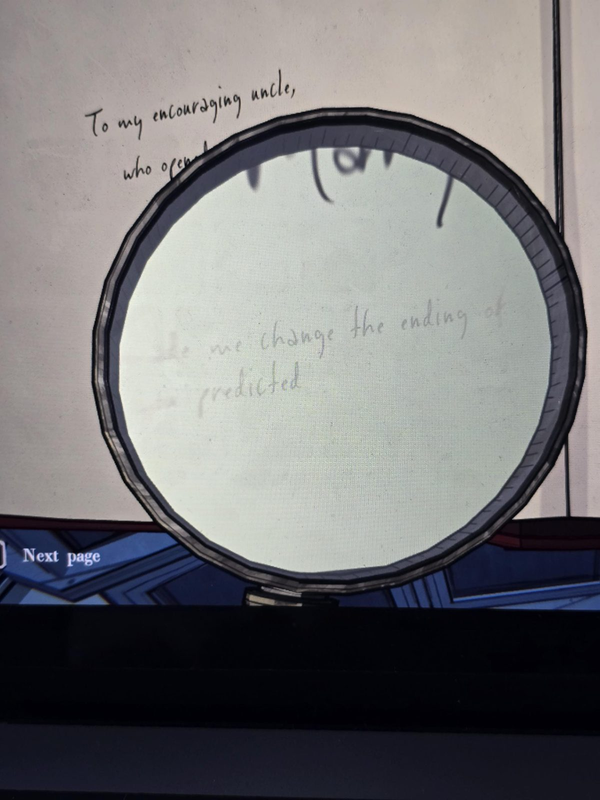

# «The Red Prince»: дарственная надпись (Master Bedroom)
Экземпляр книги в Master Bedroom. Текст книги **совпадает** с [экземпляром из Nursery](../../../nursery/docs/the-red-prince-book/ru.md) (со слов пользователя). Отличие: **рукописная надпись** в начале, и под ней мелкий бледный текст (виден через лупу).

Моему ободряющему дяде,
который открыл для меня много дверей.

Всегда благодарная,
**Мэри**

*Мелким шрифтом (через лупу), по словам пользователя:*
P.S. они заставили меня переделать концовку, как ты и предполагал.

## Заметка
- Подпись **Mary**: связь книги с Мэри (в Nursery автор указан как Marion Marigold).
- «Дядя», вероятно, Герберт (в письмах он её дядя/«опекун»?). Не подтверждено.
- Концовку книги, по этой приписке, **пришлось поменять** (по требованию кого-то). Возможно, как с «The History of Orindia»: [цензура издателей](../../../library/books/the-history-of-orindia/ru.md). Не подтверждено.

## Photos / Фото
01 — вся страница; 02, 03 — мелкий текст через лупу.

