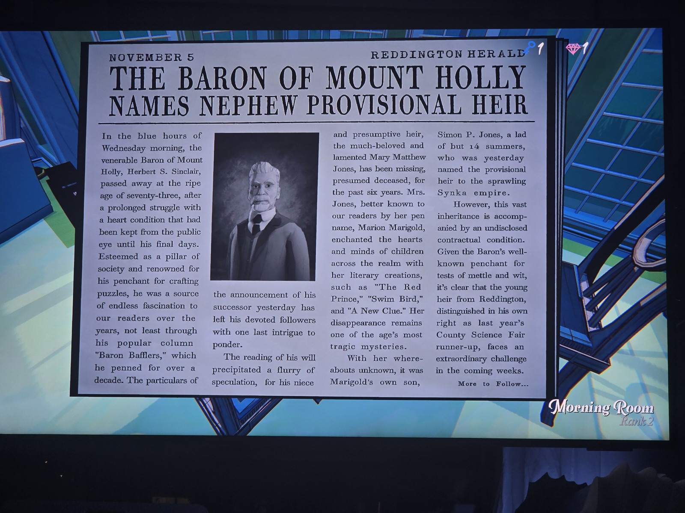

«Реддингтонский вестник», 5 ноября. **Барон Маунт-Холли назвал племянника временным наследником.**
В среду утром в возрасте 73 лет умер барон Герберт С. Синклер — после долгой болезни сердца, скрываемой до последних дней. Известен как любитель головоломок, вёл колонку «Baron Bafflers» больше десяти лет.
Предполагаемая наследница — племянница Мэри Мэтью Джонс (псевдоним Мэрион Мариголд, «The Red Prince», «Swim Bird», «A New Clue») — пропала шесть лет назад и считается погибшей.
Временным наследником **империи Synka** назван её сын **Саймон П. Джонс, 14 лет**. Наследство сопровождается нераскрытым условием договора — испытанием. Саймон — серебряный призёр окружной научной ярмарки прошлого года.

*Где: Morning Room (ранг 2). Заметка: Synka (SYNKA Co.) — компания Синклеров. Пропала «шесть лет назад» → 1987, газета — 1993.*

## Photos / Фото

