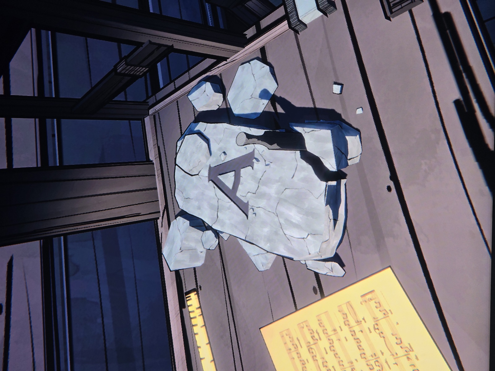

Расколотая каменная плита с вырезанной буквой **A** лежит рядом с листом нот.

*Заметка: «Stones cut by hand, and letters wrought» (лист 8 нот) и «under two stones» — возможно, это один из камней с буквами. Комната не подписана (нотный лист рядом → Music Room?), проверить.*

## Photos / Фото

